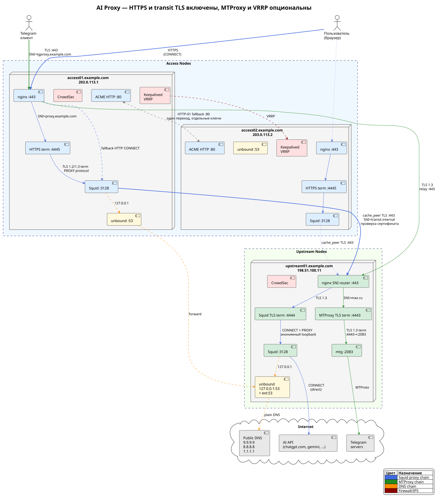

<!-- [AITS] 2026-08-30T16:55:28Z -->
# Ansible Deployment

Автоматизированное развертывание AI Proxy на базе Squid.

## Структура

```
deploy/
├── inventory.example.yml        # Образец инвентаря (отслеживается)
├── inventory.yml                # Рабочий инвентарь — НЕ отслеживается (.gitignore)
├── playbook.yml                 # Основной playbook
├── passwd.example               # Образец файла пользователей (отслеживается)
├── passwd                       # Рабочий файл пользователей — НЕ отслеживается
├── templates/
│   ├── squid-access.conf.j2     # Шаблон Squid для access
│   ├── squid-upstream.conf.j2   # Шаблон Squid для upstream
│   ├── keepalived.conf.j2       # Шаблон Keepalived для access
│   ├── check_and_restart_squid.sh.j2  # Health-check скрипт для keepalived
│   ├── nftables-upstream.conf.j2      # Шаблон nftables для upstream (Debian)
│   └── iptables-upstream.rules.j2     # Набор правил цепочки SQUID-PROXY (Ubuntu/RHEL)
├── roles/
│   ├── dns_resolver/            # Кеширующий DNS-резолвер (unbound)
│   │   ├── templates/unbound.conf.j2
│   │   ├── tasks/main.yml
│   │   ├── handlers/main.yml
│   │   └── defaults/main.yml
│   ├── nginx/                   # nginx SNI router (access nodes)
│   │   ├── templates/
│   │   │   ├── 00-sni-router.conf.j2        # Shared SNI router (port 443)
│   │   │   ├── 10-aiproxy-upstreams.conf.j2  # MTProxy relay + upstream definitions
│   │   │   └── sni-map.d/aiproxy.conf.j2     # SNI entries: MTProxy domains
│   │   └── tasks/main.yml
│   ├── mtproxy/                 # MTProxy + upstream nginx (upstream nodes)
│   │   ├── templates/
│   │   │   ├── 00-sni-router.conf.j2         # Shared SNI router (upstream)
│   │   │   ├── nginx-mtproxy-stream.conf.j2  # MTProxy TLS 1.3 terminator
│   │   │   ├── nginx-squid-tls-term.conf.j2  # Терминатор TLS участка access → upstream
│   │   │   ├── sni-map.d/mtproxy.conf.j2     # SNI entries: MTProxy hostname
│   │   │   ├── sni-map.d/squid.conf.j2       # Запись карты имён для терминатора участка
│   │   │   ├── mtg.toml.j2                   # mtg daemon config
│   │   └── tasks/main.yml
│   └── crowdsec/                # CrowdSec IPS
│       ├── tasks/main.yml
│       └── templates/whitelist-infrastructure.yaml.j2
├── MTProxy.md                   # MTProxy configuration reference
└── README.md
```

## Требования

### Управляющий хост
- Ansible >= 2.9
- Коллекции: `ansible.posix`, `community.general`

### Целевые серверы

| Дистрибутив | Версия Squid из репозитория | Примечание |
|---|---|---|
| **Ubuntu 24.04 LTS** | 6.14 | Рекомендуется |
| Debian 13 (Trixie) | 6.x | — |
| Debian 12 (Bookworm) | 5.7 | Работоспособен: все директивы проекта приняты, приём участка под шифрованием и многопроцессный режим проверены на стенде |
| Ubuntu 22.04 LTS | 5.x | Требуется [Diladele PPA](https://docs.diladele.com/howtos/build_squid_on_ubuntu_22/repository.html) для 6.x |

**Системные требования:**
- Python >= 3.8
- systemd
- SSH доступ с правами root

### Пререквизиты: версии пакетов

| Пакет | Минимум | Максимум | Назначение |
|-------|---------|----------|------------|
| Squid | 5.7 | 6.x | Прокси-сервер. Минимум **измерен, а не назначен**: на 5.7 (Debian 12) проверены все директивы проекта. Проверяется при развёртывании — переменная `squid_min_version` |
| Unbound | 1.16 | 1.x | Кеширующий DNS-резолвер |
| Keepalived | 2.0 | 2.x | VRRP для access (опционально) |

**Фаерволы (upstream прокси):**

Бэкенд выбирается по состоянию ufw и дистрибутиву — в этом порядке:

| Условие на хосте | Бэкенд | Версия | Конфигурация |
|---|---|---|---|
| ufw активен (`ufw status` = active) | UFW | >= 0.36 | правила через `community.general.ufw` |
| ufw неактивен + Debian | nftables | >= 1.0 | `/etc/nftables.conf` из шаблона; применяется reload, заменяется только таблица `inet filter` |
| ufw неактивен + не Debian (Ubuntu, RHEL) | iptables | >= 1.8 | `/etc/iptables/aiproxy-upstream.rules` → `iptables-restore --noflush`; цепочка `SQUID-PROXY`, jump из INPUT, восстановление юнитом `aiproxy-firewall.service` |

**Co-deployment.** Обе шаблонные ветки трогают только собственные объекты: nftables заменяет свою таблицу, iptables — свою цепочку, и обе делают это одной транзакцией. Таблицы и цепочки соседних проектов (Matrix, bouncer CrowdSec) сохраняются, а окна с открытым портом при обновлении правил не возникает. Пакеты полного восстановления ruleset (`iptables-persistent`, `iptables-services`) намеренно не используются: они вернули бы при загрузке снимок **чужих** правил на момент нашего развёртывания. Обратная сторона: восстановление своих правил при загрузке — забота каждого проекта; `aiproxy-firewall.service` воспроизводит только цепочку `SQUID-PROXY` и переход в неё из INPUT.

Ubuntu после чистой установки попадает в третью строку: ufw установлен, но не
активирован. Все три бэкенда закрывают один и тот же набор портов upstream-ноды
(Squid, MTProxy 443, DNS 53/tcp+udp) — доступ только с IP access-нод.
Результат проверяется на самой ноде задачей `Assert DNS (53/tcp+udp) is restricted
to access proxies`: она читает действующие правила ядра, а не шаблон.

## Бюджет памяти узла

Пределы памяти служб вычисляются от объёма RAM узла и проверяются на выполнимость:
если сумма пределов не помещается в выделяемый объём, развёртывание **останавливается**,
а не выдаёт предупреждение. Обоснование и альтернативы — [ADR-000008](../../docs/AA/ADR/ADR-000008.md).

Выделяемый объём зависит от размещения: при одиночном — память узла за вычетом резерва
ядра (`mem_reserve_share`, 25 %), при совместном с другой службой — объявленная доля узла
(`mem_share_when_shared`, 35 %).

**Предел службы = доля ВЫДЕЛЯЕМОГО объёма**, а не памяти узла, но не ниже нижней границы.
База существенна: доли служб в сумме составляют около двух третей, и при отсчёте от памяти
узла они не уложились бы в долю при совместном размещении — проверка бюджета отказывала бы
при любом исправном состоянии.

**Нижние границы измерены, а не назначены.** Служба прокси не запускается при пределе
64 МБ и поднимается при 80 (проба на узле с двумя рабочими процессами и включённой
проверкой подлинности), поэтому её граница — 96 МБ с запасом. Обнаружение вторжений
потребляет на боевом узле около 150 МБ при прежней границе 128, поэтому её граница —
192 МБ. Граница, ниже которой служба не работает, обязана быть выше её фактического
потребления, иначе она не удерживает ничего.

| Служба | Доля RAM | Нижняя граница | При 768 МБ | При 2 ГБ |
|---|---|---|---|---|
| Squid | 16 % | 64 МБ | 122 МБ | 327 МБ |
| CrowdSec | 26 % | 128 МБ | 199 МБ | 532 МБ |
| unbound | 6 % | 32 МБ | 46 МБ | 122 МБ |
| MTProxy | 6 % | 32 МБ | 46 МБ | 122 МБ |
| nginx | 4 % | 24 МБ | 30 МБ | 81 МБ |
| Firewall bouncer | 4 % | 24 МБ | 30 МБ | 81 МБ |
| Keepalived | 2 % | 12 МБ | 15 МБ | 40 МБ |
| **Сумма (upstream, все службы)** | | | **473 из 576** | **1265 из 1536** |

В systemd записываются два порога: мягкий — 80 % предела (вытеснение и торможение),
жёсткий — сам предел (аварийный). Внутренние размеры служб считаются от их пределов:
у Squid пулы — половина, кеш объектов — четверть; у unbound каждый кеш — шестая часть.

Считаются только службы, действительно разворачиваемые на узле: набор различается
для access и upstream, а `crowdsec_enabled` и `mtproxy_enabled` исключают свои пределы
из суммы. На общем узле с другим проектом укажите его бюджет в `mem_foreign_reserved_mb`,
иначе оба проекта распределят одну и ту же память дважды.

Проверено на стенде: узел 768 МиБ (701 МБ доступно ядру), полный прогон плейбука
с включённым CrowdSec — план 364 из 525 МБ выделяемых.

## Шифрование участка access → upstream

Содержимое обращений защищено сквозным шифрованием клиента с целевым сервисом
независимо от этой настройки. Она закрывает другое: **заголовок `CONNECT`**, то есть
имя целевого сервиса. Без шифрования участка оно идёт открытым текстом, и наблюдателю
между узлами виден адресат обращения — скрыт состав обмена, но не то, к кому обращаются.

Включается парой переменных инвентори:

```yaml
squid_transit_tls: true
squid_tls_sni: "transit.internal"   # опознавательное имя, в DNS разрешаться не обязано
```

**Материал.** Самоподписанный сертификат выпускается развёртыванием на управляющей
машине в `deploy/tls/` (каталог исключён из контроля версий — в нём закрытый ключ)
и раздаётся обеим сторонам: принимающей — сертификат и ключ, обращающейся — только
сертификат, служащий доверенным якорем. Выпуск именно на управляющей машине, а не
на узле: порядок обхода узлов плейбуком не определён, и выпуск на upstream оставил бы
access без доверенного материала при прогоне, начавшемся с access.

**Две ветки приёма** — по устройству upstream-узла:

| Устройство upstream | Кто принимает TLS | Порт, к которому обращается access |
|---|---|---|
| MTProxy выключен | сам Squid (`https_port`) | `squid_port` |
| MTProxy включён | nginx-терминатор за маршрутизатором SNI | 443 |

Во второй ветке маршрутизатор разбирает имя из SNI и направляет соединение
локальному терминатору (`squid_tls_term_port`, по умолчанию 4444), тот снимает TLS
и передаёт поток Squid, восстанавливая адрес клиента протоколом PROXY.

Проверка подлинности принимающей стороны обязательна: `tls-no-default-ca` отсекает
системные удостоверяющие центры, `tls-cafile` задаёт единственный доверенный
сертификат, `tls-domain` — проверяемое имя. Сертификату, подписанному кем угодно
ещё, доверия нет.

Выключение признака снимает терминатор с узла, а не оставляет его слушать порт.

## Использование

0. Создайте рабочие файлы из образцов (оба исключены из контроля версий: они содержат
   действительные адреса и реквизиты доступа и раскрытию не подлежат):
   ```bash
   cp inventory.example.yml inventory.yml
   cp passwd.example passwd        # затем наполнить: htpasswd -B -C 12 -bn user pass >> passwd
   ```

1. Отредактируйте `inventory.yml`:
   - Укажите реальные IP/hostname серверов в группах `access_proxies` и `upstreams`
   - Настройте переменные `allowed_domains` и `allowed_domain_patterns`
   - Задайте `keepalived_auth_pass`; `mtproxy_secret` можно оставить пустым — он
     сгенерируется на узле при первом развёртывании

2. Запустите playbook:
   ```bash
   ansible-playbook -i inventory.yml playbook.yml
   ```

3. Для отдельных групп:
   ```bash
   # Только access прокси
   ansible-playbook -i inventory.yml playbook.yml --limit access_proxies

   # Только upstream прокси
   ansible-playbook -i inventory.yml playbook.yml --limit upstreams

   # Только DNS
   ansible-playbook -i inventory.yml playbook.yml -t dns
   ```

## Управление пользователями (access)

Отредактируйте файл `passwd` перед развёртыванием:

```bash
# Добавить пользователя: bcrypt с фактором стоимости 12
htpasswd -B -C 12 -bn пользователь пароль >> passwd
```

Ключ `-C 12` обязателен: без него `htpasswd -B` берёт фактор стоимости 5 — по нынешним
меркам низкий. Вариант через `openssl passwd -apr1` не используется: он выдаёт MD5-crypt,
от которого проект ушёл в августе 2026 года.

Файл `passwd` лежит в рабочем каталоге и под контроль версий не попадает; на access-узлы
его копирует плейбук (тег `passwd`). Инвентори при заведении пользователя не правится.

## Переменные

| Переменная | Описание | По умолчанию |
|------------|----------|--------------|
| `squid_port` | Порт Squid, на который подключаются access-ноды | 443 (обе группы в образце инвентаря) |
| `enable_auth` | Включить аутентификацию | true (access) |
| `enable_logging` | Включить журналирование | true (access) |
| `enable_caching` | Включить кеширование | true (access) |
| `allowed_domains` | Разрешенные домены (явный список) | см. inventory |
| `allowed_domain_patterns` | Разрешенные домены (regex) | см. inventory |
| `dns_servers` | Публичные DNS (plain DNS, порт 53) | 9.9.9.9, 8.8.8.8, 1.1.1.1 |
| `dns_extra_clients` | Клиенты DNS сверх группы `access_proxies` (список IPv4) | `[]` |
| `enable_keepalived` | Включить Keepalived (access) | false |
| `keepalived_vip` | Виртуальный IP | — (обязательно задать) |
| `keepalived_interface` | Сетевой интерфейс | auto (default gw) |
| `keepalived_state` | MASTER или BACKUP | per-host |
| `keepalived_priority` | Приоритет (100/90) | per-host |
| `read_timeout` | Предел ПРОСТОЯ туннеля: соединение закрывается после этого срока без передачи данных в обе стороны. Таймер переармируется при каждой передаче, поэтому активный обмен не прерывается никогда | 1 hour |
| `client_lifetime` | Абсолютный предел жизни клиентского соединения Squid. Обязан быть строго больше `read_timeout`, иначе рвать будет он и предел простоя перестанет действовать | 1 day |
| `client_idle_pconn_timeout` | Срок удержания неиспользуемого постоянного соединения от клиента | 60 seconds |
| `squid_positive_dns_ttl` | Срок хранения разрешённого имени в собственном кеше Squid. Лежит поверх кеша резолвера: очистка unbound на эти записи не влияет | 6 hours |
| `squid_negative_dns_ttl` | То же для отрицательных ответов. Короткий срок нужен, чтобы временный отказ разрешения имени не запирал обращения надолго | 30 seconds |
| `allow_direct_fallback` | Запасной прямой выход при недоступности ВСЕХ вышестоящих узлов. Умолчание запрещающее намеренно: прямой выход раскрывает целевому сервису адрес access-узла | false |
| `connect_fail_limit` | Неудачных попыток подряд, после которых вышестоящий узел помечается мёртвым | 2 |
| `connect_timeout` | Срок ожидания установления соединения с вышестоящим узлом | 5 (секунд) |
| `dead_peer_timeout` | Как часто мёртвый узел проверяется снова | 15 seconds |

### Совместное размещение с другим проектом

| Переменная | Назначение | Умолчание |
|---|---|---|
| `mem_share_when_shared` | Доля памяти узла, которую проект берёт себе при обнаруженном соседе. Разделение: этот проект 35 %, соседний 50 %, ядру и системным службам 15 % | 0.35 |
| `shared_host` | Ручное перекрытие признака соседства. Осмотр каталогов расширения nginx поднимает признак сам; объявленное `true` осмотром не отменяется | не задана (определяется осмотром) |
| `nginx_worker_connections` | Предел одновременных соединений на рабочий процесс общего nginx. Задаёт этот проект как владелец nginx; значение обязано покрывать нагрузку ВСЕХ проектов узла | 4096 |
| `nginx_worker_rlimit_nofile` | Предел дескрипторов рабочего процесса nginx: соединение занимает два — клиентское и к цели | `fd_limit` (расчётный, не ниже 65535) |
| `squid_mgmt_port` | Порт снятия показателей Squid на петлевом адресе. Рабочий порт для этого непригоден: за маршрутизатором требует заголовок протокола PROXY, при шифровании участка принимает только TLS | 3129 |

### Журналирование и ротация

| Переменная | Назначение | Умолчание |
|---|---|---|
| `sni_router_access_log` | Путь журнала маршрутизации по имени SNI. Запись несёт адрес клиента, запрошенное имя, адрес назначения, код завершения и объём; вид подогнан под парсер обнаружения вторжений | `/var/log/nginx/sni-router.log` |
| `sni_router_log_buffered` | Буферизовать запись журнала маршрутизации (32 КБ, выгрузка раз в 5 с), чтобы она не входила в путь каждого соединения | true |
| `squid_log_rotate_period` | Период ротации журналов Squid | daily |
| `squid_log_rotate_keep` | Сколько файлов ротации хранить | 14 |

### Резолвер имён

| Переменная | Назначение | Умолчание |
|---|---|---|
| `dns_resolver_port` | Порт, на котором слушает резолвер узла | 53 |
| `dns_resolver_threads` | Число рабочих потоков резолвера | по числу ядер узла |
| `dns_resolver_cache_mb` | Объём кеша резолвера | доля предела памяти службы |
| `dns_resolver_prefetch` | Обновлять популярные записи до истечения их срока | true |
| `dns_resolver_dnssec` | Проверять подписи DNSSEC | true |

### MTProxy и переключение виртуального адреса

| Переменная | Назначение | Умолчание |
|---|---|---|
| `mtproxy_tls_port` | Порт локального терминатора TLS MTProxy на upstream-узле | 4443 |
| `mtproxy_relay_port` | Порт ретрансляции MTProxy на access-узле | 9443 |
| `mtg_versions_keep` | Сколько прежних версий MTProxy хранить сверх действующей. Умолчание «не удалять ничего»: молчаливое исчезновение версии, на которую рассчитан откат, дороже занятого места | 0 (уборка выключена) |
| `keepalived_router_id` | Имя узла в объявлениях VRRP (строка, попадает в журнал и в трассировку обмена) | `AI_PROXY_RU` |
| `keepalived_vrid` | Числовой идентификатор группы VRRP: различает независимые пары узлов в одной сети. Совпадение у двух несвязанных пар приводит к тому, что они считают друг друга участниками одной группы | 51 |
| `keepalived_vip_prefix` | Длина префикса виртуального адреса | 24 |
| `keepalived_restart_cooldown` | Пауза между попытками перезапуска Squid проверкой работоспособности | 30 (секунд) |
| `behind_nginx` | Ручное переопределение: Squid за nginx | не задана (автоопределение) |
| `squid_local_port` | Локальный порт Squid при работе за nginx | 3128 |
| `crowdsec_enabled` | Включить CrowdSec IPS | true |
| `crowdsec_memory_mb` | Лимит памяти CrowdSec (MB) | 512 |
| `crowdsec_fw_bouncer_memory_mb` | Лимит памяти firewall bouncer (MB) | 128 |
| `mtproxy_enabled` | Включить MTProxy | true |
| `mtproxy_fake_tls_domain` | Домен маскировки MTProxy; он же ключ карты имён на access-узлах. Умолчания нет: при пустом значении запись карты не выпускается | `example.com` в образце инвентори |
| `mtproxy_hostname` | Публичный домен для MTProxy (маршрутизация SNI) | tgproxy.example.com |
| `mtproxy_local_port` | Порт mtg daemon (upstream) | 2083 |
| `mtproxy_secret` | Hex-секрет | "" (автоген) |
| `mtproxy_max_connections` | Максимум подключений per IP | 100 |
| `mtproxy_version` | Версия mtg | 2.2.8 |

## Порядок развёртывания

Playbook выполняет фазы в строгом порядке:

1. **Base setup** — apt, SSH, утилиты, sysctl, лимиты
2. **Бюджет памяти** — пределы служб от объёма RAM и проверка выполнимости плана.
   Не помещается — развёртывание **останавливается** здесь, до внесения изменений на узел
3. **DNS resolver** — unbound на каждой ноде
4. **Install Squid** — пакет, systemd override, директории
5. **nginx/MTProxy** — **до** конфигурации Squid, чтобы освободить порты:
   - upstream: mtproxy role устанавливает nginx на :443, удаляет default site с :80
   - access: nginx role устанавливает nginx на :443, переконфигурирует Squid на :3128
6. **Squid config** — деплой конфигурации, reload/restart
7. **Firewall** — UFW/nftables/iptables (upstream)
8. **Keepalived** — VRRP failover (access)
9. **CrowdSec** — IPS с infrastructure whitelist

## DNS Resolver (unbound)

Каждая нода получает локальный кеширующий DNS-резолвер (unbound) с различной архитектурой в зависимости от роли:

```
                    ┌──────────────────┐
                    │  Публичные DNS   │
                    │  (plain DNS)     │
                    │ 9.9.9.9          │
                    │ 8.8.8.8          │
                    │ 1.1.1.1          │
                    └────────▲─────────┘
                             │
              ┌──────────────┴──────────────┐
              │    upstream nodes            │
              │    unbound (127.0.0.1:53     │
              │           + ansible_host:53) │
              └──────────────▲──────────────┘
                             │
         ┌───────────────────┼───────────────────┐
         │                   │                   │
┌────────┴────────┐ ┌────────┴────────┐         ...
│  access-01      │ │  access-02      │
│  unbound        │ │  unbound        │
│  (127.0.0.1:53) │ │  (127.0.0.1:53) │
│  → upstream DNS │ │  → upstream DNS │
└─────────────────┘ └─────────────────┘
```

**Ключевые характеристики:**
- **upstream** → plain DNS к публичным резолверам (9.9.9.9, 8.8.8.8, 1.1.1.1)
- **access** → forward **только** на unbound upstream-нод (никакого прямого доступа к публичным DNS)
- Squid на всех нодах использует `dns_nameservers 127.0.0.1` (локальный unbound)
- Автотюнинг: потоки = CPU, кеш = RAM/32 (мин 16 МБ), DNSSEC, prefetch
- `serve-expired: yes` — отдаёт устаревшие записи при недоступности upstream (30 сек)
- `cache-max-negative-ttl: 10` — быстрое восстановление после DNS-ошибок
- systemd-resolved отключается, `/etc/resolv.conf` → 127.0.0.1

### Ограничение доступа к резолверу upstream

Резолвер upstream слушает внешний адрес (`ansible_host:53`), поэтому доступ к нему
ограничен на двух уровнях — сетевом и прикладном:

| Уровень | Механизм | Что делает с чужим запросом |
|---|---|---|
| Сеть | UFW / nftables / iptables: 53/tcp и 53/udp только с IP из `dns_allowed_clients` | пакет отбрасывается (DROP) |
| Приложение | `access-control` в `unbound.conf`: `/32 allow` на клиента, `0.0.0.0/0 deny` | запрос отбрасывается без ответа |

Список клиентов — `dns_allowed_clients`: IP группы `access_proxies` плюс
необязательное расширение `dns_extra_clients`. Величина вычисляется один раз в
`playbook.yml` и потребляется всеми точками ограничения, чтобы правило не
разошлось между бэкендами. `deny` вместо `refuse` выбран намеренно: REFUSED —
это ответ, то есть отклик сканеру и плечо для отражённого трафика.

**Управление:**

```bash
# Развернуть только DNS
ansible-playbook -i inventory.yml playbook.yml -t dns

# Проверить статус
ssh root@<host> 'systemctl status unbound'

# Проверить резолвинг
ssh root@<host> 'dig @127.0.0.1 google.com'

# Журнал резолвера (статистика через unbound-control недоступна:
# удалённое управление в конфигурации не включено — разрыв GAP-105)
ssh root@<host> 'journalctl -u unbound -n 50'
```

**Проверка ограничения (эмпирическая):**

```bash
# Действующий список клиентов DNS на upstream (бэкенд nftables)
ssh root@<upstream> 'nft list set inet filter dns_clients'

# ... и счётчики отбитых чужих запросов
ssh root@<upstream> 'nft list chain inet filter input | grep "DNS deny"'

# То же для iptables-бэкенда
ssh root@<upstream> 'iptables -S SQUID-PROXY | grep 53'

# С access-ноды — резолвинг обязан работать (оба транспорта)
ssh root@<access> 'dig @<upstream-ip> example.com; dig +tcp @<upstream-ip> example.com'

# С постороннего хоста — обязан не отвечать (timeout, а не REFUSED)
dig +time=3 +tries=1 @<upstream-ip> example.com
dig +tcp +time=3 +tries=1 @<upstream-ip> example.com
```

## Архитектура: nginx stream routing и Squid



### Access nodes

nginx выполняет SNI-based маршрутизацию на порту 443 с `ssl_preread` (без TLS-терминации). Squid слушает на localhost:3128 за nginx и использует plain HTTP cache_peer к upstream Squid на порту 80.

```
Client → nginx:443 (access, ssl_preread + PROXY protocol)
            ├─ SNI=git.example.com / tgproxy.example.com → MTProxy relay
            │     └─ TLS 1.3 relay (proxy_ssl) → upstream:443
            └─ Default → localhost:3128 (Squid, PROXY protocol)
                  └─ cache_peer (plain HTTP) → upstream:80 (Squid)
```

### Upstream nodes

При `behind_nginx: true` (значение в образце инвентаря) единственная точка входа — nginx:443. Он же маршрутизирует MTProxy по SNI, а весь прочий трафик отдаёт локальному Squid на `127.0.0.1:3128`.

```
                            ┌─ nginx:443 (ssl_preread + PROXY protocol)
Access nodes ──┤            │     ├─ SNI=<mtproxy_hostname> → MTProxy TLS terminator (:4443)
               │            │     │       └─ TLS 1.3 termination → mtg daemon (:2083)
               │            │     │
               └────────────┘     └─ SNI пуст (plain HTTP от access Squid) → default
                                        └─ fallback_squid → Squid 127.0.0.1:3128
                                              └─ Выход в интернет
```

`ssl_preread` не находит ClientHello в plain-HTTP соединении, поэтому `$ssl_preread_server_name` пуст и срабатывает `default fallback_squid` из общей SNI-карты. Squid принимает такое соединение только с `require-proxy-header`, а реальный IP клиента приходит от nginx через PROXY protocol.

При `behind_nginx: false` Squid слушает `squid_port` напрямую, а nginx на upstream не нужен вовсе.

**Ключевые характеристики:**
- **Единый порт на upstream**: nginx :443 — и MTProxy по SNI, и цепочка Squid по умолчанию
- **Plain HTTP cache_peer**: access Squid → upstream `squid_port` без TLS (ветка с `tls`/`tls-domain` включается только при заданной `squid_tls_sni`, в образце инвентаря она не задана)
- **PROXY protocol**: nginx на access пробрасывает реальный IP клиента к локальному Squid
- **TCP keepalive**: `proxy_socket_keepalive on` для обнаружения мёртвых соединений
- **Дифференцированные таймауты**: Squid chain — 1800s (30 мин, AI API); MTProxy chain — 60s

### Upstream прокси (Squid cache_peer)

Access прокси автоматически переключается между upstream серверами. Upstream определяются как хосты группы `upstreams` в inventory:

```yaml
# inventory.yml
upstreams:
  hosts:
    upstream-01:
      ansible_host: 198.51.100.11
  vars:
    squid_port: 443
```

Параметры failover:
- `userhash` — выбор пира по хэшу имени пользователя (устойчивая привязка); единственный заданный алгоритм, при отказе пира кольцо перестраивается среди живых
- `connect-fail-limit=2` — после 2 неудач сервер помечается недоступным
- `connect-timeout=5` — таймаут подключения 5 секунд
- `dead_peer_timeout=15` — проверка недоступных серверов каждые 15 секунд

## Отказоустойчивость

### Виртуальный IP для access (Keepalived)

Access-узлы могут делить единый виртуальный адрес по VRRP. Возможность необязательная: признак `enable_keepalived` по умолчанию выключен, и без него клиент обращается к конкретному узлу.

```yaml
# Настройки в inventory.yml (группа access_proxies → vars)
enable_keepalived: true              # По умолчанию false
keepalived_vip: 192.168.0.2         # Виртуальный IP для клиентов (обязательно задать)
# keepalived_interface: eth0        # Автоопределение через ansible_default_ipv4.interface
keepalived_vrid: 51
keepalived_auth_pass: "<your-password>"

# Для каждого хоста
access01.example.com:
  keepalived_state: MASTER
  keepalived_priority: 100
access02.example.com:
  keepalived_state: BACKUP
  keepalived_priority: 90
```

### CrowdSec IPS

**CrowdSec** — современная система предотвращения вторжений (IPS) с автоматическим обновлением threat intelligence фидов от глобального сообщества (70k+ серверов).

**Функции:**
- Защита от SSH brute-force атак
- Защита от HTTP сканеров и CVE exploitation (для Squid access logs)
- Автоматическая блокировка через firewall bouncer (nftables)
- Whitelist легитимных актёров (Google, Microsoft, Cloudflare)
- **Whitelist инфраструктурных IP** — все access и upstream ноды автоматически добавляются в whitelist для предотвращения самоблокировки

**Управление:**

```bash
# Включение/отключение в inventory.yml
crowdsec_enabled: true  # или false

# Развернуть только CrowdSec
ansible-playbook -i inventory.yml playbook.yml -t crowdsec

# Проверить статус на хосте
ssh root@<host> 'systemctl status crowdsec crowdsec-firewall-bouncer'

# Просмотреть активные блокировки
ssh root@<host> 'cscli decisions list'

# Просмотреть логи
ssh root@<host> 'journalctl -u crowdsec -f'

# Удалить блокировку IP (если ошибочно заблокирован)
ssh root@<host> 'cscli decisions delete --ip 1.2.3.4'
```

**Потребление ресурсов:**
- CrowdSec: 512 MB RAM
- Firewall bouncer: 128 MB RAM
- Диск: ~50 MB (collections + база решений)

### MTProxy (Telegram Proxy)

**MTProxy** — прокси-сервер для обхода блокировок Telegram через fake-TLS маскировку.

**Архитектура:**
- **Upstream nodes**: mtg daemon на порту 2083, за nginx TLS 1.3 терминатором (:4443)
- **Access nodes**: nginx stream SNI-роутинг на порту 443, TLS 1.3 relay к upstream

**Функции:**
- DPI-circumvention через fake-TLS домен (`git.example.com`)
- TLS 1.3 шифрование access→upstream transit (self-signed cert, `proxy_ssl`)
- Load balancing между upstream instances (round-robin)
- Firewall защита: доступ к MTProxy только от access nodes
- PROXY protocol: реальный IP клиента пробрасывается через всю цепочку
- Интеграция с Squid: nginx на access маршрутизирует MTProxy трафик на upstream:443, остальной — на локальный Squid (127.0.0.1:3128)

**Управление:**

```bash
# Включение/отключение в inventory.yml
mtproxy_enabled: true  # или false

# Развернуть только MTProxy (upstream + access)
ansible-playbook -i inventory.yml playbook.yml -t mtproxy

# Развернуть только nginx для MTProxy (access)
ansible-playbook -i inventory.yml playbook.yml -t nginx

# Проверить статус на upstream хосте
ssh root@<upstream-host> 'systemctl status mtg'

# Проверить статус nginx на access хосте
ssh root@<access-host> 'systemctl status nginx'

# Просмотреть активные подключения к MTProxy
ssh root@<upstream-host> 'ss -tnp | grep :2083'

# Получить секрет для подключения клиентов
ssh root@<upstream-host> 'grep "^secret" /etc/mtproxy/mtg.toml'
```

**Конфигурация клиента:**

Подключиться к MTProxy:
- **Сервер**: IP одной из access nodes (или VIP, если Keepalived включён)
  - access01.example.com: `203.0.113.1`
  - access02.example.com: `203.0.113.2`
- **Порт**: `443`
- **Секрет**: получить из `/etc/mtproxy/mtg.toml` на любом upstream node

Формат ссылки для Telegram:
```
tg://proxy?server=203.0.113.1&port=443&secret=<hex-секрет>
```

**Потребление ресурсов:**
- **MTProxy (upstream)**: 64 MB RAM per instance
- **nginx stream (access)**: минимальное (включено в общий nginx budget)

**Переменные (inventory.yml):**

Значения — в общей таблице [«Переменные»](#переменные) выше; здесь не дублируются,
чтобы не расходились при правке.

## Совместное развёртывание с Matrix

AI Assistants Proxy поддерживает co-deployment на одном сервере с проектом [Matrix Synapse Homeserver](https://github.com/Organization/Matrix). При совместном развёртывании AI Assistants Proxy работает как **primary** (первичное развёртывание), владея shared resources (port 443, CrowdSec, firewall), а Matrix адаптируется как **secondary**.

**Архитектура co-deployment:**

```
Internet → AI Proxy nginx :443 (stream SNI routing, ssl_preread, PROXY protocol)
                ├─ SNI=git.example.com → MTProxy relay (TLS 1.3) → upstream:443
                ├─ SNI=matrix.example.com → Matrix nginx (localhost:8443)
                └─ default → Squid (localhost:3128)
                      └─ cache_peer (plain HTTP) → upstream:80

CrowdSec IPS ← AI Proxy (owner) + Matrix (collections-only)
              └─ nginx logs: both AI Proxy and Matrix
              └─ firewall bouncer: managed by AI Proxy

UFW Firewall ← AI Proxy (reset + policies) + Matrix (additive rules)
```

**Роли и ответственность:**

| Компонент | AI Assistants Proxy (primary) | Matrix (secondary) |
|---|---|---|
| **nginx port 443** | Владелец — stream SNI routing | Адаптируется — слушает только localhost:8443 |
| **CrowdSec** | Владелец — установка, systemd, firewall bouncer | Адаптируется — добавляет collections + nginx logs |
| **UFW** | Владелец — reset, default policies | Адаптируется — добавляет правила (8448, TURN, LiveKit) |
| **Squid** | Владелец — localhost:3128 (за nginx) | Не используется |
| **MTProxy** | Владелец — upstream:2083 + nginx routing | Не используется |
| **unbound** | Владелец — DNS resolver на всех нодах | Может использовать localhost:53 |

**Модульная архитектура (Composable Stream Configuration):**

Оба проекта используют модульную архитектуру nginx stream. Каждый проект управляет только своими файлами, общий SNI router создаётся первым задеплоенным проектом (`force: no`).

```
# Access nodes:
/etc/nginx/stream.d/
  00-sni-router.conf              # Shared: map + listen 443 + ssl_preread + proxy_protocol
  10-aiproxy-upstreams.conf       # ai-proxy: MTProxy relay (TLS 1.3 to upstream)
  sni-map.d/
    aiproxy.conf                  # ai-proxy: git.example.com/tgproxy.example.com → MTProxy
    matrix.conf                   # Matrix: matrix.example.com → Matrix nginx (co-deployment)

# Upstream nodes:
/etc/nginx/stream.d/
  00-sni-router.conf              # Shared: map + listen 443 + ssl_preread + proxy_protocol
  10-mtproxy-tls.conf             # MTProxy TLS 1.3 terminator (:4443 → mtg :2083)
  sni-map.d/
    mtproxy.conf                  # tgproxy.example.com → mtproxy_tls_term
```

Никаких ручных правок конфигов не требуется — при деплое Matrix на тот же хост, Matrix автоматически добавит свои upstream и SNI маппинги.

**Изоляция трафика:**

Оба проекта изолированы на уровне L4 (stream SNI routing):
- Matrix трафик (SNI = matrix.example.com) → Matrix nginx :8443
- MTProxy трафик (SNI = git.example.com/tgproxy.example.com) → MTProxy relay → upstream:443 (TLS 1.3)
- AI Proxy трафик (default) → Squid :3128 → upstream:80 (plain HTTP)

CrowdSec защищает оба проекта единым набором правил и TI-фидов.
