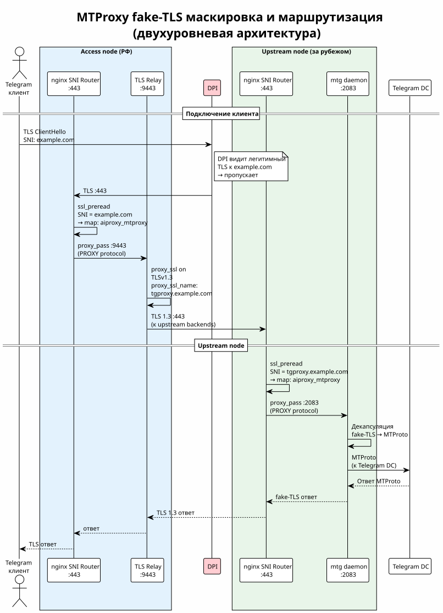

<!-- [AIGD] -->
# ADR-000005 — MTProxy co-deployment на upstream-нодах

**Последняя правка AI:** 2026-08-29T02:05:00Z

## Ссылки

- Требования: [C2-FR-006](../C2/C2-FR-006.md)
- Артефакты: [C4-RL-003](../C4/C4-RL-003.md)

| Атрибут | Значение |
|---|---|
| Статус | Active |
| Классификация | Segment × Application |
| Домен | Telegram, обход блокировок |
| Дата создания / обновления | 2025-02-01 / 2026-08-29 |
| USF / USD | нет |
| Компонент | [C3-MT-001](../C3/C3-MT-001.md) |
| Замещает / Замещён | — |

## Контекст

Организация нуждается в прокси для Telegram, обходящем DPI-блокировки. Telegram-протокол (MTProto) блокируется средствами глубокой инспекции пакетов (DPI) — необходима маскировка трафика.

Upstream-ноды уже размещены за пределами РФ и имеют внешние IP-адреса с доступом к Telegram DC. Использование этих нод для MTProxy позволит переиспользовать инфраструктуру без дополнительных серверов.

## Решение

Принято решение развернуть **mtg** (MTProxy-реализация на Go; версия закрепляется переменной `mtproxy_version`; на момент решения — 2.1.8, в действующем образце инвентори — 2.2.8) на upstream-нодах с интеграцией через nginx SNI Router ([ADR-000003](ADR-000003.md)):



> Исходник: [diagrams/ADR-000005-mtproxy-flow.puml](diagrams/ADR-000005-mtproxy-flow.puml)

**Архитектура:**
1. **mtg daemon** слушает на `127.0.0.1:2083`
2. **nginx SNI Router** маршрутизирует TLS-трафик с порта 443 на mtg по SNI-домену fake-TLS
3. mtg использует **fake-TLS маскировку** — MTProto-трафик выглядит как легитимный HTTPS
4. Секрет mtg содержит домен маскировки из переменной `mtproxy_fake_tls_domain` — средство инспекции видит рукопожатие TLS с именем этого домена

**Генерация секрета:**
```bash
# AI-GENERATED — NOT REVIEWED: SECTION START
mtg generate-secret --hex {{ mtproxy_fake_tls_domain }}
# AI-GENERATED — NOT REVIEWED: SECTION END
```

**Пользовательская ссылка:**
```
tg://proxy?server=<upstream_ip>&port=443&secret=<hex_secret>
```

**Ansible-роль:** `mtproxy` — устанавливает бинарник mtg из GitHub Releases, создаёт юнит systemd, генерирует секрет при первом развёртывании и читает существующий из `/etc/mtproxy/mtg.toml` при последующих. Форма команды — формата mtg v2: подкоманда принимает только домен, без слова `tls`.

## Альтернативы

### Отдельные серверы для MTProxy (отклонено)

Развернуть MTProxy на выделенных серверах, не связанных с AI Proxy.

**Причина отклонения:** дополнительные затраты на аренду серверов. Upstream-ноды уже имеют все необходимые ресурсы (внешний IP, доступ к Telegram DC). nginx SNI Router позволяет бесконфликтно совместить оба сервиса.

### Интеграция в Squid (отклонено)

Проксировать Telegram-трафик через Squid.

**Причина отклонения:** Squid — HTTP/HTTPS-прокси, не поддерживает MTProto. Telegram использует собственный бинарный протокол, несовместимый с HTTP CONNECT (MTProto — не HTTP).

## Последствия

### Положительные

- Переиспользование инфраструктуры: нет дополнительных серверов
- Маскировка трафика: DPI видит легитимный TLS к google.com / microsoft.com
- Простое развёртывание через Ansible-роль
- Интеграция через уже существующий nginx SNI Router

### Отрицательные

- Дополнительная нагрузка на upstream-ноды (CPU, bandwidth)
- Усложнение nginx-конфигурации (ещё один backend в SNI map)
- mtg — не официальная реализация Telegram (сторонний проект)

### Риски

- mtg может быть заброшен автором (open-source, single maintainer)
- Telegram может изменить MTProto, сломав совместимость с mtg
- Fake-TLS маскировка может быть обнаружена продвинутым DPI (анализ timing, packet size)

## Связанные требования

- [C1-BC-001](../C1/C1-BC-001.md) — Целевая система (дополнительные возможности)
- [C1-BC-003](../C1/C1-BC-003.md) — Внешние системы (Telegram DC)
- [C2-FR-006](../C2/C2-FR-006.md) — MTProxy для Telegram
- [C2-NF-002](../C2/C2-NF-002.md) — Безопасность (MTProxy secret)

## Классификация

Segment × Application

## Статус соответствия

| Дата | Уровень | Обоснование | Корректирующее действие |
|------|---------|-------------|-------------------------|
| 2026-08-29 | 4 - Conformant | Форма генерации секрета, порт и версия сверены с ролью mtproxy, её умолчаниями и образцом инвентори | - |
<!-- [/AIGD] -->
