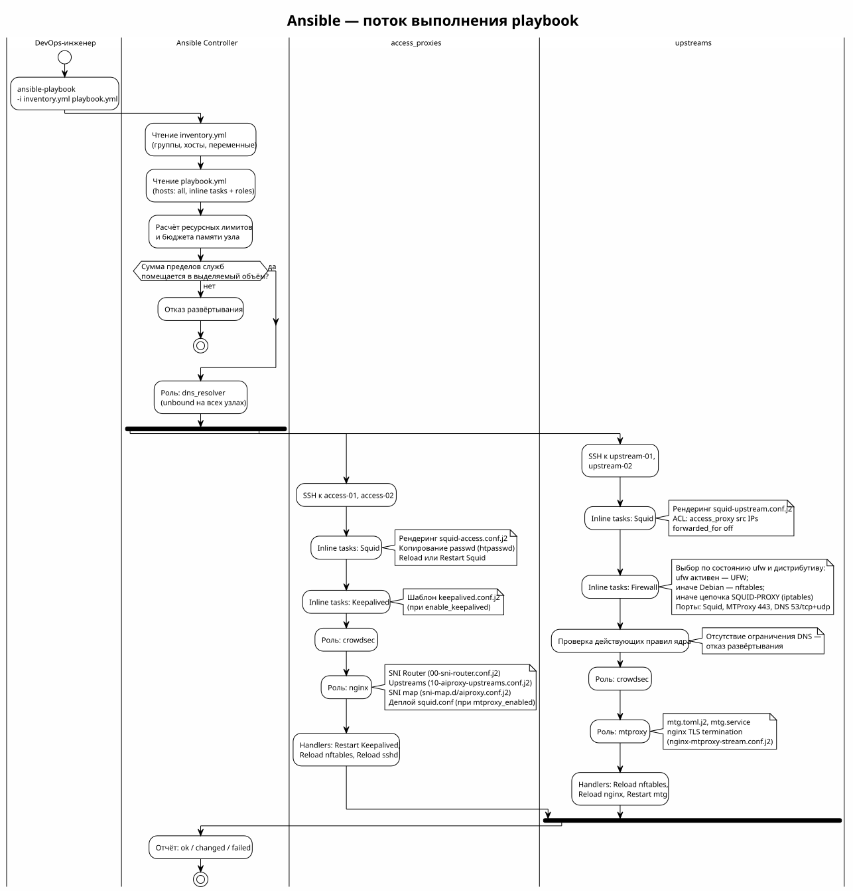

<!-- [AIGD] -->
# ADR-000007 — Ansible как IaC-инструмент

**Последняя правка AI:** 2026-08-29T02:05:00Z

## Ссылки

- Требования: [C2-FR-008](../C2/C2-FR-008.md), [C2-NF-004](../C2/C2-NF-004.md)
- Артефакты: [C4-PB-001](../C4/C4-PB-001.md), [C4-PB-002](../C4/C4-PB-002.md)

| Атрибут | Значение |
|---|---|
| Статус | Active |
| Классификация | Capability × Technology |
| Домен | Развёртывание и сопровождение |
| Дата создания / обновления | 2025-01-10 / 2026-08-29 |
| USF / USD | нет |
| Компонент | [C3-AD-001](../C3/C3-AD-001.md) |
| Замещает / Замещён | — |

## Контекст

Инфраструктура AI Assistants Proxy состоит из узлов двух уровней (в образце инвентори — два access и два upstream) с восемью компонентами ([ADR-000001](ADR-000001.md)). Ручная настройка серверов неприемлема:

- Высокий риск ошибок при ручной конфигурации
- Невоспроизводимость: трудно восстановить точное состояние после сбоя
- Нет версионирования конфигурации
- Трудоёмкость при масштабировании (добавление нод)
- Бизнес-цель BG-05 ([C1-BC-004](../C1/C1-BC-004.md)): развёртывание ≤ 10 минут

Необходим IaC-инструмент для декларативного, идемпотентного управления конфигурацией всех серверов.

## Решение

Выбран **Ansible** (версия ≥2.15) в качестве IaC-инструмента:



> Исходник: [diagrams/ADR-000007-ansible-flow.puml](diagrams/ADR-000007-ansible-flow.puml)

**Архитектура:**
- **Единый `playbook.yml`** — точка входа, применяет роли к группам хостов
- **Inventory (`inventory.yml`)** — описание всех нод, групп, переменных
- **Роли** — декларативное описание переиспользуемых компонентов:
  - `dns_resolver` — unbound caching DNS resolver (все ноды)
  - `crowdsec` — IPS с infrastructure whitelist (все ноды)
  - `nginx` — SNI Router на access-нодах (Squid + MTProxy за :443)
  - `mtproxy` — MTProxy (mtg) + nginx SNI Router на upstream-нодах
- **Inline-задачи в playbook.yml** — компоненты с уникальной конфигурацией per-role:
  - Squid access/upstream — шаблоны `squid-access.conf.j2` / `squid-upstream.conf.j2`
  - Keepalived — переключение по виртуальному адресу (access-узлы, при включённой опции)
  - Межсетевой экран upstream-узла — выбор бэкенда и выпуск правил, включая ограничение порта 53
  - Расчёт бюджета памяти и проверка его выполнимости ([ADR-000008](ADR-000008.md))

**Принципы:**
- Безагентный — подключение по SSH, не требует установки агента на серверы
- Идемпотентный — повторный запуск не изменяет уже настроенную систему
- Управление из инвентори — домены, порты, версии и признаки включения задаются там; исключение составляет файл паролей `Servers/deploy/passwd`, который ведётся отдельно и лишь копируется на access-узлы
- Jinja2-шаблоны — конфигурационные файлы генерируются из шаблонов
- Тегирование — частичное выполнение по действующим тегам: `dns`, `firewall`, `nginx`, `mtproxy`, `crowdsec`, `security`, `passwd`

**Команда развёртывания:**
```bash
# AI-GENERATED — NOT REVIEWED: SECTION START
ansible-playbook -i inventory.yml playbook.yml
# AI-GENERATED — NOT REVIEWED: SECTION END
```

## Альтернативы

### Terraform + Packer (отклонено)

Terraform для инфраструктуры, Packer для образов серверов.

**Причина отклонения:** Terraform ориентирован на провижининг облачных ресурсов (VM, сеть), а не на конфигурацию ОС. Packer создаёт неизменяемые образы — не подходит для динамических параметров (пользователи, домены). Требует облачный API, которого нет у bare-metal/VPS.

### SaltStack (отклонено)

Configuration management с агентной архитектурой (salt-minion).

**Причина отклонения:** требует установки salt-minion на каждый сервер + salt-master. Дополнительный компонент для управления. Избыточно для 4 нод.

### Chef / Puppet (отклонено)

Классические CM-инструменты с клиент-серверной архитектурой.

**Причина отклонения:** тяжёлая серверная инфраструктура (Chef Server / Puppet Master). DSL-языки с крутой кривой обучения. Избыточно для масштаба проекта.

### Ручная настройка (отклонено)

Настройка серверов вручную с документированием шагов.

**Причина отклонения:** невоспроизводимость, drift конфигурации, высокий риск ошибок, невозможность быстрого восстановления после сбоя. Нарушает BG-05 (≤ 10 мин).

## Последствия

### Положительные

- Безагентный: нет дополнительного ПО на серверах (только SSH + Python)
- Идемпотентный: безопасный повторный запуск
- Версионируемый: вся конфигурация в Git
- Простой YAML-синтаксис (низкий порог входа)
- Тегирование: гранулярное управление (обновить только один компонент)
- Активное community, тысячи готовых модулей

### Отрицательные

- Push-модель: Ansible запускается оператором, нет автоматической реакции на drift
- Производительность: последовательное выполнение задач (без параллелизма внутри роли)
- Зависимость от Python на целевых серверах
- Нет встроенного state-файла (в отличие от Terraform)

### Риски

- Secrets в inventory (пароли, ключи) — необходимо использовать ansible-vault или внешний secret manager
- Configuration drift между запусками Ansible (если кто-то изменил конфигурацию вручную)

## Связанные требования

- [C1-BC-004](../C1/C1-BC-004.md) — BG-05: время развёртывания ≤ 10 мин
- [C2-FR-007](../C2/C2-FR-007.md) — Конфигурации клиентов
- [C2-FR-008](../C2/C2-FR-008.md) — Автоматизированное развёртывание

## Классификация

Capability × Technology

## Статус соответствия

| Дата | Уровень | Обоснование | Корректирующее действие |
|------|---------|-------------|-------------------------|
| 2026-08-29 | 4 - Conformant | Состав ролей, перечень задач плейбука и действующие теги сверены с playbook.yml | - |
<!-- [/AIGD] -->
