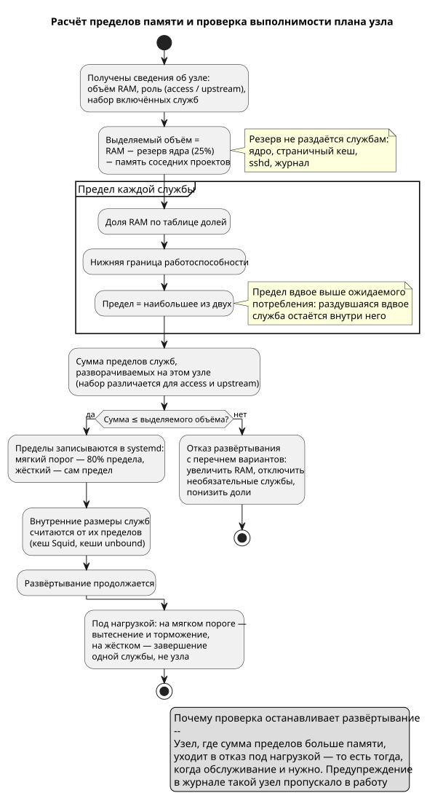

<!-- [AIGD] -->
<!-- [AITS] 2026-08-30T11:52:49Z -->
# ADR-000008 — Бюджет памяти узла: пределы служб с двукратным запасом и проверка выполнимости

**Последняя правка AI:** 2026-08-29T02:05:00Z

## Ссылки

- Родительские требования C2: [C2-NF-003](../C2/C2-NF-003.md) (производительность), [C2-NF-004](../C2/C2-NF-004.md) (масштабирование)
- Связанные C4: [C4-PB-001](../C4/C4-PB-001.md) (расчёт и проверка плана), [C4-TM-001](../C4/C4-TM-001.md), [C4-TM-002](../C4/C4-TM-002.md) (внутренние размеры Squid), [C4-RL-004](../C4/C4-RL-004.md) (кеши резолвера), [C4-RL-001](../C4/C4-RL-001.md) (CrowdSec)

| Атрибут | Значение |
|---|---|
| Статус | Active |
| Классификация | Capability × Technology |
| Домен | Эксплуатация, устойчивость |
| Дата создания / обновления | 2026-08-28 / 2026-08-28 |
| USF / USD | нет |
| Компонент | все службы узла |
| Замещает / Замещён | — |

## Контекст

Целевой размер узла — 768 МБ. Прежняя схема распределения памяти этому размеру не удовлетворяла и, что важнее, не могла об этом сообщить:

1. **Пределы задавались в трёх несогласованных местах.** CrowdSec получал жёсткие 512 МБ и 128 МБ из инвентори — на узле в 768 МБ это две трети всей памяти. MTProxy получал фиксированные 64 МБ независимо от узла. Squid, unbound и nginx не получали предела вовсе.
2. **Внутренние размеры считались от полной RAM, а не от предела службы.** Squid брал пятую часть RAM под пулы и ещё 60 % от неё под кеш объектов; unbound — тридцать вторую часть RAM на каждый из трёх кешей. Обе величины не знали ни о соседях по узлу, ни о собственном пределе.
3. **Сумма нигде не проверялась.** Развёртывание завершалось успешно на узле, где сумма пределов превышала объём памяти: расхождение обнаруживалось отказом под нагрузкой — то есть тогда, когда обслуживание и требовалось.

Дополнительное условие: приложения раздуваются вдвое относительно ожидаемого потребления, поэтому планирование «по ожидаемому» даёт отказ на первом же пике.

## Решение

> Исходник: [diagrams/ADR-000008-memory-budget.puml](diagrams/ADR-000008-memory-budget.puml)

**1. Единый бюджет узла.** Выделяемый объём при одиночном размещении = RAM − резерв ядра (25 %); при совместном — объявленная доля узла (35 % для этого проекта, см. ниже). Резерв не раздаётся службам: он нужен ядру, страничному кешу, sshd и журналу, и без него узел уходит в отказ раньше, чем сработает предел любой отдельной службы.

**2. Предел службы = доля RAM, не ниже нижней границы.** Доля задаёт масштабирование на крупных узлах, нижняя граница удерживает работоспособность на малых, где доля вырождается в единицы мегабайт.

| Служба | Доля RAM | Нижняя граница | Предел при 768 МБ |
|---|---|---|---|
| Squid | 16 % | 64 МБ | 122 МБ |
| CrowdSec | 26 % | 128 МБ | 199 МБ |
| unbound | 6 % | 32 МБ | 46 МБ |
| MTProxy | 6 % | 32 МБ | 46 МБ |
| nginx | 4 % | 24 МБ | 30 МБ |
| Firewall bouncer | 4 % | 24 МБ | 30 МБ |
| Keepalived | 2 % | 12 МБ | 15 МБ |

**3. Предел вдвое выше ожидаемого потребления.** Служба, раздувшаяся вдвое, остаётся внутри собственного предела: соседей она не задевает, а превышение гасит ядро — одну службу, а не узел целиком.

**4. Два порога вместо одного.** На мягком пороге (80 % предела) ядро включает вытеснение и торможение выделения; жёсткий предел — аварийный. Всплеск превращается в замедление одной службы, а не в её убийство.

**5. Внутренние размеры считаются от предела службы.** Squid: пулы — половина предела, кеш объектов — четверть. unbound: каждый кеш — шестая часть предела, в сумме около двух третей. Служба не может выйти за собственный предел собственной конфигурацией.

**6. Проверка выполнимости останавливает развёртывание.** Сумма пределов служб, **действительно разворачиваемых на этом узле** (набор различается для access и upstream), сверяется с выделяемым объёмом. Не помещается — отказ с перечнем вариантов, а не предупреждение в журнале.

## Альтернативы (рассмотренные)

| Альтернатива | Решение | Обоснование |
|---|---|---|
| Оставить фиксированные пределы, подобрав их под 768 МБ | Отклонено | Узлы разного размера требуют разных значений; фиксированные пришлось бы править в инвентори под каждый узел, а расхождение снова осталось бы необнаруживаемым |
| Не задавать пределов, полагаясь на ядро | Отклонено | Без предела службы конкурируют за память узла, и ядро завершает не виновника, а произвольного соседа — отказ переносится, а не устраняется |
| Оставить предупреждение вместо отказа | Отклонено | Предупреждение в журнале развёртывания не мешает выпустить узел в работу; несоответствие обнаруживается отказом под нагрузкой |
| Считать план по ожидаемому потреблению без двукратного запаса | Отклонено | Первый же пик выводит службу за предел; запас переносит границу срабатывания с обычной работы на аномалию |

## Совместное размещение: почему проверки недостаточно самой по себе

Бюджет считается от полной памяти узла. Пока проект на узле один, этого достаточно.
Когда соседний проект развёрнут рядом и считает свой бюджет тем же способом, обе проверки
проходят независимо: каждая исходит из того, что вся память узла её. Сумма пределов двух
проектов при этом может превысить память узла, и ядро начнёт гасить службы — причём
у того проекта, чья служба первой упрётся в предел, а не у того, кто занял лишнее.

**Средство — объявленные доли** (решение владельца 2026-08-30). При совместном размещении
каждый проект берёт свою долю памяти узла: ai-proxy — 35 % (`mem_share_when_shared`),
соседний проект — 50 %, остальные 15 % остаются ядру и системным службам. Долю знает
каждый сам, и опрашивать соседа не требуется.

Признак совместного размещения снимается осмотром каталогов расширения nginx при каждом
прогоне: собственные файлы перечислены поимённо, всё прочее принадлежит соседям. Осмотр
выполняется ДО расчёта памяти — вычисленный раньше него бюджет всегда описывал бы
одиночный узел.

**Отвергнутое средство — вычитание доли соседа** (`mem_foreign_reserved_mb`, действовало
до 2026-08-30). Объём, отданный соседям, вычислялся суммой пределов их служб, снятых
с узла командой `systemctl`. Отвергнуто по трём причинам, каждой достаточно:

1. Механизм требовал, чтобы сосед был УЖЕ развёрнут и его пределы выставлены. До первого
   его прогона доля выходила нулевой, и оба проекта считали, что вся память узла их.
2. После правок соседа значение устаревало молча: сумма менялась, а прогона у нас не было.
3. Разбор вывода `systemctl` оказался хрупок: свойства печатаются в порядке, который
   выбирает сама служба, а не в порядке аргументов, и разбор по номеру поля давал ноль
   при любом состоянии узла. Дефект был неотличим от «у соседа нет пределов».

Доля этих недостатков не имеет: она не зависит ни от состояния соседа, ни от разбора
чужого вывода. Цена — доли назначены, а не измерены, и при непропорциональной нагрузке
один проект может простаивать, пока другому тесно.

**Превышение доли допускается уступающей стороной**, и это заданное поведение: если сумма
неснижаемых пределов служб больше объявленной доли, берётся она — понижение ниже этих
границ ломает службы. О превышении печатается предупреждение, поскольку ведущий проект
считает свою долю от полной памяти узла и о потеснении не знает.

## Последствия

- **Положительные:** узел в 768 МБ обслуживается предсказуемо; превышение памяти локализовано одной службой; расхождение плана с узлом обнаруживается при развёртывании, а не в работе; на крупных узлах пределы растут без правки инвентори.
- **Отрицательные:** под давлением памяти службы работают медленнее (вытеснение кешей); на узле, где план не помещается, развёртывание останавливается — требуется решение оператора вместо молчаливого запуска.
- **Риски / Открытые вопросы:** доли подобраны от ожидаемого профиля потребления, а не измерены на боевых узлах; доли при совместном размещении назначены, а не выведены из измеренной нагрузки: при непропорциональном использовании узла один проект может простаивать, пока другому тесно. Суммарное превышение памяти узла при потеснении уступающей стороной обнаруживается только чтением его предупреждения — сквозной проверки, охватывающей оба проекта разом, нет.

## Инвентаризация диаграмм

| Механизм | Класс | Исходник | .svg | Статус |
|---|---|---|---|---|
| Расчёт пределов и проверка выполнимости плана | Технический процесс (Activity) | `diagrams/ADR-000008-memory-budget.puml` | `diagrams/ADR-000008-memory-budget.svg` | generated |

## Связанные ADR

| ADR | Связь |
|---|---|
| [ADR-000004](ADR-000004.md) | constrains — CrowdSec подчинён общему бюджету узла, его пределы более не задаются отдельно |
| [ADR-000005](ADR-000005.md) | constrains — предел MTProxy вычисляется из бюджета вместо фиксированного значения |

## Статус соответствия

| Дата | Уровень | Обоснование | Корректирующее действие |
|------|---------|-------------|-------------------------|
| 2026-08-29 | 4 - Conformant | Доли, нижние границы, резерв ядра и мягкий порог сверены с переменными и задачами расчёта в playbook.yml | - |
<!-- [/AIGD] -->
