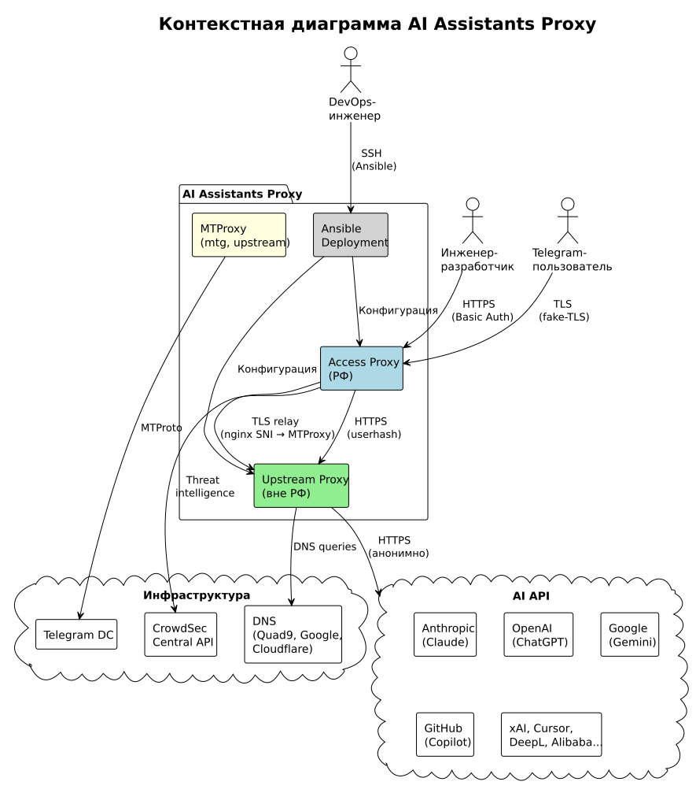

<!-- [AIGD] -->
# C1-BC-001 — Целевая система AI Assistants Proxy

**Последняя правка AI:** 2026-08-29T00:42:01Z

## Ссылки

Карточки-аспекты того же слоя: [C1-BC-002](C1-BC-002.md) — стейкхолдеры и акторы, [C1-BC-003](C1-BC-003.md) — внешние системы, [C1-BC-004](C1-BC-004.md) — цели, регуляторика и SLA.

### Требования C2, порождённые системой

Перечень сводный: он охватывает весь слой требований. Непосредственный родитель каждого требования назван в его собственной карточке и может быть аспектным ([C1-BC-002](C1-BC-002.md), [C1-BC-003](C1-BC-003.md), [C1-BC-004](C1-BC-004.md)).

- [C2-FR-001](../C2/C2-FR-001.md) — Проксирование запросов к AI API
- [C2-FR-002](../C2/C2-FR-002.md) — Аутентификация и авторизация
- [C2-FR-003](../C2/C2-FR-003.md) — Фильтрация доменов
- [C2-FR-004](../C2/C2-FR-004.md) — Кеширование ответов
- [C2-FR-005](../C2/C2-FR-005.md) — Журналирование и аудит
- [C2-FR-006](../C2/C2-FR-006.md) — MTProxy для Telegram
- [C2-FR-007](../C2/C2-FR-007.md) — Конфигурации клиентов
- [C2-FR-008](../C2/C2-FR-008.md) — Автоматизированное развёртывание
- [C2-NF-001](../C2/C2-NF-001.md) — Высокая доступность
- [C2-NF-002](../C2/C2-NF-002.md) — Безопасность
- [C2-NF-003](../C2/C2-NF-003.md) — Производительность
- [C2-NF-004](../C2/C2-NF-004.md) — Масштабируемость
- [C2-NF-005](../C2/C2-NF-005.md) — Наблюдаемость
- [C2-CN-001](../C2/C2-CN-001.md) — Ограничение: двухуровневая архитектура
- [C2-CN-002](../C2/C2-CN-002.md) — Ограничение: совместимость с co-deployment

## Описание

**AI Assistants Proxy** — корпоративный сервис проксирования доступа к западным AI API для инженерной команды Организации. Система обеспечивает безопасный, анонимный и отказоустойчивый доступ к AI-сервисам (Claude, ChatGPT, Gemini, GitHub Copilot, Cursor и др.) через единый статичный эндпоинт на территории Российской Федерации.

### Архитектурная концепция

Система реализует **двухуровневую архитектуру проксирования**:

1. **Access tier (РФ)** — точка входа для пользователей. Обеспечивает аутентификацию, авторизацию, журналирование обращений и кеширование ответов. Отказоустойчивость по виртуальному IP (VRRP) — опциональная возможность уровня: она включается на площадке, где access-узлы делят общую подсеть, и по умолчанию выключена ([C2-NF-001](../C2/C2-NF-001.md)).

2. **Upstream tier (вне РФ)** — анонимный транспортный уровень. Минимальная конфигурация, отсутствие журналирования и аутентификации. Управление доступом по IP-адресам access-прокси.

Оба уровня построены на базе прокси-сервера **Squid**. Инфраструктура управляется через **Ansible** (IaC — Infrastructure as Code).

Разрешение доменных имён вынесено в собственный кеширующий резолвер на каждом узле: access-узлы пересылают запросы на резолверы upstream-узлов, те обращаются к публичным DNS. Наружу порт резолвера открыт только адресам access-прокси. Запрашиваемые имена перестают быть видны провайдеру РФ и публичным резолверам, однако пересылка между уровнями идёт обычным DNS: на транзитном участке между площадками имена по-прежнему наблюдаемы. Полный перечень того, что мера даёт и чего не даёт, — в [ADR-000009](../ADR/ADR-000009.md) ([C2-NF-002](../C2/C2-NF-002.md), [C2-NF-003](../C2/C2-NF-003.md)).

### Дополнительные возможности

Система поддерживает **co-deployment** — совместное размещение на одних серверах с другими проектами. Маршрутизация трафика на порту 443 реализована через **nginx SNI Router**, обеспечивающий бесконфликтное разделение TLS-потоков по SNI (Server Name Indication).

На upstream-нодах дополнительно развёрнут **MTProxy (mtg)** — прокси для Telegram с обходом DPI через fake-TLS маскировку.

### Контекстная диаграмма

> Исходник: [diagrams/C1-BC-001-context.puml](diagrams/C1-BC-001-context.puml)

**Компоненты контекстной диаграммы:**

| Элемент | Тип | Описание |
|---|---|---|
| Access Proxy (РФ) | Часть целевой системы | Точка входа: проверка подлинности, фильтрация, журналирование, кеш |
| Upstream Proxy (вне РФ) | Часть целевой системы | Анонимный транспортный уровень |
| MTProxy (mtg, upstream) | Часть целевой системы | Прокси Telegram за маршрутизатором SNI |
| Ansible Deployment | Часть целевой системы | Развёртывание и конфигурирование обоих уровней |
| Инженер-разработчик | Актор | Пользователь AI-инструментов через IDE или браузер |
| DevOps-инженер | Актор | Оператор инфраструктуры, развёртывание и обслуживание |
| Telegram-пользователь | Актор | Клиент Telegram, подключающийся через MTProxy |
| AI API (Claude, ChatGPT, Gemini, Copilot, …) | Внешняя система | Целевые AI-сервисы |
| DNS (Quad9, Google, Cloudflare) | Внешняя система | Разрешение доменных имён; обращается резолвер upstream-узла |
| CrowdSec Central API | Внешняя система | Репутационные данные и сценарии обнаружения для IPS |
| Telegram DC | Внешняя система | Центры обработки данных Telegram |

### Границы системы

**Входит в scope:**
- Серверная прокси-инфраструктура (Ansible roles, playbooks, templates)
- Конфигурации клиентов (IDE, браузер, PowerShell)
- Документация развёртывания и эксплуатации

**Не входит в scope:**
- Сами AI-сервисы (Claude API, OpenAI API и др.)
- Серверы, на которых развёрнута инфраструктура (предоставляются Организацией)
- Сетевая связность между РФ и зарубежными площадками
- Биллинг и подписки на AI-сервисы

## Покрытие объектов управления
| Тип объекта | Статус | Артефакт / Обоснование N/A |
|---|---|---|
| Целевая система (System-of-Interest) | Covered | Описание выше — AI Assistants Proxy |
| Стейкхолдеры (Stakeholders) | Covered | [C1-BC-002](C1-BC-002.md) |
| Внешние системы (External Systems) | Covered | [C1-BC-003](C1-BC-003.md) |
| Акторы (Actors / Personas) | Covered | [C1-BC-002](C1-BC-002.md) |
| Бизнес-цели и метрики (Goals & KPIs) | Covered | [C1-BC-004](C1-BC-004.md) |
| Регуляторная среда (Regulatory) | Covered | [C1-BC-004](C1-BC-004.md) |
| Контракты и SLA | Covered | [C1-BC-004](C1-BC-004.md) |
| Границы системы (System Boundary) | Covered | Секция «Границы системы» выше |
| Бизнес-сущности данных (Business Data Entities) | Covered | [C1-BC-003](C1-BC-003.md) — описание потоков данных |
| Потоки ценности (Value Streams) | Covered | [C1-BC-004](C1-BC-004.md) |

## Статус соответствия

| Дата | Уровень | Обоснование | Корректирующее действие |
|------|---------|-------------|-------------------------|
| 2026-08-29 | 4 — Conformant | Контекст, границы и состав контекстной диаграммы сверены с инвентори и плейбуком развёртывания | — |
<!-- [/AIGD] -->
