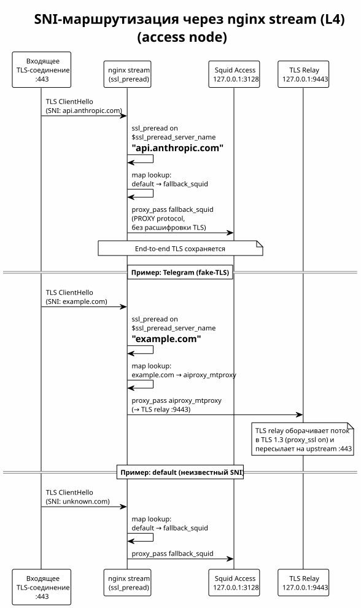

<!-- [AIGD] -->
# C2-CN-002 — Ограничение: совместимость с co-deployment

**Последняя правка AI:** 2026-10-19T10:44:33Z

## Ссылки

- Родительские требования C1: [C1-BC-001](../C1/C1-BC-001.md)
- Дочерние требования C3: [C3-NX-001](../C3/C3-NX-001.md), [C3-CS-001](../C3/C3-CS-001.md)

## Описание

Upstream-ноды **совместно используются** с другими проектами Организации. Система обязана обеспечивать бесконфликтное сосуществование на одних серверах, разделяя порт 443 и инфраструктурные компоненты.

### Механизм co-deployment



> Исходник: [../ADR/diagrams/ADR-000003-sni-routing.puml](../ADR/diagrams/ADR-000003-sni-routing.puml) (первичная диаграмма — [ADR-000003](../ADR/ADR-000003.md))

#### 1. nginx SNI Router — разделение порта 443

Все сервисы, требующие порт 443, маршрутизируются через единый nginx stream-модуль с `ssl_preread`:

```nginx
# Схематично: полные определения backend находятся в stream.d/*.conf.
stream {
    map $ssl_preread_server_name $sni_backend {
        include /etc/nginx/stream.d/sni-map.d/*.conf;
        # Например: transit.internal → squid_tls_term (upstream :4444),
        # proxy.example.com → aiproxy_https_proxy (access :4445),
        # max.ru → MTProxy; имена соседей — в собственных файлах.
        default fallback_squid;
    }
    upstream fallback_squid {
        server 127.0.0.1:3128;  # squid_local_port, умолчание
    }
    server {
        listen 443;
        ssl_preread on;
        proxy_pass $sni_backend;
        proxy_protocol on;
    }
}
```

nginx анализирует SNI (Server Name Indication) в TLS ClientHello **без терминации TLS** и маршрутизирует подключение на соответствующий backend.

#### 2. Модульная конфигурация nginx

Конфигурации потока лежат в `/etc/nginx/stream.d/`, включаемом из `nginx.conf`
директивой `include /etc/nginx/stream.d/*.conf`. Владение файлами разделено:

| Файл | Чей | Назначение |
|---|---|---|
| `00-sni-router.conf` | ai-proxy | Общий router: владелец ai-proxy перезаписывает свой файл; сосед расширяет узел собственными файлами |
| `sni-map.d/aiproxy.conf` | AI Assistants Proxy | Запись карты имён: домен маскировки MTProxy |
| `sni-map.d/matrix.conf` | Matrix | Записи карты имён: имя сервера Matrix, узла Synapse, веб-клиента |
| `10-*.conf` | По проекту | Описания бэкендов: MTProxy на 2083 у первого, приложения Matrix у второго |

Бэкенд по умолчанию — Squid: соединение с неизвестным именем, а также обращение без имени
SNI (plain HTTP CONNECT от access-узлов) уходит ему. Squid transit TLS с SNI transit.internal идёт к терминатору 4444, клиентский HTTPS на access — к отдельному терминатору 4445.

#### 3. CrowdSec — совместное использование

Обнаружение вторжений на узле одно на всех:
- Агент устанавливается тем проектом, который развернулся первым. Второй его не ставит:
  в Matrix для этого есть признак `crowdsec_external`, при котором роль ограничивается
  добавлением своих источников.
- Каждый проект владеет собственным файлом источников в `/etc/crowdsec/acquis.d/`. Прежде оба обращались к общему `acquis.yaml`, и порядок развёртывания решал исход: прогон этого проекта после соседнего затирал его источники, отчего обнаружение по журналам соседа молча переставало работать.
- Решения о блокировке применяются единым применителем в отдельной таблице `ip crowdsec`;
  правила проектов её не затрагивают, поэтому блокировки переживают развёртывание любого
  из них.

#### 4. Порт 80 и сертификаты

Проект не выпускает сертификатов и не занимает порт 80: маршрутизатор SNI работает без
расшифровки TLS, а Squid слушает петлевой адрес за ним. Роль MTProxy, напротив, удаляет
включённый по умолчанию сайт nginx — тем самым порт 80 остаётся свободным для соседних
проектов, которым он нужен для проверки владения доменом при выпуске сертификатов.

Из этого следует разделение: сертификатами на узле распоряжается тот проект, который
терминирует TLS. Здесь это соседний проект; настоящий проект его выпуску не мешает
и от его сертификатов не зависит.

### Правила co-deployment

1. **Изоляция конфигураций:** каждый проект управляет только своими файлами. Общий router перезаписывает владелец ai-proxy; сосед добавляет собственные файлы карты имён и обработчиков. Правила межсетевого экрана этот проект выпускает только для собственной цепочки; Matrix при `shared_host` не сбрасывает правила и не переписывает параметры ядра вовсе. Роль `nginx` не трогает файлы чужих проектов в `stream.d/`.

2. **Нет конфликтов портов:** все сервисы слушают на уникальных локальных портах. MTProxy: 2083, Squid HTTPS: конфигурируемый. Порт 443 управляется nginx.

3. **Graceful reload:** изменение конфигурации одного проекта не прерывает соединения другого (`nginx -s reload`).

4. **CrowdSec scope:** решения о блокировке IP применяются глобально. Блокировка атакующего IP применяется ко всем проектам на ноде. Это **ожидаемое поведение** — атакующий IP блокируется полностью.

## Критерии приёмки

| # | Критерий | Метрика / Способ проверки | Целевое значение |
|---|----------|---------------------------|------------------|
| 1 | nginx маршрутизирует MTProxy-трафик по SNI | TLS-подключение с SNI=example.com | Ответ от mtg |
| 2 | nginx маршрутизирует Squid transit TLS по SNI | Подключение с SNI=transit.internal | Проверенный TLS до терминатора, CONNECT до Squid |
| 3 | Plain HTTP fallback доступен | HTTP CONNECT на общем 443 | Ответ Squid с PROXY-заголовком |
| 4 | Клиентский HTTPS включается отдельно | SNI=https_proxy_hostname | Терминация TLS 1.2/1.3 на локальном 4445 |
| 5 | Конфигурации изолированы | ls conf.d/ | Файлы каждого проекта отдельно |
| 6 | CrowdSec активен на ноде | cscli metrics | Datasources активны |

## Доказательство реализации

### Конструктивное

Реализовано через:
- **nginx/upstream роли:** общий `templates/00-sni-router.conf.j2`, отдельные TLS-терминаторы и записи SNI; `tasks/ports.yml` проверяет общий 443 и отсутствие конфликтов локальных портов.
- **Модульные конфигурации:** собственные файлы в `stream.d/`, `stream.d/sni-map.d/` и `conf.d/` для каждого проекта.
- **CrowdSec role:** собственный `acquis.d/aiproxy.yaml`; источники соседей сохраняются.
- **Ansible:** каждый проект имеет свою роль; роли не конфликтуют.

### Трассировочное

| C1 | C2 | C3 (дочерние) |
|---|---|---|
| [C1-BC-001](../C1/C1-BC-001.md) — Целевая система | C2-CN-002 — Co-deployment | [C3-NX-001](../C3/C3-NX-001.md) — nginx SNI Router |
| [C1-BC-001](../C1/C1-BC-001.md) — Целевая система | C2-CN-002 — Co-deployment | [C3-CS-001](../C3/C3-CS-001.md) — CrowdSec |

### Аналитическое

**nginx SNI routing:** единственный способ разделить порт 443 между несколькими TLS-сервисами без терминации TLS. `ssl_preread` модуль nginx анализирует SNI из ClientHello — стандартный подход для multi-tenant TLS.

**Модульная конфигурация:** паттерн `conf.d/*.conf` предотвращает конфликты при параллельной разработке.

### Негативное

| Риск | Митигация |
|---|---|
| Ошибка в конфигурации одного проекта ломает nginx | `nginx -t` перед reload; Ansible handler |
| CrowdSec блокирует IP для всех проектов | Ожидаемое поведение; whitelist для критичных IP |
| Ресурсная конкуренция между проектами | Мониторинг CPU/RAM; разделение по cgroups (опционально) |
| SNI-based routing не работает при ESNI/ECH | ECH пока не распространён; мониторинг TLS-стандартов |

## Покрытие объектов управления
| Тип объекта | Статус | Артефакт / Обоснование N/A |
|---|---|---|
| Технологические ограничения | Covered | nginx SNI, совместное использование порта 443 |
| Организационные ограничения | Covered | Серверы разделяются между проектами |
| Совместимость | Covered | Co-deployment с другими проектами |
| Допущения | Covered | Другие проекты также используют Ansible; координация через conf.d/ |
| Риски требований | Covered | См. секцию «Негативное» |

## Статус соответствия

| Дата | Уровень | Обоснование | Корректирующее действие |
|------|---------|-------------|-------------------------|
| 2026-02-23 | 4 — Conformant | Реализовано в nginx role и CrowdSec role | — |

## Статус доказательства: verified

| Дата | Из статуса | В статус | Причина |
|------|------------|----------|---------|
| 2026-02-23 | absent | verified | Актуализация из кода Ansible/nginx/CrowdSec |
<!-- [/AIGD] -->
