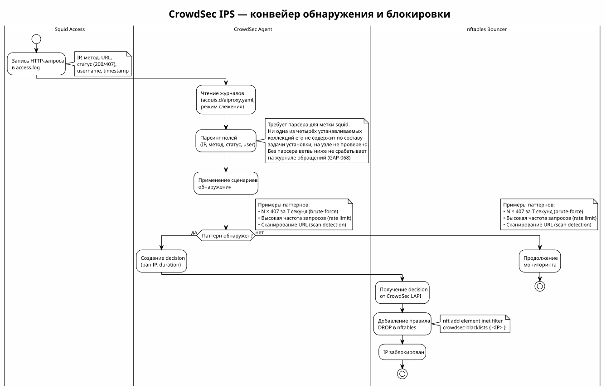
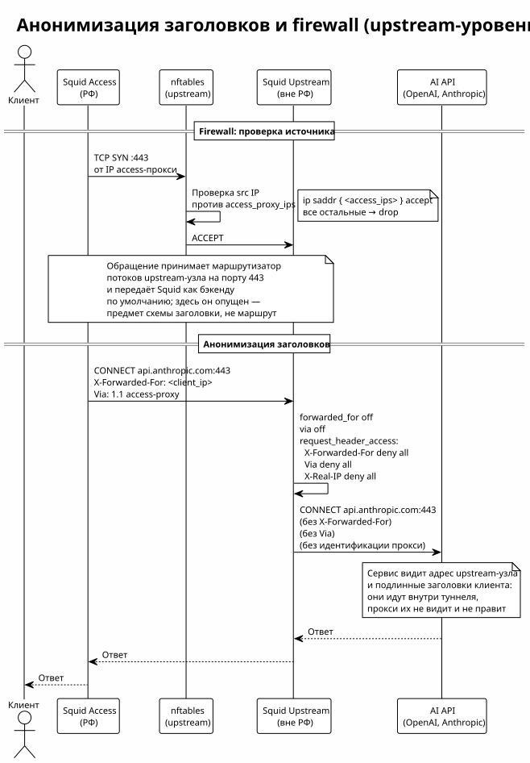

<!-- [AIGD] -->
# C2-NF-002 — Безопасность (IPS, анонимизация, firewall)

**Последняя правка AI:** 2026-08-29T06:50:58Z

## Ссылки

- Родительские требования C1: [C1-BC-004](../C1/C1-BC-004.md), [C1-BC-003](../C1/C1-BC-003.md)
- Дочерние требования C3: [C3-CS-001](../C3/C3-CS-001.md), [C3-SU-001](../C3/C3-SU-001.md)
- Архитектурные решения: [ADR-000004](../ADR/ADR-000004.md) — IPS, [ADR-000001](../ADR/ADR-000001.md) — разделение уровней, [ADR-000009](../ADR/ADR-000009.md) — закрытый резолвер

## Описание

Система реализует многоуровневую защиту: обнаружение и предотвращение вторжений (IPS), анонимизацию заголовков прокси, ограничение доступа через firewall и защиту MTProxy-секретов. Безопасность обеспечивается на обоих уровнях проксирования с разными акцентами.

### 1. CrowdSec IPS (все ноды)

CrowdSec — система обнаружения вторжений с общей базой репутации, читающая журналы узла:

| Компонент | Описание |
|---|---|
| **Агент** | Разбирает журналы, применяет сценарии обнаружения |
| **Применитель решений (nftables bouncer)** | Переносит решения в правила nftables (блокировка адреса) |
| **Источники журналов** | Файл `/etc/crowdsec/acquis.d/aiproxy.yaml`: `/var/log/squid/access.log` — только на access-узле и только при включённом журналировании; `/var/log/auth.log` и журнал systemd по юниту `ssh.service` — на всех узлах. Каталог `acquis.d` позволяет каждому проекту узла владеть своим файлом источников |
| **Коллекции** | `crowdsecurity/linux`, `crowdsecurity/nginx`, `crowdsecurity/http-cve`, `crowdsecurity/whitelist-good-actors` — сценарии и парсеры ставятся наборами, а не поштучно |

**Условие работы, связывающее два механизма.** Источник журнала Squid выпускается только при `enable_logging` на access-узле ([C2-FR-005](C2-FR-005.md)). Выключение журналирования — ради приватности либо экономии диска — оставляет обнаружение без обращений клиентов: служба остаётся исправной и продолжает работать по системным журналам, но подбор паролей и сканирование через прокси перестают замечаться. На upstream журналирование отключено всегда, поэтому там обнаружение опирается только на системные журналы изначально.

Механизм:



> Исходник: [diagrams/C2-NF-002-crowdsec-pipeline.puml](diagrams/C2-NF-002-crowdsec-pipeline.puml)

1. Агент читает источники, перечисленные в `acquis.yaml`.
2. Парсеры извлекают поля (адрес, метод, код ответа, имя пользователя).
3. Сценарии анализируют паттерны (множественные 407, высокая частота, сканирование).
4. При срабатывании — создаётся решение (decision) о блокировке.
5. nftables bouncer применяет решение как правило DROP в nftables.

### 2. Анонимизация заголовков и firewall (upstream-уровень)



> Исходник: [diagrams/C2-NF-002-anonymization.puml](diagrams/C2-NF-002-anonymization.puml)

Squid на upstream-уровне снимает заголовки, идентифицирующие клиента и прокси,
в запросах `CONNECT` — их прокси видит, поскольку они идут открыто до установления
туннеля. Заголовки **внутри** туннеля зашифрованы, прокси их не видит, и именно они
доходят до целевого сервиса.

Отсюда мера действия: сведения скрываются от промежуточных узлов и от записей
на upstream, но не от самого сервиса — он получает подлинные заголовки клиента вместе
с набором шифров и отпечатком его библиотеки. Скрыт от сервиса лишь адрес клиента.

Подставляемая взамен строка браузера **постоянна** и совпадает на обоих уровнях цепочки.
Прежняя редакция upstream-шаблона собирала её из свойств самого узла — дистрибутива,
системы и архитектуры, — то есть при всяком запросе `CONNECT` сообщала промежуточным
узлам сведения об узле вместо их сокрытия; механизм, названный анонимизацией, работал
против собственной цели. Постоянная строка этого не делает и вдобавок не позволяет
различить два уровня цепочки по подставляемому значению.

| Директива Squid | Эффект |
|---|---|
| `forwarded_for off` | Удаление X-Forwarded-For |
| `via off` | Удаление Via header |
| `request_header_access X-Forwarded-For deny all` | Блокировка пересылки X-Forwarded-For |
| `request_header_access Via deny all` | Блокировка пересылки Via |
| `visible_hostname localhost` | Скрытие имени прокси-сервера |

**Что скрыто от целевого сервиса, а что нет.** Скрыт адрес клиента: обращение приходит с адреса upstream-узла. Не скрыты свойства самого клиента — внутри туннеля идёт сквозной TLS между ним и сервисом, и его набор шифров, расширения и заголовки приложения проходят насквозь без изменений. Прокси в туннель не вмешивается по устройству ([DE-TR-001](../DD/DE/DE-TR-001.md)), поэтому анонимность здесь означает сокрытие адреса, а не неотличимость обращений.

### 3. Firewall (upstream-уровень)

Upstream-ноды разрешают входящие подключения **только с IP-адресов access-прокси**. Бэкенд выбирается по состоянию ufw и дистрибутиву (UFW / nftables / iptables), набор закрываемых портов одинаков во всех трёх ветках:

| Порт | Назначение | Кому открыт |
|---|---|---|
| 22/tcp | SSH | всем (защита от lockout) |
| `squid_port`/tcp | Squid (proxy chain) | только IP access-прокси |
| 443/tcp | MTProxy за nginx SNI (при `mtproxy_enabled`) | только IP access-прокси |
| **53/tcp и 53/udp** | **DNS-резолвер unbound** | **только IP access-прокси** |

```
# AI-GENERATED — NOT REVIEWED: SECTION START
ufw default deny incoming
ufw default allow outgoing
ufw allow 22/tcp                                       # SSH
ufw allow from <access_proxy_ip> to any port <squid>   # Squid
ufw allow from <access_proxy_ip> to any port 443       # MTProxy (nginx SNI)
ufw allow from <access_proxy_ip> to any port 53 proto tcp   # DNS
ufw allow from <access_proxy_ip> to any port 53 proto udp   # DNS
ufw deny 53/tcp ; ufw deny 53/udp                      # явный отказ прочим
# AI-GENERATED — NOT REVIEWED: SECTION END
```

Список разрешённых источников для DNS (`dns_allowed_clients`) вычисляется один раз в `playbook.yml` и используется всеми бэкендами firewall и `access-control` резолвера — так правило не расходится между точками применения. Ограничение проверяется на самой ноде после развёртывания по действующим правилам ядра, а не по шаблону; отсутствие правил -- отказ развёртывания.

CrowdSec nftables bouncer работает параллельно через отдельную таблицу `table ip crowdsec` (priority filter - 10). Конфигурация nftables заменяет **только собственную таблицу** (`add`/`delete`/`table inet filter`) и применяется через reload, поэтому блокировки bouncer'а переживают обновление правил (проверено на стенде: таблица и правило блокировки на месте после применения).

### 4. MTProxy Secret

MTProxy (mtg) использует secret для аутентификации клиентов:
- Secret генерируется при развёртывании (Ansible).
- Хранится в `/etc/mtproxy/mtg.toml` с правами 0640 (владелец mtproxy).
- Передаётся клиентам через защищённые каналы.

### Количественные целевые значения

| Метрика | Целевое значение | Метод измерения |
|---|---|---|
| Время реакции CrowdSec на brute-force | ≤ 60 секунд | Время от первого 407 до блокировки |
| Утечка заголовков X-Forwarded-For на upstream | 0 | Проверка заголовков через httpbin.org |
| Неавторизованные подключения к upstream | 0 | UFW logs / nftables counters |

**Защита секретов** (решение владельца, 2026-08-29): защищённое хранилище Ansible
не задействовано намеренно; действующая мера — исключение рабочего инвентори из контроля
версий и права доступа к файлу. Признано достаточным для одного оператора на управляющей
машине, которой он владеет. Хранилище добавило бы пароль при каждом прогоне, не меняя
модели угроз: доступ к машине оператора даёт и то и другое.

Что это НЕ покрывает и покрывать не должно: доступ к самой управляющей машине; резервные
копии рабочего каталога; случайную отправку файла, исключённого из контроля версий,
иным путём.

## Критерии приёмки

| # | Критерий | Метрика / Способ проверки | Целевое значение |
|---|----------|---------------------------|------------------|
| 1 | CrowdSec agent запущен на access-ноде | systemctl status crowdsec | active (running) |
| 2 | Применитель решений запущен | `systemctl status crowdsec-firewall-bouncer` (юнит; пакет называется иначе — `crowdsec-firewall-bouncer-nftables`) | active (running) |
| 3 | X-Forwarded-For отсутствует в запросах от upstream | curl через прокси к httpbin.org/headers | Нет X-Forwarded-For |
| 4 | Upstream отклоняет подключение не с access-IP | curl с произвольного IP к upstream | Connection refused / timeout |
| 5 | Brute-force блокируется CrowdSec | 10+ запросов с неверным паролем | IP заблокирован в nftables |
| 6 | DNS upstream закрыт для посторонних | `dig` и `dig +tcp` к `<upstream>:53` с хоста вне allowlist | timeout по обоим транспортам, счётчик drop-правила растёт |
| 7 | DNS upstream доступен access-ноде | `dig` и `dig +tcp` к `<upstream>:53` с access-ноды | NOERROR по обоим транспортам |
| 8 | Ограничение переживает перезагрузку | reboot upstream, затем критерии 6--7 | результат не меняется |

## Доказательство реализации

### Конструктивное

- **CrowdSec:** Ansible-роль `crowdsec` устанавливает agent и bouncer, конфигурирует acquis.yaml для чтения access.log.
- **Анонимизация:** `squid-upstream.conf.j2` содержит директивы `forwarded_for off`, `via off`, `request_header_access deny all`; те же директивы есть и в шаблоне access-уровня.
- **Межсетевой экран:** задачи плейбука настраивают выбранный бэкенд по списку адресов группы `access_proxies`; для DNS список берётся из общей переменной `dns_allowed_clients`.
- **MTProxy secret:** генерируется Ansible-задачей, хранится в mtg.toml.

### Трассировочное

| C1 | C2 | C3 (дочерние) |
|---|---|---|
| [C1-BC-004](../C1/C1-BC-004.md) — Бизнес-цели | C2-NF-002 — Безопасность | [C3-CS-001](../C3/C3-CS-001.md) — CrowdSec |
| [C1-BC-004](../C1/C1-BC-004.md) — Бизнес-цели | C2-NF-002 — Безопасность | [C3-SU-001](../C3/C3-SU-001.md) — Squid Upstream |

### Аналитическое

**CrowdSec vs Fail2Ban:** CrowdSec обеспечивает коллаборативную защиту (shared threat intelligence), поддерживает nftables (в отличие от iptables-only Fail2Ban), имеет модульную архитектуру с коллекциями для Squid.

**Анонимизация на upstream:** целевые AI API не должны видеть IP клиентов и инфраструктуру прокси. Upstream действует как анонимный транспортный уровень.

### Негативное

| Риск | Митигация |
|---|---|
| CrowdSec ложно блокирует легитимного пользователя | Whitelist IP в CrowdSec; мониторинг decisions |
| Обход firewall через скомпрометированный access-прокси | Аутентификация на access-уровне; мониторинг |
| Утечка секрета MTProxy | Хранилище Ansible не задействовано: секрет лежит открытым текстом в рабочем инвентори, исключённом из контроля версий, и в файле конфигурации с ограниченными правами на узле |
| 0-day в Squid/CrowdSec/mtg | Мониторинг CVE; обновление через Ansible |

## Покрытие объектов управления
| Тип объекта | Статус | Артефакт / Обоснование N/A |
|---|---|---|
| Безопасность | Covered | IPS, анонимизация, firewall, secret management |
| Аудит и журналирование | Covered | CrowdSec анализирует access.log |
| Надёжность / Доступность | Covered | IPS защищает от DoS/brute-force |
| Технологические ограничения | Covered | CrowdSec, nftables, Squid ACL |
| Допущения | Covered | CrowdSec intelligence доступен из access-нод |
| Риски требований | Covered | См. секцию «Негативное» |

## Статус соответствия

| Дата | Уровень | Обоснование | Корректирующее действие |
|------|---------|-------------|-------------------------|
| 2026-02-23 | 4 — Conformant | Реализовано в роли crowdsec, шаблонах Squid и правилах межсетевого экрана | — |

## Статус доказательства: verified

| Дата | Из статуса | В статус | Причина |
|------|------------|----------|---------|
| 2026-02-23 | absent | verified | Актуализация из кода Ansible/CrowdSec/Squid/nftables |
<!-- [/AIGD] -->
