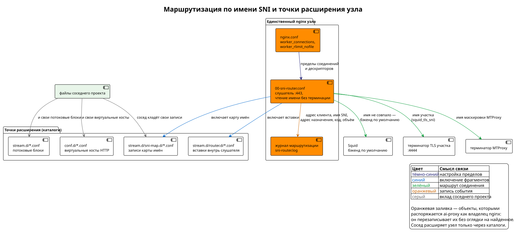

<!-- [AIGD] -->
<!-- [AITS] 2026-08-30T16:44:38Z -->
# C3-NX-001 -- nginx SNI Router

**Последняя правка AI:** 2026-08-29T06:17:01Z

## Ссылки

- Реализация: роли `Servers/deploy/roles/nginx/` и `Servers/deploy/roles/mtproxy/` (обе разворачивают маршрутизатор)
- Родительские требования C2:
  - [C2-FR-006](../C2/C2-FR-006.md) -- MTProxy для Telegram
  - [C2-CN-002](../C2/C2-CN-002.md) -- Ограничение: совместимость с co-deployment
- Архитектурное решение: [ADR-000003](../ADR/ADR-000003.md) — маршрутизация по имени SNI для совместного размещения
- Ограничение в области действия: [C2-CN-001](../C2/C2-CN-001.md) — двухуровневая архитектура проксирования
- Дочерние требования C4:
  - [C4-RL-002](../C4/C4-RL-002.md) -- Ansible role: nginx

## Описание

nginx SNI Router -- компонент маршрутизации TLS-трафика, работающий на узлах **обоих уровней** и использующий модуль `stream` для бесконфликтного разделения порта 443 между несколькими сервисами. Маршрутизация выполняется на основе SNI (Server Name Indication) из TLS ClientHello -- без терминации TLS.

### Принцип работы

nginx читает SNI из TLS ClientHello и направляет всё TCP-соединение на соответствующий upstream-бэкенд:
- **По умолчанию** (`default`) -- трафик направляется на Squid (`127.0.0.1:3128`), который работает как fallback.
- **MTProxy-домены** -- трафик с именем SNI, равным значению `mtproxy_fake_tls_domain` либо `mtproxy_hostname` (оба задаются в инвентори), направляется на MTProxy upstream-ноды (порт 2083).

### Модульная архитектура конфигурации

Конфигурация разделена на три уровня для поддержки co-deployment:

1. **`00-sni-router.conf`** -- общая инфраструктура: connection limits, SNI map, fallback upstream, server block на порту 443. Создаётся первым развёрнутым проектом (`force: no` -- не перезаписывается).
2. **`10-aiproxy-upstreams.conf`** -- upstream-определения для данного проекта (MTProxy бэкенды).
3. **`sni-map.d/aiproxy.conf`** -- SNI-маршруты данного проекта (MTProxy fake-TLS домен + hostname).

Каждый co-deployed проект добавляет свои файлы в `10-*-upstreams.conf` и `sni-map.d/*.conf`, не затрагивая общий router.

### Параметры

| Параметр | Значение | Обоснование |
|---|---|---|
| Ограничение числа подключений | не задаётся | Снято намеренно: на upstream-узле соединения принимаются только с адресов access-узлов, что обеспечено межсетевым экраном, а ограничение частоты выполняется на access-уровне |
| `proxy_connect_timeout` | 10s | Быстрое обнаружение недоступного бэкенда |
| `proxy_timeout` | 3900s на общем маршрутизаторе, 60s на промежуточных блоках передачи и терминации | Предел простоя соединения; действует наименьший в цепочке. На маршрутизаторе он заведомо ВЫШЕ часового предела Squid, чтобы бездействующее соединение рвал Squid, а не маршрутизатор |
| `proxy_buffer_size` | 16k | Оптимизация TCP-проксирования |
| `ssl_preread on` | -- | Чтение SNI без терминации TLS |

### Цепочка передачи к MTProxy

Обращение проходит два узла и три уровня, и промежуточные порты легко принять
за конечные:

| Где | Что принимает | Куда передаёт |
|---|---|---|
| access-узел | Общий вход 443, разбор по имени | Петлевой порт передачи |
| access-узел | Петлевой порт передачи | Общий вход upstream-узла, обёрнуто в TLS |
| upstream-узел | Общий вход 443, разбор по имени | Петлевой порт терминации |
| upstream-узел | Петлевой порт терминации | MTProxy на петлевом адресе |

Обёртка в TLS между узлами нужна затем, что обмен идёт по открытой сети, а подставляемое
имя позволяет маршрутизатору принимающего узла опознать назначение. Проверка подлинности
сертификата при этом выключена намеренно: на upstream-узлах он самоподписанный.

## Интерфейсы

**Спецификации контрактов:**

- [C3-NX-001-Config](../Interfaces/User/C3-NX-001-Config.md) — точки расширения маршрутизатора
- [C3-SA-001-Log](../Interfaces/User/C3-SA-001-Log.md) — журнал маршрутизации

| Интерфейс | Направление | Протокол / Формат | Описание |
|---|---|---|---|
| Порт 443 (TCP) | Входящий | TLS (SNI preread) | Единая точка входа для всех TLS-сервисов |
| `127.0.0.1:3128` | Исходящий | TCP (proxy_pass) | Бэкенд -- Squid Access Proxy (default) |
| `upstream:443` | Исходящий | TLS поверх TCP | Передача к MTProxy: обращение идёт на общий вход upstream-узлов, обёрнутое в TLS с подстановкой имени, а не на порт самого MTProxy — тот слушает только петлевой адрес |
| `/etc/nginx/stream.d/00-sni-router.conf` | Конфигурация | nginx stream config (Jinja2) | Общий SNI router |
| `/etc/nginx/stream.d/10-aiproxy-upstreams.conf` | Конфигурация | nginx stream config (Jinja2) | Upstream-определения AI Proxy |
| `/etc/nginx/stream.d/sni-map.d/aiproxy.conf` | Конфигурация | nginx stream config (Jinja2) | SNI-маршруты AI Proxy |

## Зависимости

| Зависимость | Тип | Описание |
|---|---|---|
| [C3-SA-001](C3-SA-001.md) (Squid Access Proxy) | Обязательная | Fallback-бэкенд на localhost:3128 |
| [C3-MT-001](C3-MT-001.md) (MTProxy) | Условная | Бэкенд для Telegram-трафика (при mtproxy_enabled=true) |
| nginx (stream module) | Системная | Устанавливается через apt/dnf; stream module обязателен |

## Механизм реализации

### Механизм SNI-маршрутизации

1. Клиент инициирует TCP-соединение на порт 443.
2. nginx принимает соединение и читает TLS ClientHello (`ssl_preread on`).
3. Из ClientHello извлекается SNI (`$ssl_preread_server_name`).
4. SNI сопоставляется с map-таблицей, агрегированной из `sni-map.d/*.conf`.
5. При совпадении -- TCP-соединение проксируется на указанный upstream.
6. При отсутствии совпадения -- TCP-соединение направляется на `fallback_squid` (localhost:3128).
7. TLS handshake и весь последующий трафик проходят прозрачно (без расшифрования).

### Механизм co-deployment безопасности

1. Ansible role `nginx` проверяет, установлен ли nginx и активен ли stream.d.
2. `00-sni-router.conf` создаётся с `force: no` -- первый развёрнутый проект владеет общей конфигурацией.
3. Последующие проекты добавляют свои upstream и SNI-маршруты, не затрагивая router.
4. При конфликте параметров (например, `proxy_timeout`) используется максимальное значение из всех проектов (86400s для Telegram).
5. nginx reload (не restart) при добавлении новых маршрутов -- без разрыва существующих соединений.

## Общий маршрутизатор SNI при совместном размещении

Файл `/etc/nginx/stream.d/00-sni-router.conf` принадлежит узлу, а не проекту: он один
на все размещённые вместе проекты и определяет их поведение сразу. Разворачивают его
трое — роли `nginx` и `mtproxy` этого проекта и роль `nginx` проекта Matrix.

Редакции расходятся по одной директиве: Matrix задаёт ограничение числа подключений
(зона и предел 100 с адреса), ai-proxy намеренно его не задаёт. Замысел «первый
развернувший побеждает» (`force: false`) аннулирован следующей же задачей, которая
перезаписывает файл безусловно, — одинаково в обоих проектах. Поэтому поведение
маршрутизатора определял тот, кто разворачивал последним, и происходило это молча.

**Правило владельца (2026-08-30): ведущий — ai-proxy.** Он перезаписывает общий
маршрутизатор при каждом развёртывании, не сверяясь с найденным на узле и не
подстраиваясь под него: его редакция — единственная действующая. Соседи расширяют
маршрутизацию не правкой файла, а собственными фрагментами в предоставленных каталогах.

Соседний проект уступает: свою редакцию он разворачивает лишь тогда, когда файла нет
вовсе — иначе порт 443 не слушает никто и узел неработоспособен независимо от соседства.
Такая редакция временная, до ближайшего прогона ведущего, и потому обязана не ломать
соседа: тайминги в ней согласованы (предел простоя 3900 с — выше часового предела
цепочки Squid), а специфичное для неё ограничение числа соединений с адреса снято.

Прежде расхождение редакций разрешалось иначе — развёртывание останавливалось проверкой
на предмет расхождения. Проверка снята: при названном ведущем расхождение перестало быть
конфликтом, требующим решения, и стало нормальным ходом дел.

### Пределы соединений и дескрипторов

Строки `worker_connections` и `worker_rlimit_nofile` главного `/etc/nginx/nginx.conf`
задаёт этот проект как владелец nginx на узле — и задаёт при любом размещении:

| Переменная | Умолчание | Смысл |
|---|---|---|
| `nginx_worker_connections` | 4096 | Предел одновременных соединений на рабочий процесс |
| `nginx_worker_rlimit_nofile` | `fd_limit` (расчётный, не ниже 65535) | Предел дескрипторов процесса: соединение занимает два — клиентское и к цели |
| Кто задаёт | этот проект как владелец nginx | При любом размещении; сосед при обнаруженном соседстве уступает и своих значений не пишет |

**Значение обязано покрывать нагрузку ВСЕХ проектов узла, а не только нашу.** Сосед,
уступивший право задавать предел, восполнить его нехватку не может: строка в файле одна.

Прежде их не задавал никто из этого проекта: при одиночном размещении действовало
умолчание поставки Debian (768 соединений на процесс), при совместном их безусловно
задавал сосед, выводя из числа СВОИХ пользователей, — предел общего nginx вычислялся
по чужой нагрузке без запаса под нас.

### Журналирование маршрутизации

Журнал обращений в потоковом режиме включён (`log_format sni_router`, файл
`sni_router_access_log`, по умолчанию `/var/log/nginx/sni-router.log`). Запись несёт
адрес клиента, запрошенное имя SNI, адрес назначения, код завершения сессии и объём.
Буферизация включаема (`sni_router_log_buffered`, по умолчанию да): 32 КБ с выгрузкой
раз в 5 секунд, чтобы запись журнала не входила в путь каждого соединения.

**Вид записи подогнан под парсер `crowdsecurity/nginx-logs`** действующей коллекции
обнаружения вторжений: собственного парсера для потокового режима не существует
(проверено сплошным поиском по индексу хаба 2026-08-30). Отсюда подстановка — запрошенное
имя занимает в записи место цели запроса, адрес назначения — место источника перехода:
полей потокового режима в шаблоне разбора нет, а терять сведения незачем. Совместимость
проверена прогоном образцов против шаблона: разбираются адреса IPv4 и IPv6 в обеих
формах, пустое имя SNI и отказ маршрутизации, адрес клиента извлекается верно.

**Цена включения названа прямо:** узел начинает хранить след того, к каким сервисам
обращались, что ослабляет неразличимость обращений — свойство, ради которого построена
двухуровневая цепочка. Включено решением владельца ради разбора происшествий.

### Предел простоя складывается из цепочки

Соединение проходит несколько участков, и на каждом задан свой предел простоя. Действует
наименьший, а не тот, что указан у входа:

| Путь | Участки | Предел простоя |
|---|---|---|
| Обращения к API | Общий маршрутизатор → Squid | 1800 секунд; согласовано с ожиданием данных у Squid |
| MTProxy, access-узел | Общий маршрутизатор (1800) → блок передачи (60) | **60 секунд** |
| MTProxy, upstream-узел | Общий маршрутизатор (1800) → блок терминации (60) → служба | **60 секунд** |

Отсюда следствие для клиентов Telegram: сеанс без обмена дольше минуты будет разорван,
и клиент переподключится. На работу это влияет мало, поскольку обмен идёт постоянно,
но при разборе жалоб на переподключения искать причину следует здесь, а не в самой службе.

## Критерии приёмки

| # | Критерий | Метрика / Способ проверки | Целевое значение |
|---|----------|---------------------------|------------------|
| 1 | SNI-маршрутизация к Squid | TLS-запрос с произвольным SNI -> попадает на Squid | pass |
| 2 | SNI-маршрутизация к MTProxy | TLS-запрос с SNI=fake_tls_domain -> попадает на MTProxy | pass |
| 3 | Co-deployment не ломает существующие маршруты | Повторный deploy -> 00-sni-router.conf не перезаписан | pass |
| 4 | Ограничение числа подключений отсутствует намеренно | `grep limit_conn /etc/nginx/stream.d/00-sni-router.conf` | Директив нет; доступ ограничен экраном |
| 5 | Конфигурация валидна | nginx -t -> exit code 0 | pass |
| 6 | Пределы простоя соответствуют цепочке | `grep proxy_timeout /etc/nginx/stream.d/*.conf` | 3900s у общего маршрутизатора (выше часового предела Squid), 60s у блоков передачи и терминации |
| 7 | TLS не терминируется | tcpdump / wireshark: TLS ClientHello от клиента доходит до бэкенда | pass |

## Доказательство реализации

### Конструктивное

Механизм реализован тремя шаблонами: `00-sni-router.conf.j2` — общий маршрутизатор, лежит в общем каталоге развёртывания и разворачивается обеими ролями узла; `10-aiproxy-upstreams.conf.j2` и `sni-map.d/aiproxy.conf.j2` — собственные шаблоны роли `nginx`. Шаблоны размещаются в `/etc/nginx/stream.d/` и `/etc/nginx/stream.d/sni-map.d/`. Подробнее -- секция "Механизм реализации" выше.

### Трассировочное

| C2 | C3 | C4 (дочерние) |
|---|---|---|
| [C2-FR-006](../C2/C2-FR-006.md) -- MTProxy для Telegram | C3-NX-001: маршрутизация MTProxy-доменов по имени на общий вход upstream-узлов | [C4-RL-002](../C4/C4-RL-002.md) -- role nginx |
| [C2-CN-002](../C2/C2-CN-002.md) -- Co-deployment | C3-NX-001: модульная конфигурация, force:no, sni-map.d/ | [C4-RL-002](../C4/C4-RL-002.md) -- role nginx |

### Контрактное

- **Входной контракт:** TCP-соединение на порт 443 с TLS ClientHello, содержащим SNI.
- **Выходной контракт к Squid:** TCP proxy_pass на 127.0.0.1:3128 (без модификации).
- **Выходной контракт к MTProxy:** передача на общий вход upstream-узлов (порт 443) по очереди между ними, обёрнутая в TLS с подстановкой имени; разбор и терминацию выполняет маршрутизатор принимающего узла, после чего обращение идёт к MTProxy на петлевой адрес.
- **Контракт co-deployment:** файлы `10-*.conf` и `sni-map.d/*.conf` -- изолированные namespace для каждого проекта.

### Аналитическое

nginx stream выбран как SNI router по следующим причинам:
- Нативная поддержка `ssl_preread` -- чтение SNI без терминации TLS.
- Модульная конфигурация через `include` -- идеальна для co-deployment.
- Низкий overhead: nginx проксирует TCP-потоки без анализа содержимого.
- Широкая распространённость и стабильность в production.
- Совместимость с другими проектами организации.

### Эмпирическое

Верификация:
- Валидация конфигурации: `nginx -t` при deploy.
- Функциональная проверка: TLS-запрос с целевым SNI -> корректный бэкенд.
- Co-deployment проверка: повторный deploy не перезаписывает `00-sni-router.conf`.
- MTProxy проверка: Telegram-клиент подключается через SNI-маршрут.

### Негативное

| Риск | Митигация |
|---|---|
| Исчерпание соединений | **Не митигировано на уровне маршрутизатора**: ограничения числа подключений нет. Защиту даёт межсетевой экран, принимающий соединения только с адресов access-узлов, и обнаружение вторжений на access-уровне; при обращении с разрешённого адреса ограничения не будет |
| Неизвестный SNI -> неправильный бэкенд | `default fallback_squid` -- все неизвестные SNI идут на Squid |
| Co-deployment конфликт конфигурации | `force: no` для общего router; изолированные namespace |
| Обрыв долгоживущих соединений | Общий маршрутизатор держит 1800 секунд простоя, чего хватает на длинные ответы API. Для MTProxy предел иной: промежуточный блок передачи разрывает соединение после 60 секунд без обмена, и это фактический предел простоя такого сеанса |

## Покрытие объектов управления
| Тип объекта | Статус | Артефакт / Обоснование N/A |
|---|---|---|
| Компоненты / модули | Covered | Описание компонента: nginx SNI Router |
| Интерфейсы (API Contracts) | Covered | Таблица интерфейсов; контрактное доказательство |
| Зависимости | Covered | Таблица зависимостей |
| Хранилища данных | N/A | nginx stream не хранит данных -- чистый TCP-проксирование |
| ADR | N/A | Выбор nginx описан в аналитическом доказательстве |
| Паттерны и стили | Covered | SNI-based routing + modular co-deployment (namespace isolation) |
| Матрица трассируемости | Covered | Трассировочное доказательство (C2 -> C3 -> C4) |
| Конфигурационные единицы | Covered | `00-sni-router.conf.j2`, `10-aiproxy-upstreams.conf.j2`, `sni-map.d/aiproxy.conf.j2` |
| Среды исполнения | Covered | Linux, systemd, nginx с модулем stream |
| Интерфейс командной строки (CLI) | N/A | Управление через конфигурационные файлы и systemd |
| Контракт наблюдаемости | Covered | nginx error.log (системный); диагностика -- `nginx -t`, `ss -tlnp :443` |

## Статус соответствия

| Дата | Уровень | Обоснование | Корректирующее действие |
|------|---------|-------------|-------------------------|
| 2026-02-23 | 4 -- Conformant | Реализовано в коде, все типы доказательств представлены | -- |

## Статус доказательства: verified

| Дата | Из статуса | В статус | Причина |
|------|------------|----------|---------|
| 2026-02-23 | absent | verified | Актуализация из кода |
<!-- [/AIGD] -->
