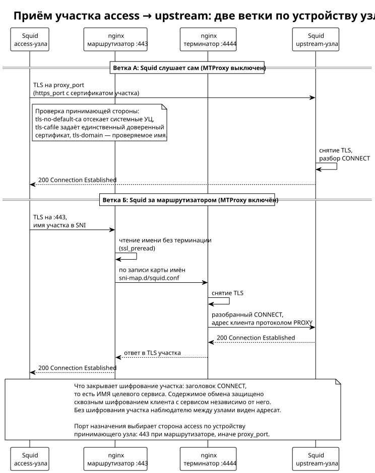

<!-- [AIGD] -->
<!-- [AITS] 2026-08-30T12:09:29Z -->
# C3-SU-001 -- Squid Upstream Proxy

**Последняя правка AI:** 2026-10-19

## Ссылки

- Реализация: шаблон `Servers/deploy/templates/squid-upstream.conf.j2` и задачи `Servers/deploy/playbook.yml`
- Родительские требования C2:
  - [C2-FR-001](../C2/C2-FR-001.md) -- Проксирование запросов к AI API
  - [C2-NF-001](../C2/C2-NF-001.md) -- Высокая доступность
  - [C2-NF-002](../C2/C2-NF-002.md) -- Безопасность
  - [C2-NF-003](../C2/C2-NF-003.md) -- Производительность
  - [C2-NF-004](../C2/C2-NF-004.md) -- Масштабируемость
- Архитектурные решения: [ADR-000001](../ADR/ADR-000001.md) — разделение уровней, [ADR-000002](../ADR/ADR-000002.md) — выбор прокси-движка, [ADR-000003](../ADR/ADR-000003.md) — публикация через маршрутизатор SNI
- Ограничение в области действия: [C2-CN-001](../C2/C2-CN-001.md) — двухуровневая архитектура проксирования
- Дочерние требования C4:
  - [C4-TM-006](../C4/C4-TM-006.md) -- Шаблон правил iptables для upstream
  - [C4-TM-002](../C4/C4-TM-002.md) -- Шаблон squid-upstream.conf.j2
  - [C4-TM-004](../C4/C4-TM-004.md) -- Шаблон nftables-upstream.conf.j2
  - [C4-PB-001](../C4/C4-PB-001.md) -- Playbook: секция Squid deployment

## Описание

Squid Upstream Proxy -- компонент upstream tier, развёрнутый на серверах вне Российской Федерации. Реализует анонимный транспортный уровень с минимальной конфигурацией. Ключевые принципы: отсутствие аутентификации, журналирования и кеширования; управление доступом исключительно по IP-адресам access-прокси.

### Основные характеристики

1. **Анонимный режим** -- подавление всех прокси-заголовков:
   - `forwarded_for off` -- не добавлять X-Forwarded-For
   - `via off` -- не добавлять Via
   - `request_header_access X-Forwarded-For deny all`
   - `request_header_access Via deny all`
   - `request_header_access X-Real-IP deny all`
   - `reply_header_access Via deny all`
   - `reply_header_access X-Cache deny all`

2. **IP ACL** -- доступ разрешён только с IP-адресов access-прокси. ACL `access_proxy src` формируется динамически из inventory (`groups['access_proxies']`). Весь остальной трафик блокируется (`http_access deny all`).

3. **Без аутентификации** -- upstream не проверяет учётные данные. Управление доступом полностью делегировано firewall (nftables/UFW/iptables) и ACL.

4. **Без журналирования** -- `access_log none`, `cache_log /dev/null`. Это минимизирует хранимую информацию на серверах вне юрисдикции организации.

5. **Без кеширования** -- `cache deny all`. Upstream работает как чистый транспорт.

6. **SMP workers** = количество ядер CPU (параллельная обработка).

7. **Динамическая память** -- `memory_pools_limit` = 50% предела памяти службы в бюджете узла ([ADR-000008](../ADR/ADR-000008.md)).

8. **DNS** -- локальный unbound (`dns_nameservers 127.0.0.1`), DNS v4 first, TTL 6 часов (positive) / 30 секунд (negative).

9. **Таймауты** -- `read_timeout` = 1 час (предел ПРОСТОЯ: таймер переармируется при каждой передаче, поэтому долгое обдумывание ответа его не исчерпывает), `client_lifetime` = 1 сутки (абсолютный предел жизни соединения, обязан быть строго больше предела простоя), `connect_timeout` = 15 секунд, `request_timeout` = 30 секунд.

## Интерфейсы

**Спецификации контрактов:**

- [C3-SU-001-API](../Interfaces/Integration/C3-SU-001-API.md) — участок access → upstream

| Интерфейс | Направление | Протокол / Формат | Описание |
|---|---|---|---|
| `proxy_port` | Входящий | HTTP CONNECT | Подключение от access-прокси. При `behind_nginx: true` порт слушает nginx и передаёт соединение локальному Squid по правилу умолчания SNI-карты |
| Прямое соединение с AI API | Исходящий | HTTPS (TLS) | Подключение к целевым AI-сервисам |
| `/etc/squid/squid.conf` | Конфигурация | Squid config (Jinja2 template) | Основная конфигурация -- `squid-upstream.conf.j2` |
| `/etc/nftables.conf` | Конфигурация | nftables (Jinja2 template) | Firewall -- `nftables-upstream.conf.j2` |

## Зависимости

| Зависимость | Тип | Описание |
|---|---|---|
| [C3-SA-001](C3-SA-001.md) (Squid Access Proxy) | Обязательная | Upstream принимает трафик только от access-прокси |
| unbound (localhost:53) | Системная | Локальный кеширующий DNS-резолвер |
| nftables / UFW / iptables | Системная | Firewall для ограничения доступа по IP |
| Пакет `squid` (версия из репозитория ОС: 5.7 на Debian 12, 6.14 на Ubuntu 24.04) | Системная | Устанавливается через apt/dnf; минимальная версия проверяется развёртыванием (`squid_min_version`, умолчание 5.7) |
| AI API (Claude, ChatGPT, Gemini, ...) | Внешняя | Целевые сервисы |

## Механизм реализации

### Механизм обработки запроса от access-прокси

1. Access-прокси отправляет CONNECT через cache_peer. При выключенном `squid_transit_tls` — открытым текстом на `proxy_port`; при включённом — внутри TLS, и заголовок CONNECT (то есть имя целевого сервиса) наблюдателю между узлами недоступен.
2. UFW проверяет IP-адрес источника -- только IP access-прокси допускаются.
3. Squid ACL (`access_proxy src`) верифицирует IP-адрес запроса.
4. Squid устанавливает прямое TCP-соединение с целевым AI API.
5. TLS-туннель проксируется прозрачно (end-to-end шифрование сохраняется).
6. Все прокси-заголовки удаляются -- целевой сервис не видит промежуточные hop.

### Механизм эшелонированной защиты (Defense-in-Depth)

Upstream защищён на нескольких уровнях:

1. **Firewall (L3/L4)** -- nftables (Debian) / UFW (Ubuntu) / iptables (RHEL):
   - Policy `drop` для входящего трафика.
   - Разрешён SSH (порт 22) и Squid-порт только с IP access-прокси.
   - ICMP echo-request разрешён для диагностики.
2. **Squid ACL (L7)** -- `http_access allow access_proxy` + `http_access deny all`.
3. **Отсутствие данных** -- нет логов, нет кеша, нет credentials. Компрометация сервера не раскрывает данные пользователей.

### Механизм выбора firewall

Ansible автоматически определяет стратегию firewall:

1. Проверяется наличие активного UFW (`ufw status | grep active`).
2. Если UFW активен -- используются правила UFW.
3. Если Debian и UFW не активен -- используется nftables (шаблон `nftables-upstream.conf.j2`).
4. Иначе (RHEL, CentOS, Ubuntu без UFW) -- используется iptables с собственной цепочкой `SQUID-PROXY`.

## Критерии приёмки

| # | Критерий | Метрика / Способ проверки | Целевое значение |
|---|----------|---------------------------|------------------|
| 1 | Доступ с access-прокси работает | curl через access-прокси -> upstream -> AI API | HTTP 200 |
| 2 | Доступ с неразрешённого IP заблокирован | Прямой curl к upstream с произвольного IP | Connection refused / timeout |
| 3 | Журналирование отключено | ls /var/log/squid/ -> пусто или access_log none | pass |
| 4 | Кеширование отключено | squid.conf содержит `cache deny all` | pass |
| 5 | Прокси-заголовки удалены | Проверка исходящего трафика на отсутствие Via, X-Forwarded-For | pass |
| 6 | SMP workers = CPU cores | squid -k parse -> workers | pass |
| 7 | Firewall развёрнут | nftables/ufw/iptables rules содержат разрешения только для access IP | pass |
| 8 | Предел простоя = 1 час, предел жизни соединения строго больше него | `grep -E '^(read_timeout\|client_lifetime)' /etc/squid/squid.conf` | `read_timeout 1 hour`, `client_lifetime 1 day` |
| 9 | Конфиг валиден | squid -k parse -f squid.conf -> exit code 0 | pass |

## Доказательство реализации

### Конструктивное

Механизм реализован через Jinja2-шаблон `squid-upstream.conf.j2` -- минимальная конфигурация без аутентификации, логирования и кеширования. Firewall настраивается параллельно через шаблон `nftables-upstream.conf.j2` (для Debian) или задачи UFW/iptables в playbook. IP-адреса access-прокси подставляются из inventory (`groups['access_proxies']`).

### Трассировочное

| C2 | C3 | C4 (дочерние) |
|---|---|---|
| [C2-FR-001](../C2/C2-FR-001.md) -- Проксирование | C3-SU-001: прямое соединение с AI API | [C4-TM-002](../C4/C4-TM-002.md) -- squid-upstream.conf.j2 |
| [C2-NF-001](../C2/C2-NF-001.md) -- HA | C3-SU-001: несколько upstream-нод в inventory | [C4-PB-001](../C4/C4-PB-001.md) -- параллельный deploy |
| [C2-NF-002](../C2/C2-NF-002.md) -- Безопасность | C3-SU-001: IP ACL + nftables + анонимизация + отсутствие данных | [C4-TM-002](../C4/C4-TM-002.md), [C4-TM-004](../C4/C4-TM-004.md) |
| [C2-NF-003](../C2/C2-NF-003.md) -- Производительность | C3-SU-001: SMP workers, persistent connections, pipelining | [C4-TM-002](../C4/C4-TM-002.md) |
| [C2-NF-004](../C2/C2-NF-004.md) -- Масштабируемость | C3-SU-001: предел памяти от бюджета узла, горизонтальное масштабирование | [C4-TM-002](../C4/C4-TM-002.md), [C4-PB-001](../C4/C4-PB-001.md) |

### Контрактное

- **Входной контракт:** CONNECT от access-прокси (cache_peer). Без шифрования участка — `http_port {{ proxy_port }}`; с шифрованием — `https_port` с сертификатом участка, и порт принимает ТОЛЬКО TLS (проверено на стенде: обращение открытым текстом отвергается). При `behind_nginx: true` соединение принимает nginx: маршрутизатор разбирает имя из SNI, локальный терминатор снимает TLS и передаёт поток Squid, восстанавливая адрес клиента протоколом PROXY. Без аутентификации -- доступ по IP.
- **Выходной контракт:** Прямое TCP/TLS соединение с целевым AI API. Прокси-заголовки отсутствуют.
- **Контракт firewall:** UFW -- default deny, allow SSH + Squid port 80 от IP access-прокси.

### Аналитическое

Минимальная конфигурация upstream обусловлена принципом наименьшего объёма данных на серверах вне юрисдикции организации. Отсутствие логов, кеша и credentials означает, что компрометация upstream-сервера не раскрывает информацию о пользователях или содержимом запросов. Эшелонированная защита (firewall + ACL) обеспечивает устойчивость к несанкционированному доступу.

### Эмпирическое

Верификация:
- Валидация конфигурации: `squid -k parse -f /etc/squid/squid.conf` (при deploy).
- Функциональная проверка: запрос через полную цепочку (клиент -> access -> upstream -> AI API).
- Проверка блокировки: прямое подключение к upstream с неразрешённого IP -> отказ.
- Проверка nftables: `nft list ruleset` -> правила соответствуют шаблону.

### Негативное

| Риск | Митигация |
|---|---|
| Прямой доступ к upstream минуя access | IP ACL в Squid + UFW firewall (default deny) |
| Утечка информации при компрометации upstream | Нет логов, нет кеша, нет credentials |
| DNS poisoning | Локальный unbound с множественными upstream (Quad9, Google, Cloudflare) |
| Долго отвечающий AI API обрывает соединение | Предел простоя (1 час) считает бездействие, а не общую длительность: пока сервис шлёт данные, таймер переармируется, и обращение живёт сколько угодно |
| Исчерпание ресурсов (DDoS) | memory_pools_limit, SYN flood защита (sysctl), лимиты FD |

## Покрытие объектов управления
| Тип объекта | Статус | Артефакт / Обоснование N/A |
|---|---|---|
| Компоненты / модули | Covered | Описание компонента выше: Squid Upstream Proxy |
| Интерфейсы (API Contracts) | Covered | Таблица интерфейсов; контрактное доказательство |
| Зависимости | Covered | Таблица зависимостей |
| Хранилища данных | N/A | Upstream не хранит данных (нет кеша, нет логов) -- принцип минимизации |
| ADR | N/A | Использование Squid -- общее решение с access tier |
| Паттерны и стили | Covered | Transparent proxy + defense-in-depth (firewall + ACL) + zero-data-at-rest |
| Матрица трассируемости | Covered | Трассировочное доказательство (C2 -> C3 -> C4) |
| Конфигурационные единицы | Covered | `squid-upstream.conf.j2`, `nftables-upstream.conf.j2`, inventory variables |
| Среды исполнения | Covered | Linux (Debian/Ubuntu/RHEL), systemd, Squid 5.7–6.14 из репозитория дистрибутива |
| Интерфейс командной строки (CLI) | N/A | Управление через конфигурационный файл и systemd |
| Контракт наблюдаемости | Covered | Журналирование намеренно отключено; диагностика -- через `squidclient mgr:info` и systemd status |

## Статус соответствия

| Дата | Уровень | Обоснование | Корректирующее действие |
|------|---------|-------------|-------------------------|
| 2026-02-23 | 4 -- Conformant | Реализовано в коде, все типы доказательств представлены | -- |

## Статус доказательства: verified

| Дата | Из статуса | В статус | Причина |
|------|------------|----------|---------|
| 2026-02-23 | absent | verified | Актуализация из кода |
<!-- [/AIGD] -->
