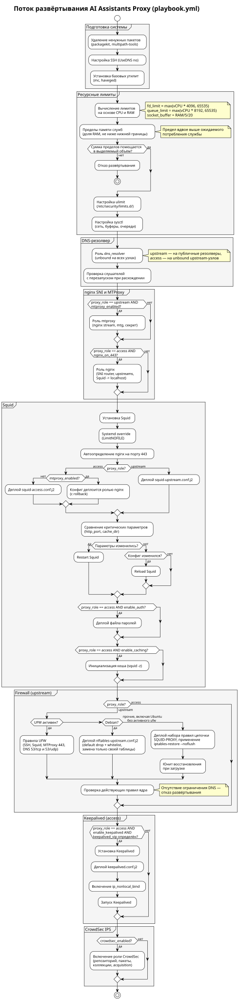

<!-- [AIGD] -->
<!-- [AITS] 2026-08-30T12:09:29Z -->
# C4-PB-001 -- Главный плейбук (playbook.yml)

**Последняя правка AI:** 2026-10-19

## Ссылки

- Родительские требования C3: [C3-AD-001](../C3/C3-AD-001.md) — оркестрация; компоненты, реализуемые задачами плейбука напрямую: [C3-SA-001](../C3/C3-SA-001.md), [C3-SU-001](../C3/C3-SU-001.md), [C3-KA-001](../C3/C3-KA-001.md)
- Связанные C4: [C4-PB-002](C4-PB-002.md) (инвентори), [C4-TM-001](C4-TM-001.md), [C4-TM-002](C4-TM-002.md), [C4-TM-003](C4-TM-003.md), [C4-TM-004](C4-TM-004.md), [C4-TM-005](C4-TM-005.md), [C4-TM-006](C4-TM-006.md), [C4-RL-001](C4-RL-001.md), [C4-RL-002](C4-RL-002.md), [C4-RL-003](C4-RL-003.md), [C4-RL-004](C4-RL-004.md)
- Компоненты в области развёртывания через вызов ролей (охват, а не родительство — такой компонент называет своим артефактом роль): [C3-NX-001](../C3/C3-NX-001.md), [C3-CS-001](../C3/C3-CS-001.md), [C3-MT-001](../C3/C3-MT-001.md), [C3-DN-001](../C3/C3-DN-001.md)

## Описание

Файл `Servers/deploy/playbook.yml` (~1635 строк) -- главный Ansible playbook, оркестрирующий полное развёртывание инфраструктуры AI Assistants Proxy. Применяется ко всем хостам (`hosts: all`) с повышением привилегий (`become: true`). Логика ветвления определяется переменной `proxy_role` (access/upstream) и набором feature-флагов из инвентори.

Запуск: `ansible-playbook -i inventory.yml playbook.yml`

## Структура файла

Плейбук организован в последовательные фазы развёртывания:

| Фаза | Артефакт / описание |
| --- | --- |
| TLS-участок | Умолчания false / `transit.internal`; явное включение требует OpenSSL (Debian/Ubuntu: `squid-openssl`), проверка имени до выпуска сертификата; CA раздаётся до ролей, проверяющих конфигурацию Squid |
| Пул Squid | `squid_upstream_hosts`: по умолчанию вся группа upstreams; явный список проверяется до изменения служб |
| Общий секрет MTProxy | `tasks/mtproxy-cluster.yml`: проверка до изменения узлов, переиспользование либо однократная генерация |
| Ресурсный preflight | Актуальные facts, cgroup v2, соседние проекты, `filter_plugins/resources.py` |
| Бюджет и ограничения | План памяти, `aiproxy.slice`, пределы systemd и ограничения числа соединений |
| Подготовка узла | Пакеты, sysctl, каталоги и системные службы |
| DNS | Роль `dns_resolver`, единый список разрешённых клиентов |
| nginx / MTProxy | Условные роли перед применением Squid, освобождение нужных портов |
| Squid | Проверка конфигурации, пароли, кеш, выбор reload/restart |
| Межсетевой экран | UFW / nftables / iptables и проверка действующих правил; интеграция портов Matrix |
| Дополнительные службы | Keepalived по флагу, CrowdSec и bouncer |
| Обработчики | Русские имена задач и обработчиков; проверка связи `notify` при локальных проверках |

Номера строк фаз не фиксируются: основная логика вынесена также в `tasks/`, роли
и фильтры. Источник фактического порядка — `Servers/deploy/playbook.yml`.

## Ключевые механизмы

### Динамическое вычисление ресурсных лимитов

Лимиты адаптируются к аппаратным характеристикам каждого хоста:

- **CPU-зависимые**: `fd_limit` = max(vcpus * 4096, 65535), `queue_limit` = max(vcpus * 8192, 65535), `tw_buckets` = vcpus * 32768
- **RAM-зависимые**: `socket_buffer_bytes` = (RAM / 5 / 20) * 1024 * 1024

### Бюджет памяти узла

Исходное решение — [ADR-000008](../ADR/ADR-000008.md); действующий алгоритм
реализован в `filter_plugins/resources.py`:

1. Целевой бюджет — треть RAM; если сумма минимумов включённых служб и явных
   переопределений больше, бюджет повышается до этой суммы.
2. Жёсткий потолок — 1 000 000 000 байт. Явный `proxy_memory_budget_mb` может
   установить меньший потолок. Резервы ОС и соседних проектов остаются обязательными.
3. Минимумы служб не уменьшаются. Явные пределы фиксируются; остаток распределяется
   только между автоматически рассчитываемыми службами. Неразмещаемый план останавливает deploy.

Жёсткие пределы служб и общего `aiproxy.slice`, запрет swap для этого набора,
внутренние кеши, workers, лимиты FD и сессий согласованы с планом. Пределы служб —
не измеренное фактическое потребление; nginx может обслуживать соседние проекты,
что требует корректного резерва. Проверка под рабочей нагрузкой остаётся отдельной
эксплуатационной задачей — [Ideas.md](../Ideas.md), GAP-056.

### Умный reload vs restart Squid

Критические параметры (http_port, cache_dir) сохраняются до и после деплоя конфигурации. Если они изменились -- выполняется restart; если нет -- достаточно reload. Это минимизирует downtime при рутинных обновлениях ACL, таймаутов и заголовков.

### Условная логика по proxy_role

Плейбук использует единый play для обоих типов узлов. Условия `when: proxy_role == 'access'` / `when: proxy_role == 'upstream'` разделяют логику:

- **access**: Squid с аутентификацией, upstream peers, Keepalived, nginx SNI, без firewall
- **upstream**: Squid без аутентификации, firewall, MTProxy, без Keepalived

### Multi-OS firewall

Три стратегии настройки межсетевого экрана для upstream-узлов, условия взаимно исключающие:

1. **UFW** -- если ufw активен (`ufw status` = active)
2. **nftables** -- Debian с неактивным ufw (шаблон [C4-TM-004](C4-TM-004.md))
3. **iptables с кастомной цепочкой `SQUID-PROXY`** -- прочие дистрибутивы с неактивным ufw: RHEL/CentOS и **Ubuntu после чистой установки** (ufw установлен, но не активирован); набор правил -- шаблон [C4-TM-006](C4-TM-006.md)

Каждая ветка закрывает один и тот же набор портов upstream-узла: Squid (`squid_port`), MTProxy 443 (условно) и **DNS 53/tcp+udp**. Во всех трёх возврат loopback стоит выше запретов, иначе запрет порта 53 разорвал бы локальный резолвинг Squid через `127.0.0.1:53`.

Обе шаблонные ветки применяются **одной транзакцией и только к своим объектам**: nftables — заменой зарезервированных цепочек и набора в общей `inet filter` без удаления таблицы, iptables -- через `iptables-restore --noflush` с объявлением единственной цепочки. Отсюда два следствия, важных для co-deployment (Matrix и другие проекты на тех же узлах): промежуточного состояния с открытым портом при обновлении правил не возникает, а чужие таблицы, цепочки и правила встроенных цепочек не затрагиваются. По той же причине пакеты полного восстановления ruleset (`iptables-persistent`, `iptables-services`) не используются -- вместо них юнит `aiproxy-firewall.service` воспроизводит при загрузке только собственную цепочку и собственный переход из INPUT.

### Единый список клиентов DNS

Переменная уровня play `dns_allowed_clients` вычисляется один раз:

```yaml
dns_allowed_clients: >-
  {{ (groups['access_proxies'] | default([]) | map('extract', hostvars, 'ansible_host') | list
      + (dns_extra_clients | default([]))) | unique | list }}
```

Её потребляют все четыре точки ограничения: UFW-, nftables- и iptables-ветки плюс `access-control` в `unbound.conf` ([C4-RL-004](C4-RL-004.md)). Дублирование списка по бэкендам было бы источником расхождения: правило, добавленное в одну ветку, молча отсутствовало бы в остальных.

### Проверка результата вместо проверки намерения

Фаза `Firewall verification` читает **действующие правила ядра** (`nft list table inet filter`, `ufw status verbose`, `iptables -S`) и требует, чтобы в них присутствовали и правила для порта 53, и каждый IP из `dns_allowed_clients`. Без этого «правило записано в шаблон» неотличимо от «правило применено на узле». Перед проверкой выполняется `meta: flush_handlers` (только для upstream) -- иначе при изменении конфигурации сверялась бы прежняя загрузка nftables. Отсутствие ограничения -- отказ развёртывания, а не предупреждение.

Проверка выполняется **только на upstream-узлах**, и причина не в различии требований,
а в очерёдности: перед сверкой отложенные обработчики принудительно исполняются, чтобы
изменение конфигурации экрана успело примениться. На access-узлах в очереди может стоять
перезагрузка Squid, а сам Squid там настраивается позже по ходу плейбука — принудительное
исполнение обработчиков сорвало бы его настройку.

### Автоопределение nginx

Скрипт проверяет наличие активного nginx с виртуалхостом на порту 443. Результат определяет, слушает ли Squid на порту напрямую или на localhost:3128 за nginx. Ручное переопределение: `behind_nginx=true/false` в инвентори.

### Миграционные задачи и их бессрочность

Двенадцать задач приводят узел из прежнего устройства в нынешнее: снимают старые правила
экрана, удаляют конфигурации, оставшиеся от иной раскладки, обновляют общий маршрутизатор.
Они рассеяны по плейбуку и трём ролям, и в выводе развёртывания видны наравне
с настраивающими.

| Что приводится в порядок | Где |
|---|---|
| Правила экрана и конфигурации Squid прежней раскладки | Плейбук |
| Файл источников обнаружения, писавшийся прежде этой ролью | Роль обнаружения |
| Маркер блока потоков, старый монолитный конфиг, общий маршрутизатор | Роли маршрутизатора и MTProxy |
| Конфигурации access-раскладки, попавшие на upstream-узел | Роль MTProxy |
| Терминация Squid и её запись в карте имён | Роль MTProxy |

**Срока жизни у них нет.** На узле, развёрнутом начисто, каждая ничего не находит
и завершается без изменений — но выполняется всё равно, при каждом прогоне. Отличить
по выводу «миграция сработала» от «мигрировать было нечего» можно лишь по признаку
изменения у задачи.

Безусловное обновление общего маршрутизатора — не побочный эффект, а заданное
поведение ведущего проекта узла: его редакция единственная действующая, и «первый
развернувший побеждает» к ней не относится (правило владельца 2026-08-30,
[C3-NX-001](../C3/C3-NX-001.md)).

### Что задаётся, что вычисляется, что осматривается

Поведение развёртывания определяют три разных источника, и смешивать их не следует:

| Источник | Примеры | Где смотреть значение |
|---|---|---|
| Задаётся оператором | Проверка подлинности, журналирование, кеширование, обнаружение, MTProxy, переключение адреса | Инвентори — значение там и есть действующее |
| Вычисляется из других признаков и осмотра | Работа за маршрутизатором: `behind_nginx` переопределяет вручную, иначе значение выводится из включённости MTProxy и наличия действующего маршрутизатора на узле | В инвентори лишь переопределение; действующее значение известно после осмотра |
| Осмотр узла | Действующий межсетевой экран, наличие маршрутизатора на порту 443, прежний файл источников обнаружения, принадлежность общего маршрутизатора соседу, состояние ключа доверия резолвера, наличие локального файла паролей | В инвентори не значится вовсе |

Практическое следствие: у признака второго и третьего рода значение в инвентори либо
неполно, либо отсутствует, и вопрос «включено ли» решается только на узле. Вчерашняя
сводка состояния мер ([CC-Risks.md](../CC/CC-Risks.md)) приводит значения задаваемых
признаков — для них она достаточна.

Осмотры узла — не второстепенная деталь: именно они выбирают средство фильтрации
и решают, слушает ли Squid петлевой адрес или внешний порт. Ошибка осмотра меняет
устройство узла целиком, поэтому две проверки из шести останавливают развёртывание,
а не подстраиваются молча.

### Порядок настройки служб и его причина

Маршрутизатор потоков и MTProxy настраиваются **раньше** Squid, и порядок этот не
произволен: они занимают внешний порт узла и тем определяют, на каком адресе Squid должен
слушать.

| Состояние узла | Где слушает Squid |
|---|---|
| Маршрутизатор занял внешний порт | Петлевой адрес, обращения приходят от маршрутизатора |
| Маршрутизатора нет | Внешний порт из инвентори, обращения приходят напрямую |

Отсюда связь с выборочным развёртыванием: тег маршрутизатора существует, а у Squid тега
нет, и прогон с одним лишь тегом маршрутизатора настроит вход, не тронув Squid. Адрес
прослушивания останется прежним, и обращения, пришедшие на маршрутизатор, упрутся
в службу, которая их не ждёт.

### Выборочное развёртывание по тегам

Части плейбука помечены тегами, поэтому прогон можно ограничить одной подсистемой:

| Тег | Что разворачивает |
|---|---|
| `nginx` | Маршрутизатор потоков и файлы проекта в общем каталоге |
| `mtproxy` | MTProxy и его терминацию |
| `dns` | Резолвер и правила экрана для него |
| `firewall` | Правила межсетевого экрана |
| `crowdsec`, `security` | Обнаружение вторжений и применитель решений |

Squid и общая настройка узла тегов не имеют и выполняются при всяком прогоне без
ограничения по тегам.

**Частичный прогон способен оставить механизмы несогласованными.** Источник журналов для обнаружения вторжений порождается только при `proxy_role: access` и `enable_logging: true`, а роль обнаружения помечена собственным тегом — тогда как задачи настройки Squid тегов не имеют вовсе. Отсюда два несимметричных случая:

| Способ прогона | Что настроится | Итог |
|---|---|---|
| Без указания тегов | Всё, включая обнаружение | Согласовано |
| С исключением роли обнаружения | Squid настроится, источник — нет | Журнал ведётся, обнаружение по обращениям не работает; внешних признаков нет |
| Только с тегом обнаружения | Источник появится, Squid не тронут | Источник указывает на журнал, которого может не быть |


Правило: изменение признака, от которого зависит содержимое чужой подсистемы, требует
полного прогона либо прогона обеих подсистем.

## Переменные

| Переменная | Тип | Значение по умолчанию | Описание |
|---|---|---|---|
| `proxy_role` | string | -- (обязательная) | Роль узла: `access` или `upstream` |
| `squid_port` | int | -- (обязательная) | Порт Squid (access: 443, upstream: 80) |
| `enable_auth` | bool | -- | Включение аутентификации (access) |
| `enable_logging` | bool | `true` | Включение журналирования |
| `enable_caching` | bool | -- | Включение кеширования (access) |
| `behind_nginx` | bool | auto-detect | Squid за nginx |
| `squid_local_port` | int | `3128` | Локальный порт Squid за nginx |
| `read_timeout` | string | `1 hour` | Предел ПРОСТОЯ туннеля: таймер переармируется при каждой передаче данных, поэтому долгий ответ его не исчерпывает |
| `dns_servers` | list | -- | DNS-серверы |
| `allowed_domains` | list | `[]` | Явный whitelist доменов |
| `allowed_domain_patterns` | list | `[]` | Regex-паттерны доменов |
| `enable_keepalived` | bool | `true` | Включение VRRP |
| `keepalived_vip` | string | -- (условная) | Виртуальный IP-адрес |
| `crowdsec_enabled` | bool | `true` | Включение CrowdSec IPS |
| `mtproxy_enabled` | bool | `true` | Включение MTProxy |

## Критерии приёмки

| # | Критерий | Метрика / Способ проверки | Целевое значение |
|---|----------|---------------------------|------------------|
| 1 | Синтаксическая корректность | `ansible-playbook --syntax-check playbook.yml` | exit code 0 |
| 2 | Идемпотентность | Повторный запуск playbook | changed=0 на стабильной системе |
| 3 | Squid запущен после деплоя | `systemctl is-active squid` | active |
| 4 | Sysctl-параметры применены | `sysctl net.ipv4.tcp_slow_start_after_idle` | 0 |
| 5 | Предел дескрипторов установлен | `cat /proc/$(systemctl show -p MainPID --value squid)/limits` \| grep 'Max open files' | >= 65535. Подстановка берёт главный процесс службы: `pidof` в многопроцессном режиме возвращает несколько значений, и путь выходит неверным |
| 6 | Firewall настроен (upstream) | `nft list ruleset` / `ufw status` / `iptables -L` | Squid доступен только от access-прокси |
| 7 | Ролевые включения условны | Проверка `when` на каждом `include_role` | Роли включаются только при соответствующих флагах |

## Доказательство реализации

### Конструктивное

Плейбук реализует полный цикл развёртывания: от системного тюнинга до запуска сервисов. Каждая фаза изолирована и условна. Механизм умного reload/restart предотвращает ненужные перезапуски: критические параметры (http_port, cache_dir) сравниваются до и после деплоя конфигурации, restart выполняется только при их изменении.

Диаграмма потока развёртывания:



> Исходник: [diagrams/C4-PB-001-deployment-flow.puml](diagrams/C4-PB-001-deployment-flow.puml)

### Трассировочное

| C3 | C4 |
|---|---|
| [C3-AD-001](../C3/C3-AD-001.md) | C4-PB-001 -- оркестрация развёртывания |

### Эмпирическое

- Проверка синтаксиса: `ansible-playbook --syntax-check -i inventory.yml playbook.yml`
- Dry run: `ansible-playbook --check -i inventory.yml playbook.yml`
- Проверка идемпотентности: повторный запуск на уже сконфигурированном хосте

### Негативное

- **Отказ upstream** -- restart Squid только при реальном изменении критических параметров, минимизация downtime
- **Несовместимость OS** -- условная логика по `ansible_os_family` / `ansible_distribution` для пакетов и firewall
- **Отсутствие nginx** -- автоопределение nginx на 443, fallback на прямой порт
- **Co-deployment конфликт** -- модульная архитектура nginx/nftables для сосуществования с другими проектами

## Покрытие объектов управления
| Тип объекта | Статус | Артефакт / Обоснование N/A |
|---|---|---|
| Классы / модули | Covered | Ansible playbook как модуль оркестрации, включение ролей crowdsec/nginx/mtproxy |
| Функции / методы | Covered | Ansible tasks (40+ задач), handlers (4 handler) |
| Code Interfaces | Covered | Входной интерфейс: переменные из inventory; выходной: сконфигурированные сервисы |
| Physical Data Model | Covered | Структуры конфигурационных файлов: squid.conf, sysctl.d, limits.d, systemd overrides |
| Тесты | Covered | `--syntax-check`, `--check` (dry run), `validate:` на шаблонах, `squid -k parse` |
| Build & Deploy Configs | Covered | Сам плейбук является конфигурацией развёртывания |
| Зависимости кода | Covered | Ansible collections: `ansible.builtin`, `ansible.posix`, `community.general` |
| Метрики кода | Covered | 936 строк, 86 задач, 5 обработчиков, 4 включения ролей |
| Документация кода | Covered | Комментарии в YAML, описательные имена задач |

## Статус соответствия

| Дата | Уровень | Обоснование | Корректирующее действие |
|------|---------|-------------|-------------------------|
| 2026-02-23 | 4 -- Conformant | Артефакт существует в кодовой базе, все механизмы реализованы | -- |

## Статус доказательства: verified

| Дата | Из статуса | В статус | Причина |
|------|------------|----------|---------|
| 2026-02-23 | absent | verified | Актуализация из кода |
<!-- [/AIGD] -->
