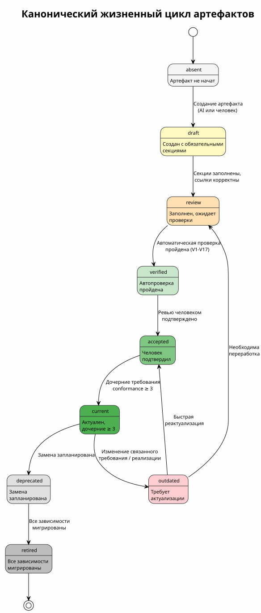

<!-- [AIGD] -->
# CC-Lifecycle — Жизненный цикл артефактов

**Последняя правка AI:** 2026-08-29T02:40:00Z

Реестр порождается сценарием `Servers/audit/gen_lifecycle.py` по фактическому составу
корпуса; правки вручную будут потеряны при следующем запуске. Статус выводится
из наблюдаемого признака: карточка с отметкой последней правки AI сверена
с источником истины и получает `verified`, прочие — `review`.

## Канонический жизненный цикл

> Исходник: [diagrams/CC-artifact-lifecycle.puml](diagrams/CC-artifact-lifecycle.puml)

Диаграмма состояний отражает все переходы жизненного цикла артефактов документации
(требования C1–C4, решения, TD, DD, CC, спецификации интерфейсов) и доказательств.

## Реестр статусов артефактов

### Реестры слоёв

| Артефакт | Тип | Статус | Дата | Зависимости |
|---|---|---|---|---|
| [AAD](../AAD.md) | Реестр слоя | verified | 2026-08-29 | -- |
| [ADL-archive](../ADL-archive.md) | Реестр слоя | verified | 2026-08-29 | -- |
| [ADL](../ADL.md) | Реестр слоя | verified | 2026-08-29 | ADR-000001, ADR-000002, ADR-000003, ADR-000004, ADR-000005, ADR-000006, ADR-000007, ADR-000008 |
| [ARR](../ARR.md) | Реестр слоя | verified | 2026-08-29 | ADR-000001, C2-CN-001, ADR-000003, C2-CN-002, C4-PB-002, C2-NF-002, C4-TM-001, C2-FR-001 |
| [C1-BR](../C1-BR.md) | Реестр слоя | verified | 2026-08-29 | C1-BC-001, C1-BC-002, C1-BC-003, C1-BC-004 |
| [C2-PR](../C2-PR.md) | Реестр слоя | verified | 2026-10-18 | C2-FR-001, C1-BC-001, C1-BC-003, C2-FR-002, C1-BC-002, C2-FR-003, C2-FR-004, C2-FR-005 |
| [C3-CR](../C3-CR.md) | Реестр слоя | verified | 2026-08-29 | C3-SA-001, C2-FR-001, C2-FR-002, C2-FR-003, C2-FR-004, C2-FR-005, C2-NF-001, C2-NF-003 |
| [C4-SR](../C4-SR.md) | Реестр слоя | verified | 2026-08-29 | C4-PB-001, C3-AD-001, C4-PB-002, C4-TM-001, C3-SA-001, C4-TM-002, C3-SU-001, C4-TM-003 |
| [DD](../DD.md) | Реестр слоя | verified | 2026-08-29 | -- |
| [TD](../TD.md) | Реестр слоя | verified | 2026-08-29 | C1-BC-002 |

### C1 — Бизнес-контекст

| Артефакт | Тип | Статус | Дата | Зависимости |
|---|---|---|---|---|
| [C1-BC-001](../C1/C1-BC-001.md) | Детальный C1 | verified | 2026-08-29 | C1-BC-002, C1-BC-003, C1-BC-004, C2-FR-001, C2-FR-002, C2-FR-003, C2-FR-004, C2-FR-005 |
| [C1-BC-002](../C1/C1-BC-002.md) | Детальный C1 | verified | 2026-08-29 | C1-BC-001, C2-FR-002, C2-FR-007, C2-FR-008, C2-FR-005 |
| [C1-BC-003](../C1/C1-BC-003.md) | Детальный C1 | verified | 2026-08-29 | C1-BC-001, C2-FR-001, C2-FR-003, C2-FR-006, C2-NF-002 |
| [C1-BC-004](../C1/C1-BC-004.md) | Детальный C1 | verified | 2026-08-29 | C1-BC-001, C2-NF-001, C2-NF-002, C2-NF-003, C2-NF-004, C2-NF-005, C2-FR-005, C2-FR-008 |

### C2 — Требования к продукту

| Артефакт | Тип | Статус | Дата | Зависимости |
|---|---|---|---|---|
| [C2-CN-001](../C2/C2-CN-001.md) | Детальный C2 | verified | 2026-08-29 | C1-BC-001, C3-SA-001, C3-SU-001, C3-KA-001, C3-CS-001, C3-NX-001, C3-MT-001, C3-AD-001 |
| [C2-CN-002](../C2/C2-CN-002.md) | Детальный C2 | verified | 2026-08-29 | C1-BC-001, C3-NX-001, C3-CS-001 |
| [C2-FR-001](../C2/C2-FR-001.md) | Детальный C2 | verified | 2026-08-29 | C1-BC-001, C1-BC-003, C3-SA-001, C3-SU-001 |
| [C2-FR-002](../C2/C2-FR-002.md) | Детальный C2 | verified | 2026-08-29 | C1-BC-002, C2-FR-001, C3-SA-001 |
| [C2-FR-003](../C2/C2-FR-003.md) | Детальный C2 | verified | 2026-08-29 | C1-BC-003, C3-SA-001 |
| [C2-FR-004](../C2/C2-FR-004.md) | Детальный C2 | verified | 2026-08-29 | C1-BC-001, C3-SA-001 |
| [C2-FR-005](../C2/C2-FR-005.md) | Детальный C2 | verified | 2026-08-29 | C1-BC-002, C1-BC-004, C3-SA-001, C3-CS-001 |
| [C2-FR-006](../C2/C2-FR-006.md) | Детальный C2 | verified | 2026-08-29 | C1-BC-001, C1-BC-003, C3-MT-001, C3-NX-001 |
| [C2-FR-007](../C2/C2-FR-007.md) | Детальный C2 | verified | 2026-10-18 | C1-BC-002, C3-AD-001 |
| [C2-FR-008](../C2/C2-FR-008.md) | Детальный C2 | verified | 2026-08-29 | C1-BC-004, C1-BC-002, C3-AD-001 |
| [C2-META](../C2/C2-META.md) | Детальный C2 | verified | 2026-08-29 | C2-FR-001, C2-FR-002, C2-FR-003, C2-FR-004, C2-FR-005, C2-FR-006, C2-FR-007, C2-FR-008 |
| [C2-NF-001](../C2/C2-NF-001.md) | Детальный C2 | verified | 2026-08-29 | C1-BC-004, C3-KA-001, C3-SA-001, C3-SU-001, C3-DN-001, ADR-000006 |
| [C2-NF-002](../C2/C2-NF-002.md) | Детальный C2 | verified | 2026-08-29 | C1-BC-004, C1-BC-003, C3-CS-001, C3-SU-001, ADR-000004, ADR-000001, ADR-000009 |
| [C2-NF-003](../C2/C2-NF-003.md) | Детальный C2 | verified | 2026-08-29 | C1-BC-004, C3-SA-001, C3-SU-001, C3-DN-001, ADR-000002, ADR-000008, ADR-000009 |
| [C2-NF-004](../C2/C2-NF-004.md) | Детальный C2 | verified | 2026-08-29 | C1-BC-004, C3-SA-001, C3-SU-001, C3-AD-001, ADR-000001, ADR-000008 |
| [C2-NF-005](../C2/C2-NF-005.md) | Детальный C2 | verified | 2026-08-29 | C1-BC-004, C3-SA-001, C3-CS-001, C3-KA-001 |

### C3 — Компонентный контекст

| Артефакт | Тип | Статус | Дата | Зависимости |
|---|---|---|---|---|
| [C3-AD-001](../C3/C3-AD-001.md) | Детальный C3 | verified | 2026-10-18 | C2-FR-007, C2-FR-008, C2-NF-004, ADR-000007, C2-CN-001, C4-PB-001, C4-PB-002 |
| [C3-CS-001](../C3/C3-CS-001.md) | Детальный C3 | verified | 2026-08-29 | C2-FR-005, C2-NF-002, C2-CN-002, C2-NF-005, ADR-000004, C2-CN-001, C4-RL-001 |
| [C3-DN-001](../C3/C3-DN-001.md) | Детальный C3 | verified | 2026-08-29 | C2-NF-003, C2-NF-001, C2-CN-001, C4-RL-004, ADR-000009 |
| [C3-KA-001](../C3/C3-KA-001.md) | Детальный C3 | verified | 2026-08-29 | C2-NF-001, C2-NF-005, ADR-000006, C2-CN-001, C4-TM-003, C4-TM-005, C4-PB-001 |
| [C3-MT-001](../C3/C3-MT-001.md) | Детальный C3 | verified | 2026-08-29 | C2-FR-006, ADR-000005, C2-CN-001, C4-RL-003 |
| [C3-NX-001](../C3/C3-NX-001.md) | Детальный C3 | verified | 2026-08-29 | C2-FR-006, C2-CN-002, ADR-000003, C2-CN-001, C4-RL-002 |
| [C3-SA-001](../C3/C3-SA-001.md) | Детальный C3 | verified | 2026-08-29 | C2-FR-001, C2-FR-002, C2-FR-003, C2-FR-004, C2-FR-005, C2-NF-001, C2-NF-003, C2-NF-004 |
| [C3-SU-001](../C3/C3-SU-001.md) | Детальный C3 | verified | 2026-08-29 | C2-FR-001, C2-NF-001, C2-NF-002, C2-NF-003, C2-NF-004, ADR-000001, ADR-000002, ADR-000003 |

### C4 — Уровень кода

| Артефакт | Тип | Статус | Дата | Зависимости |
|---|---|---|---|---|
| [C4-PB-001](../C4/C4-PB-001.md) | Детальный C4 | verified | 2026-10-18 | C3-AD-001, C3-SA-001, C3-SU-001, C3-KA-001, C4-PB-002, C4-TM-001, C4-TM-002, C4-TM-003 |
| [C4-PB-002](../C4/C4-PB-002.md) | Детальный C4 | verified | 2026-08-29 | C3-AD-001, C4-PB-001 |
| [C4-RL-001](../C4/C4-RL-001.md) | Детальный C4 | verified | 2026-08-29 | C3-CS-001, C4-PB-001 |
| [C4-RL-002](../C4/C4-RL-002.md) | Детальный C4 | verified | 2026-08-29 | C3-NX-001, C4-PB-001, C4-TM-001, C4-RL-003 |
| [C4-RL-003](../C4/C4-RL-003.md) | Детальный C4 | verified | 2026-08-29 | C3-MT-001, C4-PB-001, C4-RL-002 |
| [C4-RL-004](../C4/C4-RL-004.md) | Детальный C4 | verified | 2026-08-29 | C3-DN-001, ADR-000009 |
| [C4-TM-001](../C4/C4-TM-001.md) | Детальный C4 | verified | 2026-08-29 | C3-SA-001, C4-PB-001, C4-PB-002, C4-TM-002 |
| [C4-TM-002](../C4/C4-TM-002.md) | Детальный C4 | verified | 2026-08-29 | C3-SU-001, C4-PB-001, C4-TM-001, C4-TM-004 |
| [C4-TM-003](../C4/C4-TM-003.md) | Детальный C4 | verified | 2026-08-29 | C3-KA-001, C4-PB-001, C4-PB-002 |
| [C4-TM-004](../C4/C4-TM-004.md) | Детальный C4 | verified | 2026-10-18 | C3-SU-001, C4-PB-001, C4-TM-002 |
| [C4-TM-005](../C4/C4-TM-005.md) | Детальный C4 | verified | 2026-08-29 | C3-KA-001, C4-PB-001, C4-TM-003, C4-TM-001 |
| [C4-TM-006](../C4/C4-TM-006.md) | Детальный C4 | verified | 2026-08-29 | C3-SU-001, C4-PB-001, C4-TM-004, C4-TM-002, C4-RL-004 |

### ADR — Архитектурные решения

| Артефакт | Тип | Статус | Дата | Зависимости |
|---|---|---|---|---|
| [ADR-000001](../ADR/ADR-000001.md) | Архитектурное решение | verified | 2026-08-29 | C2-CN-001, C2-NF-002, C3-SA-001, C3-SU-001, ADR-000009, ADR-000005, C1-BC-001, C1-BC-004 |
| [ADR-000002](../ADR/ADR-000002.md) | Архитектурное решение | verified | 2026-08-29 | C2-FR-001, C2-NF-003, C4-TM-001, C4-TM-002, C3-SA-001, C3-SU-001, ADR-000001, ADR-000003 |
| [ADR-000003](../ADR/ADR-000003.md) | Архитектурное решение | verified | 2026-10-18 | C2-CN-002, C2-FR-006, C4-RL-002, C4-RL-003, C3-NX-001, C1-BC-001 |
| [ADR-000004](../ADR/ADR-000004.md) | Архитектурное решение | verified | 2026-08-29 | C2-NF-002, C2-FR-005, C4-RL-001, DE-BD-001, C3-CS-001, C1-BC-004, C2-NF-005 |
| [ADR-000005](../ADR/ADR-000005.md) | Архитектурное решение | verified | 2026-08-29 | C2-FR-006, C4-RL-003, C3-MT-001, ADR-000003, C1-BC-001, C1-BC-003, C2-NF-002 |
| [ADR-000006](../ADR/ADR-000006.md) | Архитектурное решение | verified | 2026-08-29 | C2-NF-001, C4-TM-003, C4-TM-005, C3-KA-001, ADR-000001, C1-BC-004, C2-NF-005 |
| [ADR-000007](../ADR/ADR-000007.md) | Архитектурное решение | verified | 2026-08-29 | C2-FR-008, C2-NF-004, C4-PB-001, C4-PB-002, C3-AD-001, ADR-000001, C1-BC-004, ADR-000008 |
| [ADR-000008](../ADR/ADR-000008.md) | Архитектурное решение | verified | 2026-08-29 | C2-NF-003, C2-NF-004, C4-PB-001, C4-TM-001, C4-TM-002, C4-RL-004, C4-RL-001, ADR-000004 |
| [ADR-000009](../ADR/ADR-000009.md) | Архитектурное решение | verified | 2026-08-29 | C2-NF-002, C2-NF-003, C3-DN-001, C4-RL-004, C4-TM-004, C4-TM-006, ADR-000008 |

### TD — Техническая документация

| Артефакт | Тип | Статус | Дата | Зависимости |
|---|---|---|---|---|
| [TD-Events](../TD/TD-Events.md) | Представление TD | verified | 2026-08-29 | -- |
| [TD-FA](../TD/TD-FA.md) | Представление TD | verified | 2026-08-29 | -- |
| [TD-Logs](../TD/TD-Logs.md) | Представление TD | verified | 2026-08-29 | -- |
| [TD-Matrices](../TD/TD-Matrices.md) | Представление TD | verified | 2026-08-29 | -- |
| [TD-Metrics](../TD/TD-Metrics.md) | Представление TD | verified | 2026-08-29 | -- |
| [TD-Shared](../TD/TD-Shared.md) | Представление TD | verified | 2026-08-29 | -- |
| [TD-TA](../TD/TD-TA.md) | Представление TD | verified | 2026-08-29 | -- |
| [TD-VP](../TD/TD-VP.md) | Представление TD | verified | 2026-08-29 | -- |

### DD — Архитектура данных

| Артефакт | Тип | Статус | Дата | Зависимости |
|---|---|---|---|---|
| [DD-CDM](../DD/DD-CDM.md) | Модель DD | verified | 2026-08-29 | -- |
| [DD-Catalog](../DD/DD-Catalog.md) | Модель DD | verified | 2026-08-29 | -- |
| [DD-Glossary](../DD/DD-Glossary.md) | Модель DD | verified | 2026-08-29 | -- |
| [DD-Governance](../DD/DD-Governance.md) | Модель DD | verified | 2026-10-18 | -- |
| [DD-Integration](../DD/DD-Integration.md) | Модель DD | verified | 2026-08-29 | -- |
| [DD-LDM](../DD/DD-LDM.md) | Модель DD | verified | 2026-08-29 | -- |
| [DD-Lifecycle](../DD/DD-Lifecycle.md) | Модель DD | verified | 2026-08-29 | -- |
| [DD-Migration](../DD/DD-Migration.md) | Модель DD | verified | 2026-08-29 | -- |
| [DD-PDM](../DD/DD-PDM.md) | Модель DD | verified | 2026-08-29 | -- |
| [DD-Quality](../DD/DD-Quality.md) | Модель DD | verified | 2026-10-18 | -- |
| [DD-Security](../DD/DD-Security.md) | Модель DD | verified | 2026-08-29 | -- |
| [DD-SourceMap](../DD/DD-SourceMap.md) | Модель DD | verified | 2026-10-18 | -- |
| [DE-AC-001](../DD/DE/DE-AC-001.md) | Сущность данных | verified | 2026-08-29 | -- |
| [DE-BD-001](../DD/DE/DE-BD-001.md) | Сущность данных | verified | 2026-08-29 | -- |
| [DE-CA-001](../DD/DE/DE-CA-001.md) | Сущность данных | verified | 2026-08-29 | -- |
| [DE-CF-001](../DD/DE/DE-CF-001.md) | Сущность данных | verified | 2026-10-18 | -- |
| [DE-CR-001](../DD/DE/DE-CR-001.md) | Сущность данных | verified | 2026-08-29 | -- |
| [DE-DM-001](../DD/DE/DE-DM-001.md) | Сущность данных | verified | 2026-08-29 | -- |
| [DE-LG-001](../DD/DE/DE-LG-001.md) | Сущность данных | verified | 2026-08-29 | -- |
| [DE-SC-001](../DD/DE/DE-SC-001.md) | Сущность данных | verified | 2026-08-29 | -- |
| [DE-SC-002](../DD/DE/DE-SC-002.md) | Сущность данных | verified | 2026-08-29 | -- |
| [DE-TR-001](../DD/DE/DE-TR-001.md) | Сущность данных | verified | 2026-08-29 | -- |

### CC — Сквозные объекты

| Артефакт | Тип | Статус | Дата | Зависимости |
|---|---|---|---|---|
| [CC-CM](CC-CM.md) | Сквозной объект | verified | 2026-08-29 | -- |
| [CC-Changes](CC-Changes.md) | Сквозной объект | verified | 2026-10-18 | C3-DN-001, C4-RL-004, ADR-000003, C3-MT-001, ADR-000008, C4-PB-001, ADR-000009, C4-TM-004 |
| [CC-Lifecycle](CC-Lifecycle.md) | Сквозной объект | verified | 2026-08-29 | ADR-000001, ADR-000002, ADR-000003, ADR-000004, ADR-000005, ADR-000006, ADR-000007, ADR-000008 |
| [CC-RACI](CC-RACI.md) | Сквозной объект | verified | 2026-08-29 | -- |
| [CC-Risks](CC-Risks.md) | Сквозной объект | verified | 2026-08-29 | C2-CN-001, C2-NF-002, C3-SA-001, C3-SU-001, C3-KA-001, C2-NF-001, C3-CS-001, C3-AD-001 |
| [CC-Versioning](CC-Versioning.md) | Сквозной объект | verified | 2026-08-29 | ADR-000009 |

## Статистика

| Статус | Количество |
|---|---|
| verified | 95 |
| review | 0 |
| draft | 0 |
| absent | 0 |
| accepted | 0 |
| current | 0 |
| outdated | 0 |
| deprecated | 0 |
| retired | 0 |
| **Итого** | **95** |

## Правила перехода

| Переход | Условие |
|---|---|
| review → verified | Содержание сверено с источником истины, проставлена отметка последней правки AI |
| verified → accepted | Человек подтвердил содержание |
| current → outdated | Изменилось связанное: требование, решение, код либо данные |
| outdated → review | Выполнена ревизия заполненного артефакта |
| current → deprecated | Запланирована замена; замещающий артефакт указан |
| deprecated → retired | Активных зависимостей не осталось; файл сохраняется |

## Статус соответствия

| Дата | Уровень | Обоснование | Корректирующее действие |
|------|---------|-------------|-------------------------|
| 2026-08-29 | 4 — Conformant | Реестр порождён по фактическому составу корпуса; статусы выведены из отметок сверки | — |
<!-- [/AIGD] -->
