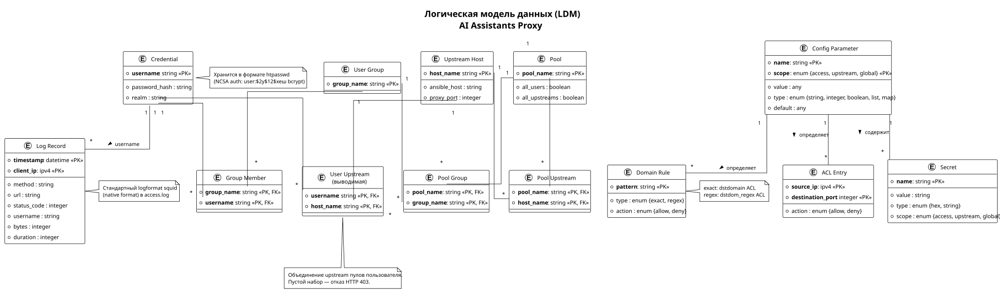

<!-- [AIGD] -->
<!-- [AITS] 2026-11-06T15:25:09Z -->
# DD-LDM — Логическая модель данных

**Последняя правка AI:** 2026-11-06T15:25:09Z

## Описание

Логическая модель данных (LDM) проекта AI Assistants Proxy описывает нормализованные сущности с атрибутами, типами и ключами. Модель не привязана к конкретной платформе хранения.

Так как проект является IaC-системой без традиционных СУБД, логические сущности отражают структуру конфигурационных данных, файлов учётных записей, правил фильтрации, журнальных записей и секретов.

## Диаграмма LDM

> Исходник: [diagrams/DD-LDM.puml](diagrams/DD-LDM.puml)

## Сущности и атрибуты

### Credential (Учётные данные)

Трассировка CDM: Учётные данные → Credential.

| Атрибут | Тип | PK | Обязательность | Описание |
|---|---|---|---|---|
| username | string | PK | Обязательный | Имя пользователя (уникальное) |
| password_hash | string | — | Обязательный | Хеш пароля bcrypt (`$2y$`), фактор стоимости 12 |
| realm | string | — | Обязательный | Область аутентификации (Squid proxy realm) |

**Ограничения:**
- username: уникальный, не пустой, ASCII, без пробелов
- password_hash: формат `$2y$12$` — bcrypt с фактором стоимости 12
- realm: задаётся шаблоном как "Squid Proxy Authentication" — эту строку видит пользователь в окне ввода пароля

### ACL Entry (Запись списка управления доступом)

Трассировка CDM: ACL → ACL Entry.

| Атрибут | Тип | PK | Обязательность | Описание |
|---|---|---|---|---|
| source_ip | ipv4 | PK | Обязательный | IP-адрес access-прокси |
| destination_port | integer | PK | Обязательный | Порт назначения (443) |
| action | enum {allow, deny} | — | Обязательный | Действие при совпадении |

**Ограничения:**
- source_ip: валидный IPv4-адрес
- destination_port: диапазон 1–65535
- action: по умолчанию — deny (whitelist-подход)

### Domain Rule (Правило фильтрации домена)

Трассировка CDM: Белый список доменов → Domain Rule.

| Атрибут | Тип | PK | Обязательность | Описание |
|---|---|---|---|---|
| pattern | string | PK | Обязательный | Паттерн домена (exact или regex) |
| type | enum {exact, regex} | — | Обязательный | Тип совпадения |
| action | enum {allow, deny} | — | Обязательный | Действие при совпадении |

**Ограничения:**
- pattern: не пустой; для type=regex — валидное регулярное выражение
- Два источника: `allowed_domains` (type=exact) и `allowed_domain_patterns` (type=regex)
- action: всегда allow (whitelist); все остальные домены блокируются по умолчанию

### Config Parameter (Конфигурационный параметр)

Трассировка CDM: Конфигурация → Config Parameter.

| Атрибут | Тип | PK | Обязательность | Описание |
|---|---|---|---|---|
| name | string | PK | Обязательный | Имя параметра (ключ YAML) |
| scope | enum {access, upstream, global} | PK | Обязательный | Область применения |
| value | any | — | Обязательный | Значение параметра |
| type | enum {string, integer, boolean, list, map} | — | Обязательный | Тип данных значения |
| default | any | — | Необязательный | Значение по умолчанию |

**Ограничения:**
- Составной ключ: (name, scope)
- scope=global: параметры из секции `all.vars`
- scope=access: параметры из секции `access_proxies.vars`
- scope=upstream: параметры из секции `upstreams.vars`

### Log Record (Запись журнала)

Трассировка CDM: Записи журнала → Log Record.

| Атрибут | Тип | PK | Обязательность | Описание |
|---|---|---|---|---|
| timestamp | datetime | PK | Обязательный | Метка времени запроса: время Unix с миллисекундами (`1708700400.123`), как его пишет Squid |
| client_ip | ipv4 | PK | Обязательный | IP-адрес клиента |
| method | string | — | Обязательный | HTTP-метод (CONNECT, GET, POST) |
| url | string | — | Обязательный | Запрошенный URL или хост:порт |
| status_code | integer | — | Обязательный | HTTP-код статуса ответа |
| username | string | — | Необязательный | Имя аутентифицированного пользователя (или «-») |
| bytes | integer | — | Обязательный | Размер ответа в байтах |
| duration | integer | — | Обязательный | Время обработки запроса (мс) |

**Ограничения:**
- timestamp: формат определяется Squid logformat directive
- method: ограничен CONNECT для HTTPS-прокси
- status_code: стандартные HTTP-коды + специфичные Squid-коды (TCP_TUNNEL/200)
- username: FK → Credential.username (или «-» при отсутствии аутентификации)

### Secret (Секрет)

Трассировка CDM: Секреты → Secret.

| Атрибут | Тип | PK | Обязательность | Описание |
|---|---|---|---|---|
| name | string | PK | Обязательный | Идентификатор секрета |
| value | string | — | Обязательный | Значение секрета |
| type | enum {hex, string} | — | Обязательный | Формат значения |
| scope | enum {access, upstream, global} | — | Обязательный | Область применения |

**Ограничения:**
- name: уникальный
- type=hex: значение содержит только символы [0-9a-f]
- Секреты не должны появляться в логах (no_log в Ansible)

### User Group (Группа пользователей)

Трассировка CDM: Группа пользователей → User Group. Источник — ключи отображения `proxy_user_groups`, карточка — [DE-AC-002](DE/DE-AC-002.md).

| Атрибут | Тип | PK | Обязательность | Описание |
|---|---|---|---|---|
| group_name | string | PK | Обязательный | Имя группы |

**Ограничения:**
- group_name: `^[A-Za-z0-9][A-Za-z0-9_.-]{0,63}$`, строка YAML, а не число и не логическое значение
- group_name ≠ `all`: имя зарезервировано за особой группой «все пользователи файла паролей»

### Group Member (Член группы)

Трассировка CDM: связь «Группа пользователей включает Учётные данные». Источник — списки значений `proxy_user_groups`.

| Атрибут | Тип | PK | Обязательность | Описание |
|---|---|---|---|---|
| group_name | string | PK, FK → User Group.group_name | Обязательный | Группа |
| username | string | PK, FK → Credential.username | Обязательный | Пользователь группы |

**Ограничения:**
- username: `^[A-Za-z0-9][A-Za-z0-9._@+-]{0,127}$`, не `REQUIRED` — ключевое слово Squid
- (group_name, username) уникальна: повтор имени в одной группе — ошибка
- username присутствует в файле паролей: проверяется при развёртывании, а не ссылкой хранилища

### Upstream Host (Upstream-узел)

Трассировка CDM: Upstream Proxy → Upstream Host. Источник — узлы группы inventory `upstreams`, параметры — [DE-CF-001](DE/DE-CF-001.md).

| Атрибут | Тип | PK | Обязательность | Описание |
|---|---|---|---|---|
| host_name | string | PK | Обязательный | Имя узла в inventory, оно же имя пира Squid (`name=`) |
| ansible_host | string | — | Обязательный | Адрес узла |
| proxy_port | integer | — | Обязательный | Внешний порт upstream, диапазон 1–65535 |

### Pool (Пул)

Трассировка CDM: Пул → Pool. Источник — элементы списка `proxy_pools`.

| Атрибут | Тип | PK | Обязательность | Описание |
|---|---|---|---|---|
| pool_name | string | PK | Обязательный | Имя пула (`name`) |
| all_users | boolean | — | Обязательный | `true`, если в `groups` есть особая группа `all` |
| all_upstreams | boolean | — | Обязательный | `true`, если `upstreams` задан строкой `all` |

**Ограничения:**
- pool_name: `^[a-z][a-z0-9_-]{0,31}$`, уникально в списке
- элемент списка несёт ровно ключи `name`, `groups`, `upstreams`
- all_upstreams = `true` раскрывается в состав группы `upstreams` на момент развёртывания. Строк Pool Upstream при этом в источнике нет
- порядок элементов на результат не влияет

### Pool Group (Группа пула)

Трассировка CDM: связь «Пул охватывает Группу пользователей». Источник — список `groups` пула, кроме особой группы `all`.

| Атрибут | Тип | PK | Обязательность | Описание |
|---|---|---|---|---|
| pool_name | string | PK, FK → Pool.pool_name | Обязательный | Пул |
| group_name | string | PK, FK → User Group.group_name | Обязательный | Группа пула |

**Ограничения:**
- (pool_name, group_name) уникальна: повтор группы в `groups` — ошибка
- group_name существует в `proxy_user_groups`: неизвестная группа — ошибка

### Pool Upstream (Upstream пула)

Трассировка CDM: связь «Пул направляет через Upstream Proxy». Источник — список `upstreams` пула.

| Атрибут | Тип | PK | Обязательность | Описание |
|---|---|---|---|---|
| pool_name | string | PK, FK → Pool.pool_name | Обязательный | Пул |
| host_name | string | PK, FK → Upstream Host.host_name | Обязательный | Upstream-узел пула |

**Ограничения:**
- (pool_name, host_name) уникальна: повтор в `upstreams` — ошибка
- host_name входит в группу inventory `upstreams`: неизвестный узел — ошибка

### User Upstream (Набор upstream пользователя, выводимый)

Трассировка CDM: Набор upstream пользователя → User Upstream. Не хранится в inventory: выводится при развёртывании и материализуется директивами `squid.conf`.

| Атрибут | Тип | PK | Обязательность | Описание |
|---|---|---|---|---|
| username | string | PK, FK → Credential.username | Обязательный | Пользователь |
| host_name | string | PK, FK → Upstream Host.host_name | Обязательный | Разрешённый пользователю upstream |

**Правило вывода:** строка (username, host_name) существует, если найдётся пул, который одновременно:

- охватывает пользователя — `all_users = true` либо есть Pool Group с группой, где есть Group Member с этим username;
- ведёт к узлу — `all_upstreams = true` либо есть Pool Upstream с этим host_name.

Пользователь без строк User Upstream получает отказ HTTP 403.

## Связи между сущностями

| Источник | Связь | Назначение | Кардинальность | Описание |
|---|---|---|---|---|
| Credential | → | Log Record | 1:N | username в Log Record ссылается на Credential.username |
| Config Parameter | → | Domain Rule | 1:N | Конфигурация определяет правила фильтрации доменов |
| Config Parameter | → | ACL Entry | 1:N | IP-адреса из inventory порождают ACL-записи |
| Config Parameter | → | Secret | 1:N | Секреты определены в inventory как параметры |
| User Group | → | Group Member | 1:N | Группа перечисляет имена пользователей |
| Credential | → | Group Member | 1:N | Член группы ссылается на учётную запись по имени |
| Pool | → | Pool Group | 1:N | Пул перечисляет группы |
| User Group | → | Pool Group | 1:N | Группа входит в несколько пулов |
| Pool | → | Pool Upstream | 1:N | Пул перечисляет upstream-узлы |
| Upstream Host | → | Pool Upstream | 1:N | Узел входит в несколько пулов |
| Credential | → | User Upstream | 1:N | Набор upstream пользователя, выводимый |
| Upstream Host | → | User Upstream | 1:N | Узел, разрешённый пользователю |

## Связанные требования

- [C2-FR-002](../C2/C2-FR-002.md) — Аутентификация (Credential)
- [C2-FR-003](../C2/C2-FR-003.md) — Фильтрация доменов (Domain Rule)
- [C2-FR-005](../C2/C2-FR-005.md) — Журналирование (Log Record)
- [C2-FR-008](../C2/C2-FR-008.md) — Развёртывание (Config Parameter)
- [C2-NF-002](../C2/C2-NF-002.md) — Безопасность (Secret, Credential)
- [C2-FR-009](../C2/C2-FR-009.md) — Пулы пользователей и upstream (User Group, Group Member, Pool, Pool Group, Pool Upstream, User Upstream)

## Статус соответствия

| Дата | Уровень | Обоснование | Корректирующее действие |
|------|---------|-------------|-------------------------|
| 2026-08-29 | 4 - Conformant | Атрибуты сущностей сверены с форматами файлов и записей журнала | - |
| 2026-11-06 | 4 - Conformant | Сущности пулов, их ключи и ограничения сверены с фильтром `aiproxy_pools` и шаблоном Squid рабочего дерева | - |
<!-- [/AIGD] -->
