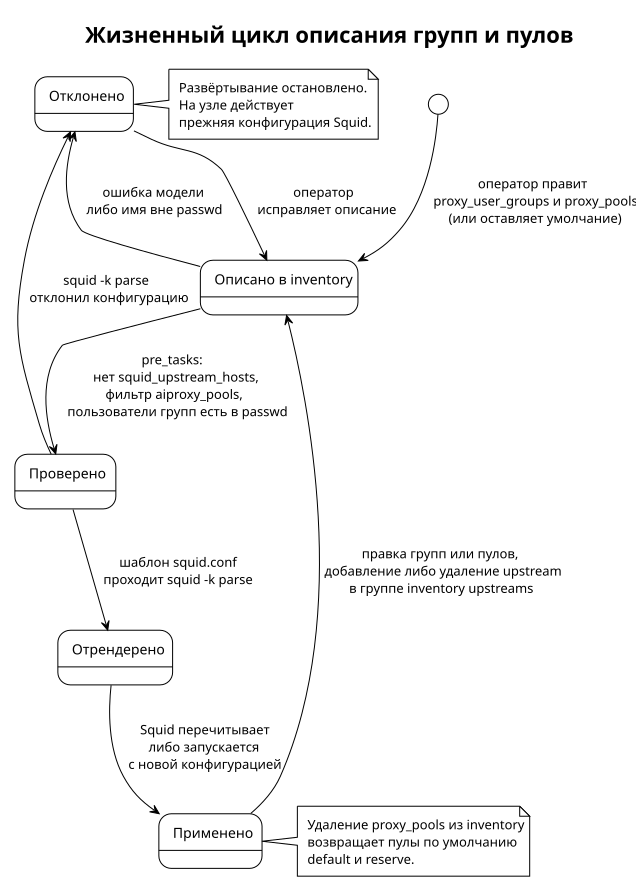

<!-- [AIGD] -->
<!-- [AITS] 2026-11-06T17:39:56Z -->
# DE-AC-002 — Группы пользователей и пулы upstream

**Последняя правка AI:** 2026-11-06T17:39:56Z

## Описание

Группы пользователей и пулы upstream определяют, через какие upstream-узлы выходит в интернет каждый пользователь access-прокси. Группа объединяет имена пользователей из файла паролей ([DE-CR-001](DE-CR-001.md)). Пул связывает группы с набором upstream-узлов группы inventory `upstreams`. Из обоих объектов при развёртывании выводится набор upstream пользователя, по которому Squid ограничивает выбор вышестоящего прокси.

Описание общее для всех access-узлов: каждый access рендерит одни и те же пулы, переопределения на отдельный узел нет. Требование — [C2-FR-009](../../C2/C2-FR-009.md), решение и отклонённые альтернативы — [ADR-000010](../../ADR/ADR-000010.md).

Сущность отделена от списков управления доступом ([DE-AC-001](DE-AC-001.md)) намеренно. Те списки вычисляются автоматически из адресов узлов inventory. Группы и пулы задаёт оператор, и их предмет — назначение пользователей, а не адреса.

## Атрибуты

### Группа пользователей (`proxy_user_groups`)

Отображение «имя группы → список имён пользователей», умолчание — `{}`.

| Атрибут | Тип | Описание | Обязательность |
|---|---|---|---|
| group_name | string, `^[A-Za-z0-9][A-Za-z0-9_.-]{0,63}$` | Имя группы, ключ отображения. Имя `all` зарезервировано | Обязательный |
| members | list[string] | Имена пользователей группы. Каждое имя — `^[A-Za-z0-9][A-Za-z0-9._@+-]{0,127}$`, не `REQUIRED`, без повторов в группе, присутствует в файле паролей | Обязательный, допускается пустой список |

### Пул (`proxy_pools`, элемент списка)

Список отображений, у каждого ровно 3 ключа.

| Атрибут | Тип | Описание | Обязательность |
|---|---|---|---|
| name | string, `^[a-z][a-z0-9_-]{0,31}$` | Имя пула, уникально в списке | Обязательный |
| groups | list[string] | Имена групп из `proxy_user_groups` либо особая группа `all` — все пользователи файла паролей. Без повторов | Обязательный, допускается пустой список |
| upstreams | строка `all` либо list[string] | `all` — вся группа inventory `upstreams` на момент развёртывания. Список — имена узлов этой группы без повторов | Обязательный, допускается пустой список |

Порядок пулов в списке на маршрутизацию не влияет. Владельца, статуса и срока действия у пула нет: пул действует, пока описан в inventory.

### Набор upstream пользователя (выводимый)

| Атрибут | Тип | Описание |
|---|---|---|
| username | string | Имя пользователя из файла паролей |
| upstreams | множество имён узлов | Объединение `upstreams` всех пулов, в чьих `groups` есть группа пользователя либо `all` |

Правила вывода:

1. Пул **активен**, если у него есть upstream и есть пользователи: группа `all` либо непустой список имён после разрешения групп.
2. Неактивный пул в конфигурацию Squid не попадает.
3. Пустой набор upstream пользователя (пользователь вне пулов либо все его пулы без upstream) даёт отказ HTTP 403. Прямой выход с access-узла при этом не выполняется, даже при `allow_direct_fallback: true`.
4. Внутри набора выбор пира делает `userhash` — устойчивая привязка пользователя к одному пиру из разрешённых ему.

Без учётных данных запрос по-прежнему получает 407, если есть хотя бы один активный пул: набор upstream вычисляется только для аутентифицированного пользователя. Без активных пулов правило `http_access deny all` стоит выше проверки подлинности, и запрос без учётных данных получает 403.

## Хранилище

### Источник (SSOT) — inventory.yml

| Параметр | Значение |
|---|---|
| **Путь** | `Servers/deploy/inventory.yml` (рабочий каталог, вне контроля версий) |
| **Секция** | `all.children.access_proxies.vars`: `proxy_user_groups`, `proxy_pools` |
| **Формат** | YAML |
| **Образец** | `Servers/deploy/inventory.yml.sample` — закомментированные примеры без реальных имён |
| **Умолчание** | Задача плейбука «Определить пулы upstream для Squid на access»: пул `default` (`groups: [all]`, `upstreams: all`) и пул `reserve` (`groups: []`, `upstreams: []`). Умолчание не вынесено в переменные плейбука, иначе оно перекрыло бы значения inventory |

**Пример:**
```yaml
# AI-GENERATED — NOT REVIEWED: SECTION START
proxy_user_groups:
  team-a: [alice, bob]
  team-b: [carol]
proxy_pools:
  - {name: alpha, groups: [team-a], upstreams: [upstream-01]}
  - {name: beta, groups: [team-b], upstreams: [upstream-01, upstream-02]}
# AI-GENERATED — NOT REVIEWED: SECTION END
```

Имена групп, пользователей и пулов, которые YAML читает как число либо логическое значение (`1001`, `no`), отклоняются с советом взять имя в кавычки. Элемент `upstreams`, прочитанный как число, фильтр совета не сопровождает и сообщает только «неизвестные upstream».

### Промежуточное представление — факт `_squid_pools`

Фильтр `aiproxy_pools` (`Servers/deploy/filter_plugins/pools.py`) проверяет описание и возвращает список разрешённых пулов в исходном порядке. Каждый элемент несёт поля:

- `name` — имя пула;
- `all_users` — признак особой группы `all`;
- `users` — отсортированные имена пользователей всех групп пула;
- `upstreams` — имена узлов, где `all` раскрыт в состав группы `upstreams`.

Факт живёт только в памяти прогона Ansible и на диск не записывается.

### Целевое хранилище — squid.conf (access)

| Параметр | Значение |
|---|---|
| **Путь** | `/etc/squid/squid.conf` на каждом access-узле |
| **Генерация** | Шаблон `squid-access.conf.j2` с проверкой `squid -k parse` до записи |
| **Права** | 640 (`root:proxy`): читают root и рабочий процесс Squid под группой proxy |
| **Компонент** | [C3-SA-001](../../C3/C3-SA-001.md) — Squid Access Proxy |

Правила рендера:

1. `cache_peer` объявляется только для upstream активных пулов, в порядке группы inventory `upstreams`.
2. На каждый активный пул выпускается `acl aiproxy_pool_<имя> proxy_auth`: `REQUIRED` для группы `all`, иначе имена по 20 в строке.
3. `acl aiproxy_routed` — объединение пользователей всех активных пулов.
4. На каждого пира выпускаются `cache_peer_access <пир> allow aiproxy_pool_<имя>` для каждого пула, куда пир входит, и завершающий `cache_peer_access <пир> deny all`.
5. Правило `http_access deny authenticated !aiproxy_routed all` стоит до разрешающих правил. Завершающий `all` не даёт Squid отвечать повторным запросом 407.
6. Нет ни одного активного пула — выпускается `http_access deny all`.

Блоки пулов выпускаются только при включённой проверке подлинности (`enable_auth`).

**Пример рендеринга** для примера выше:
```
# AI-GENERATED — NOT REVIEWED: SECTION START
acl aiproxy_pool_alpha proxy_auth alice bob
acl aiproxy_pool_beta proxy_auth carol
acl aiproxy_routed proxy_auth alice bob carol
cache_peer_access upstream-01 allow aiproxy_pool_alpha
cache_peer_access upstream-01 allow aiproxy_pool_beta
cache_peer_access upstream-01 deny all
cache_peer_access upstream-02 allow aiproxy_pool_beta
cache_peer_access upstream-02 deny all
http_access deny authenticated !aiproxy_routed all
# AI-GENERATED — NOT REVIEWED: SECTION END
```

## Качество данных

Правила валидности имён, уникальности и ссылочной целостности (группа → пул, пользователь → файл паролей, upstream → группа inventory `upstreams`) — [DD-Quality.md](../DD-Quality.md), строки сущности DE-AC-002. Все они проверяются в pre_tasks на access-узлах, до первой задачи, меняющей узел, и при любом наборе тегов.

## Жизненный цикл



> Исходник: [diagrams/DE-AC-002-lifecycle.puml](diagrams/DE-AC-002-lifecycle.puml)

| Состояние | Вход | Проверка на выходе |
|---|---|---|
| **Описано в inventory** | Оператор правит `proxy_user_groups` и `proxy_pools` либо оставляет умолчание | — |
| **Проверено** | Задачи pre_tasks плейбука на access-узлах, тег `always` | Не задан упразднённый `squid_upstream_hosts`. Фильтр `aiproxy_pools` принял модель. Задача «Проверить, что пользователи групп есть в файле паролей» не нашла недостающих имён |
| **Отрендерено** | Шаблон `squid-access.conf.j2` | `squid -k parse` до записи файла |
| **Применено** | Squid перечитывает конфигурацию либо запускается с ней | Локальная готовность Squid |
| **Отклонено** | Отказ на любом переходе | Развёртывание access-узла остановлено, на нём действует прежняя конфигурация Squid |

Смена состава группы требует развёртывания конфигурации Squid: полного прогона либо, при `nginx_on_443`, прогона с тегом `nginx`, рендерящим `squid.conf`. Тега `passwd` недостаточно. Сверка пользователей групп с файлом паролей выполняется при любом наборе тегов, в том числе при `-t passwd` и `-t nginx`. Удаление пользователя из файла паролей при сохранении его имени в группе останавливает развёртывание: сначала имя убирается из группы. Удаление `proxy_pools` из inventory возвращает пулы по умолчанию. Стадии DAMA — [DD-Lifecycle.md](../DD-Lifecycle.md).

## Безопасность

| Параметр | Значение |
|---|---|
| **Уровень конфиденциальности** | Средний |
| **Обоснование** | Имена пользователей — идентификаторы. Описание связывает пользователя с его выходными узлами и раскрывает состав групп |
| **Хранение источника** | Частный `inventory.yml` вне контроля версий, в образце — только вымышленные имена |
| **Внедрение директив** | Имена пула, группы и пользователя ограничены шаблонами без пробелов и спецсимволов конфигурации Squid |
| **Изоляция пользователей** | Не гарантируется: пул с группой `all` открывает свои upstream всем пользователям. Для изоляции upstream, отведённые группе, не должны входить ни в один пул с группой `all` |
| **Журналирование** | Имя пользователя и выбранный пир пишутся в access.log ([DE-LG-001](DE-LG-001.md)) |

Имена пользователей из групп, кроме особой группы `all`, попадают в `squid.conf`. Поэтому файл на access закрыт теми же правами 640 `root:proxy`, что и файл паролей. Так же закрыта копия отката `squid.conf.nginx-rollback`.

## Управление

| Роль | Назначение |
|---|---|
| **Data Owner** | Оператор inventory (DevOps-инженер): определяет группы и пулы, отдельного атрибута владельца у пула нет |
| **Data Steward** | Ansible: фильтр `aiproxy_pools` и проверки плейбука до изменения служб |
| **Data Consumer** | Squid на каждом access-узле |

Политики — [DD-Governance.md](../DD-Governance.md).

## Связанные требования

- [C2-FR-009](../../C2/C2-FR-009.md) — Пулы пользователей и upstream
- [C2-FR-002](../../C2/C2-FR-002.md) — Аутентификация: имя пользователя, по которому определяется пул
- [C2-FR-001](../../C2/C2-FR-001.md) — Проксирование: `userhash` внутри набора пользователя
- [ADR-000010](../../ADR/ADR-000010.md) — Модель пулов
- [C3-SA-001](../../C3/C3-SA-001.md) — Squid Access Proxy

## Статус соответствия

| Дата | Уровень | Обоснование | Корректирующее действие |
|------|---------|-------------|-------------------------|
| 2026-11-06 | 3 — Compliant | Атрибуты, правила вывода и рендера сверены с фильтром `aiproxy_pools`, задачами плейбука и шаблоном `squid-access.conf.j2` рабочего дерева (не закоммичено). Нативная проверка на Squid 6.14 — 965 запросов, 0 нарушений — заявлена прогоном `tests/check_proxy_pools_native.py`, в этой правке не повторялась | Повторить нативную проверку после фиксации изменений |
<!-- [/AIGD] -->
