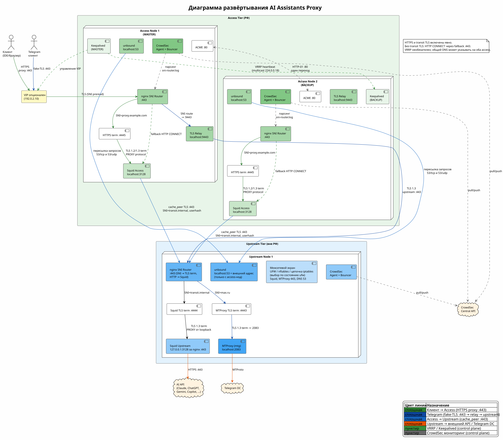
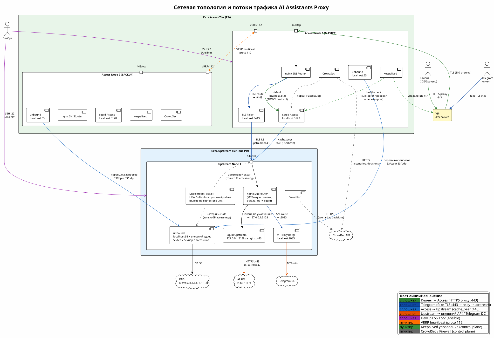

<!-- [AIGD] -->
# TD-FA — Функциональные области системы

**Последняя правка AI:** 2026-08-29T04:20:00Z

## Описание

Функциональные области (ФО) системы AI Assistants Proxy описывают логическую группировку возможностей системы. Каждая ФО объединяет связанные компоненты и требования, обеспечивающие определённый аспект функциональности.

## Функциональные области

| ID | Функциональная область | Описание | Компоненты | Требования |
|---|---|---|---|---|
| ФО-01 | Проксирование | Маршрутизация HTTPS-запросов через двухуровневую цепочку access → upstream → AI API. CONNECT-туннелирование TLS-трафика без расшифровки. | Squid Access (C3-SA-001), Squid Upstream (C3-SU-001) | [C2-FR-001](../C2/C2-FR-001.md), [C2-FR-003](../C2/C2-FR-003.md), [C2-FR-004](../C2/C2-FR-004.md) |
| ФО-02 | Безопасность и контроль доступа | Аутентификация пользователей (Basic Auth), фильтрация доменов (whitelist ACL), обнаружение и предотвращение вторжений (IPS), анонимизация заголовков, межсетевое экранирование. | Squid Access (C3-SA-001), CrowdSec (C3-CS-001), nftables | [C2-FR-002](../C2/C2-FR-002.md), [C2-FR-003](../C2/C2-FR-003.md), [C2-FR-005](../C2/C2-FR-005.md), [C2-NF-002](../C2/C2-NF-002.md) |
| ФО-03 | Отказоустойчивость | Переключение виртуального адреса по VRRP на access-уровне (возможность необязательная, по умолчанию выключена), распределение запросов между upstream-узлами хешем имени пользователя. Health-check мониторинг компонентов. | Keepalived (C3-KA-001), Squid Access (C3-SA-001) | [C2-NF-001](../C2/C2-NF-001.md), [C2-NF-004](../C2/C2-NF-004.md) |
| ФО-04 | Co-deployment и маршрутизация | SNI-маршрутизация для совместного использования порта 443 между AI Proxy и другими проектами. Бесконфликтное разделение TLS-потоков. | nginx SNI Router (C3-NX-001) | [C2-CN-002](../C2/C2-CN-002.md) |
| ФО-05 | Telegram proxy | MTProxy с fake-TLS маскировкой для обхода DPI-блокировок. Co-deployment на upstream-нодах. Маршрутизация через nginx SNI Router. | MTProxy/mtg (C3-MT-001), nginx SNI Router (C3-NX-001) | [C2-FR-006](../C2/C2-FR-006.md) |
| ФО-06 | Развёртывание и управление | Автоматизированное развёртывание через Ansible IaC. Единый playbook, роли для каждого компонента, идемпотентное выполнение. Управление пользователями и конфигурациями. | Ansible (C3-AD-001) | [C2-FR-007](../C2/C2-FR-007.md), [C2-FR-008](../C2/C2-FR-008.md) |
| ФО-07 | Разрешение имён | Кеширующий резолвер на каждом узле; каскад access → upstream → публичные резолверы. Порт 53 upstream-узла открыт только адресам access-узлов, проверка DNSSEC выполняется на upstream. | Unbound ([C3-DN-001](../C3/C3-DN-001.md)) | [C2-NF-002](../C2/C2-NF-002.md), [C2-NF-003](../C2/C2-NF-003.md) |

## Диаграмма функциональных областей

> Исходник: [diagrams/TD-deployment.puml](diagrams/TD-deployment.puml)

Диаграмма развёртывания показывает распределение компонентов по физическим нодам и их принадлежность к функциональным областям.

## Сетевая топология и потоки трафика

> Исходник: [diagrams/TD-network.puml](diagrams/TD-network.puml)

Диаграмма сетевой топологии детализирует порты, протоколы и направление потоков трафика между компонентами функциональных областей. Сплошные линии — data plane (пользовательский трафик), пунктирные — control plane (VRRP, CrowdSec, мониторинг).

## Каталог наблюдаемости

Вынесен в отдельные документы: [TD-Events.md](TD-Events.md) — события,
[TD-Metrics.md](TD-Metrics.md) — метрики, [TD-Logs.md](TD-Logs.md) — журналы.
Каждое событие и каждая метрика отнесены там к функциональной области настоящего документа.

## Связь метрик с бизнес-целями

Перенесена в [TD-Metrics.md](TD-Metrics.md): соответствие показателей целям [C1-BC-004](../C1/C1-BC-004.md) описано там вместе с самими показателями.

## Статус соответствия

| Дата | Уровень | Обоснование | Корректирующее действие |
|------|---------|-------------|-------------------------|
| 2026-08-29 | 4 - Conformant | Функциональные области и каталог наблюдаемости сверены с составом компонентов и механизмами узла | - |
<!-- [/AIGD] -->
