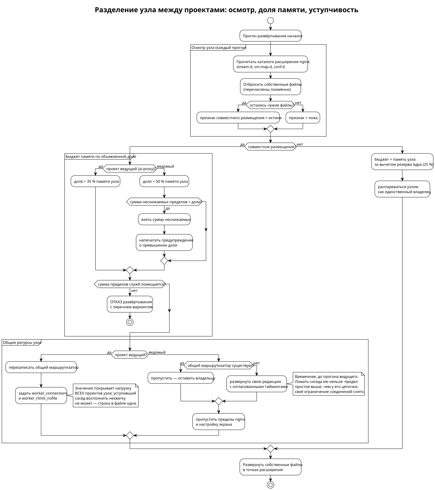

<!-- [AIGD] -->
<!-- [AITS] 2026-08-30T16:55:28Z -->
# TD-Shared — Общие ресурсы узла при совместном размещении

**Последняя правка AI:** 2026-08-29T08:01:39Z

## Описание

Узел может обслуживать не один проект. Штатный сосед — сервер Matrix, разворачиваемый
отдельным набором сценариев из своего репозитория. Проекты не знают друг о друге во время
исполнения и связаны только тем, что пишут в одни и те же файлы, занимают одни порты
и делят одну оперативную память.

Настоящее представление отвечает на один вопрос: **какими ресурсами узла проекты владеют
совместно и что происходит, когда в ресурс пишут оба**. Оно не заменяет карточки
компонентов, а сводит рассыпанное по ним в одно место — иначе конфликт общего ресурса
обнаруживается только на узле и только по последствиям.

Бюджет памяти вынесен отдельно и здесь не повторяется:
[ADR-000008](../ADR/ADR-000008.md).

## Классы совместного владения

Различать их необходимо, поскольку последствия несовпадения различны:

| Класс | Что происходит при несовпадении | Как обнаруживается |
|---|---|---|
| Согласованная запись | Ничего: содержимое одинаково у обоих | Сверкой шаблонов |
| Раздельная запись | Ничего: каждый пишет свой файл в общий каталог | Сверкой имён файлов |
| Соперничающая запись | Побеждает развернувший последним, молча | Только проверкой при развёртывании |
| Односторонняя запись | Значение задаёт один проект за обоих | Сверкой, кто вообще пишет |

## Карта общих ресурсов

| Ресурс | Класс | Кто пишет | Состояние |
|---|---|---|---|
| `/etc/nginx/nginx.conf`, блок `stream` | Согласованная | Обе роли ai-proxy и роль Matrix | Единый маркер, содержимое совпадает дословно |
| `/etc/nginx/nginx.conf`, `worker_connections` и `worker_rlimit_nofile` | Ведомая ai-proxy | Задаёт ai-proxy как владелец nginx; Matrix уступает при обнаруженном соседе | Правило владельца 2026-08-30: пределы единственного на узле nginx задаёт ведущий, и значение обязано покрывать нагрузку ВСЕХ проектов узла — уступивший сосед восполнить его нехватку не может. Переменные `nginx_worker_connections` (умолчание 4096) и `nginx_worker_rlimit_nofile` |
| `/etc/nginx/stream.d/00-sni-router.conf` | Ведомая ai-proxy | Обе роли ai-proxy (пишут безусловно) и роль Matrix (только при отсутствии файла) | Правило владельца 2026-08-30: ведущий — ai-proxy, он перезаписывает файл без оглядки на найденное. Matrix разворачивает свою редакцию лишь когда файла нет вовсе (иначе порт 443 не слушает никто) и держит в ней те же тайминги, чтобы не рвать цепочку соседа. Ограничение числа соединений из общей редакции Matrix снято: его пределы действуют в его собственных блоках на его порту |
| `/etc/nginx/stream.d/*.conf`, кроме маршрутизатора | Раздельная | Каждый свой файл | Имена файлов и объявлений разнесены префиксами проектов |
| `/etc/nginx/stream.d/sni-map.d/*.conf` | Раздельная | Каждый свой файл | Ключом служит имя из запроса; совпадение имён у двух проектов сделало бы конфигурацию неверной |
| `/etc/crowdsec/acquis.d/*.yaml` | Раздельная | Каждый свой файл | Разведено ранее: общий файл источников заменён отдельными |
| Наборы правил обнаружения (`cscli collections`) | Согласованная | Оба, включая подчинённый режим соседа | Перечни совпадают дословно: `linux`, `nginx`, `http-cve`, `whitelist-good-actors`. Наборы общие для узла, поэтому проект ставит их и в чужое обнаружение — иначе разбор его журналов не работает |
| Пределы памяти служб (`*.service.d/`) | Односторонняя с уступкой | ai-proxy — для nginx, каждый — для своих служб | Matrix свой предел nginx уступает соседу явным условием |
| Параметры ядра, сетевые (`net.*`) | Односторонняя с уступкой | На общем узле — только ai-proxy | Перечни пересекаются семью параметрами, и значения у них разные: время ожидания закрытия 6 против 15, период проверки соединения 720 против 600, длина очереди вычисляется каждым по своей нагрузке. Matrix задаёт их лишь на одиночном узле, поэтому конфликта не возникает |
| Параметры ядра, памяти (`vm.swappiness`, размеры буферов по умолчанию) | Раздельная | Только Matrix | Задаются им всегда, включая общий узел; ai-proxy этих параметров не трогает — он задаёт предельные размеры буферов, а не значения по умолчанию, и пересечения нет |
| Пакет nginx | Согласованная | Оба ставят, ни один не обновляет | Устанавливается лишь при отсутствии: обновление версии перезапустило бы общую службу и оборвало соединения соседнего проекта. Правило соблюдается обоими репозиториями — сверено по состоянию пакета в задачах |
| Порты узла | Раздельная | Каждый свои | Пересечений нет: петлевые порты разнесены. Единственный общий вход 443 обслуживает маршрутизатор потоков, и совместное размещение возможно только при `nginx_on_443` — иначе порт занимает Squid напрямую |
| Оперативная память | Согласованная | Оба, по общему плану | [ADR-000008](../ADR/ADR-000008.md): доли, нижние границы, резерв ядру и соседям |
| Сертификаты и терминация TLS к Squid | Двусторонняя, у каждого свой материал | ai-proxy — при `squid_transit_tls`; Matrix — при своём признаке | ai-proxy выпускает сертификат участка access → upstream на управляющей машине и раздаёт обеим сторонам; на upstream-узле за маршрутизатором разворачивает терминатор `20-squid-tls-term.conf` и запись карты имён `sni-map.d/squid.conf`. Материал СВОЙ, а не общий с соседом: имя в сертификате должно совпадать с проверяемым, и общий сертификат означал бы отказ проверки подлинности у одной из сторон |
| Обработчики обновления сертификатов | Раздельная | Только Matrix | Каталог обработчиков принадлежит узлу, а имена сценариев признака проекта не несут; при появлении второго выпускающего имена придётся развести |
| Межсетевой экран | Соперничающая, разрешена | Оба | Разведено ранее: включение экрана обусловлено тем, служит ли он уже бэкендом |
| Восстановление правил экрана при загрузке | Раздельная | Каждый свою цепочку | Полное восстановление сохранённого набора запрещено: снимок с общего узла содержит правила соседа, и возвращая его, проект распоряжался бы чужими правилами — включая снятые соседом намеренно |

## Распределение портов

| Порт | Слушает | Проект | Назначение |
|---|---|---|---|
| 443 | Маршрутизатор потоков либо Squid | Общий | Единственный вход снаружи. При `nginx_on_443` порт занимает маршрутизатор и разбирает обращения по имени из запроса; иначе — Squid напрямую, и совместное размещение с Matrix невозможно |
| 80 | nginx | Matrix | Перенаправление и подтверждение владения именем |
| 8443 | nginx | Matrix | Клиентский доступ за терминацией |
| 8448 | nginx | Matrix | Обмен между серверами Matrix |
| 3128 | Squid, петлевой | ai-proxy | Приём от маршрутизатора; требует заголовок PROXY и принимает его только с петлевого адреса |
| 3129 | nginx, петлевой | Matrix | Терминация к Squid |
| 4443 | nginx, петлевой | ai-proxy | Терминация MTProxy |
| 4444 | ai-proxy, при включённом `squid_transit_tls` на upstream-узле за маршрутизатором | ai-proxy | Локальный терминатор TLS участка access → upstream (`squid_tls_term_port`). Маршрутизатор разбирает имя `squid_tls_sni` из SNI и направляет соединение сюда; терминатор снимает TLS и передаёт поток Squid, восстанавливая адрес клиента протоколом PROXY. При выключенном признаке порт не занят: терминатор снимается с узла |
| 3129 | ai-proxy, оба уровня | ai-proxy | Порт снятия показателей прокси на петлевом адресе (`squid_mgmt_port`). Рабочий порт для этого непригоден: за маршрутизатором требует заголовок протокола PROXY, при шифровании участка принимает только TLS. Слушатель привязан к петлевому адресу и снаружи недостижим — для соседних проектов порт не занят |
| 9443 | nginx, петлевой | ai-proxy | Передача MTProxy |
| 2083 | MTProxy, петлевой | ai-proxy | Приём от маршрутизатора |
| 53 | unbound | ai-proxy | Разрешение имён. На access-узле слушает только петлевой адрес; на upstream — ещё и адрес узла, принимая запросы от access-узлов |

Порты задаются переменными инвентори и приведены по умолчаниям шаблонов; исключение —
внешний порт Squid, умолчания не имеющий. Источник истины — образец файла инвентори.

Наличие директивы прослушивания в шаблоне ещё не означает, что порт занят: шаблон
может не разворачиваться ни одной задачей. Порты выше сверены и с этим условием.

## Почему проверки при развёртывании обязательны

Соперничающая запись не обнаруживается ни сверкой репозиториев, ни осмотром одного
проекта: расхождение возникает на узле и зависит от порядка запуска сценариев. Поэтому
каждый разобранный случай закрыт проверкой, останавливающей развёртывание, а не
предупреждением в документации:

| Ресурс | Что проверяется | Где |
|---|---|---|
| Маршрутизатор потоков | Существующий файл не принадлежит соседнему проекту | Роли `nginx` и `mtproxy` |
| Бюджет памяти | План умещается в память узла с резервом ядру и соседям | Плейбук |
| Источники журналов CrowdSec | Свой файл, а не общий | Роль `crowdsec` |

## Критерии приёмки

| # | Критерий | Способ проверки | Ожидаемое |
|---|----------|-----------------|-----------|
| 1 | Блок `stream` в общем конфиге один | `grep -c "ANSIBLE MANAGED - nginx stream block" /etc/nginx/nginx.conf` | 2 (открывающий и закрывающий маркеры) |
| 2 | Объявления проектов не сталкиваются именами | `nginx -t` | Конфигурация принята |
| 3 | Порты не заняты дважды | `ss -tlnp` — вывод отсортирован по локальному адресу | Каждый порт слушает одна служба |
| 4 | Ведомая сторона уступает общий маршрутизатор | На узле с соседом: `stat -c '%y' /etc/nginx/stream.d/00-sni-router.conf` до и после прогона соседнего проекта | Время правки не меняется: сосед файл не трогает |
| 5 | Файлы источников CrowdSec раздельны | `ls /etc/crowdsec/acquis.d/` | Отдельный файл на проект |

## Инвентаризация диаграмм

| Механизм | Класс | Исходник | .svg | Статус |
|---|---|---|---|---|
| Совместное владение ресурсами узла | Декомпозиция компонентов | [TD-shared-resources.puml](diagrams/TD-shared-resources.puml) | [TD-shared-resources.svg](diagrams/TD-shared-resources.svg) | current |
| Порядок принятия решений при совместном размещении: осмотр, доля памяти, уступчивость | Технический процесс | [TD-Shared-codeployment.puml](diagrams/TD-Shared-codeployment.puml) | [TD-Shared-codeployment.svg](diagrams/TD-Shared-codeployment.svg) | current |

## Связанные артефакты

- Бюджет памяти узла: [ADR-000008](../ADR/ADR-000008.md)
- Маршрутизатор потоков: [C3-NX-001](../C3/C3-NX-001.md)
- Реестр представлений: [TD.md](../TD.md)
- Разрывы: [Ideas.md](../Ideas.md)

## Статус соответствия

| Дата | Уровень | Обоснование | Корректирующее действие |
|------|---------|-------------|-------------------------|
| 2026-08-29 | 4 — Conformant | Карта построена сплошным обходом путей, в которые пишут оба проекта, и сверкой содержимого каждого; порты собраны из директив прослушивания с проверкой того, что шаблон разворачивается. Дополнена по итогам покомпонентного описания обоих проектов: обход путей не видел ресурсов, задаваемых не файлами, — параметров ядра, наборов правил обнаружения, выпуска сертификатов | — |
<!-- [/AIGD] -->
