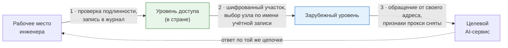

# 1. Назначение и устройство

## Что делает служба

Даёт инженерам организации доступ к внешним AI-сервисам, не раскрывая этим сервисам
ни адресов рабочих мест, ни адреса узла, с которого обращение вышло из страны.

## Как проходит обращение

Целевой сервис видит обращение от зарубежного узла: адрес рабочего места и адрес узла
в стране ему недоступны. Содержимое обмена зашифровано между рабочим местом и сервисом —
ни один узел службы его не разбирает.

## Два уровня

Обращение проходит через два узла, и разделение между ними — существо решения.

| Уровень | Где размещается | Что делает |
|---|---|---|
| Уровень доступа | В стране размещения организации | Принимает обращения инженеров, проверяет подлинность, ведёт журнал, выбирает узел второго уровня |
| Зарубежный уровень | За пределами страны | Снимает признаки прохождения через прокси и обращается к целевому сервису от своего адреса |

Целевой сервис видит обращение от зарубежного узла. Адрес рабочего места и адрес узла
первого уровня ему недоступны.

## Что защищено, а что нет

**Содержимое обмена** защищено сквозным шифрованием между рабочим местом и целевым
сервисом: ни один из узлов службы его не видит и в журналы не записывает.

**Имя целевого сервиса** между узлами службы закрывается шифрованием участка, когда оно
включено. При выключенном шифровании наблюдатель между узлами видит, к какому сервису
обращаются, хотя и не видит, что именно передаётся.

**Факт обращения** записывается в журнал узла первого уровня: время, имя учётной записи,
адрес рабочего места, целевой сервис, объём. Это осознанная плата за возможность
разобрать происшествие.

## Из чего состоит узел

| Служба | Назначение | На каком уровне |
|---|---|---|
| Прокси-сервер | Приём обращений, проверка подлинности, цепочка ко второму уровню | Оба |
| Резолвер имён | Разрешение имён без обращения к публичным серверам напрямую | Оба |
| Маршрутизатор соединений | Разбор имени из запроса и направление соединения нужной службе | При работе на общем порту |
| Обнаружение вторжений | Блокировка адресов, ведущих подбор реквизитов или сканирование | Оба |
| Переключение адреса | Перенос виртуального адреса на живой узел пары | Уровень доступа, необязательно |

Состав узла определяется признаками в инвентаре: ненужные службы не разворачиваются
и памяти не занимают.
