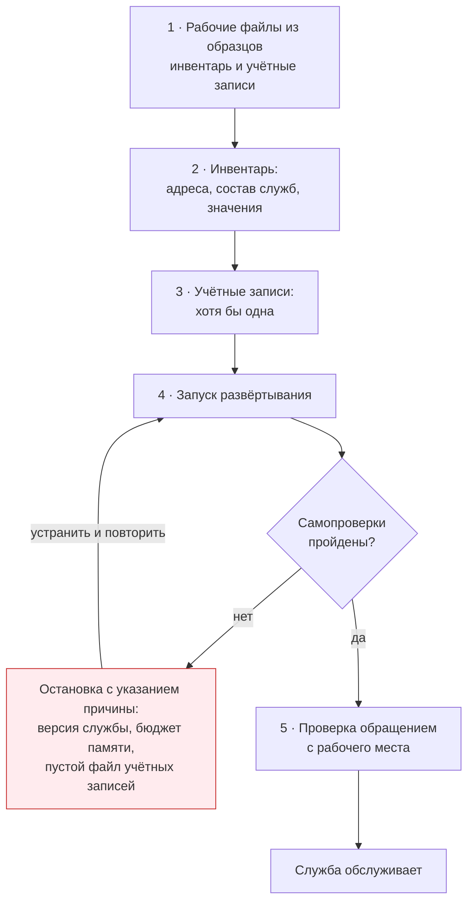

# 3. Первое развёртывание

## Порядок



Развёртывание останавливается само, если условие не выполнено: версия службы ниже
поддерживаемой, бюджет памяти не сходится, файл учётных записей пуст. Это сделано
намеренно — узел, развёрнутый с нарушенным условием, отказывает под нагрузкой.

## Шаг 1. Рабочие файлы из образцов

Инвентарь и файл учётных записей создаются из образцов и **раскрытию не подлежат**:
в них действительные адреса и реквизиты доступа. Оба исключены из контроля версий.

```bash
cp inventory.example.yml inventory.yml
cp passwd.example passwd
```

## Шаг 2. Инвентарь

В инвентаре указываются:

1. Адреса узлов в группах уровня доступа и зарубежного уровня.
2. Признаки состава: какие службы разворачивать на каждом уровне.
3. Значения таймингов и сроков хранения, если умолчания не подходят.
4. Реквизиты, которые не порождаются на узле сами.

Полный перечень параметров — в [разделе 9](09-parameters.md).

## Шаг 3. Учётные записи

Файл учётных записей наполняется до первого развёртывания: без записей служба
развернётся, но подключиться не сможет никто — сверять пароль будет не с чем, и всякое
обращение получит отказ проверки подлинности.

```bash
htpasswd -B -C 12 -bn пользователь пароль >> passwd
```

Развёртывание проверяет файл и останавливается, если он пуст либо недоступен, сообщая
причину и ожидаемый путь.

## Шаг 4. Запуск

```bash
ansible-playbook -i inventory.yml playbook.yml
```

Отдельные части:

```bash
ansible-playbook -i inventory.yml playbook.yml --limit access_proxies   # только уровень доступа
ansible-playbook -i inventory.yml playbook.yml --limit upstreams        # только зарубежный уровень
ansible-playbook -i inventory.yml playbook.yml -t dns                   # только разрешение имён
ansible-playbook -i inventory.yml playbook.yml -t passwd                # только учётные записи
```

## Шаг 5. Проверка

Развёртывание проверяет себя само и останавливается при расхождениях: версия
прокси-сервера, бюджет памяти, наличие учётных записей, ограничение доступа
к разрешению имён на узле.

Дополнительно стоит убедиться вручную:

```bash
# Обращение с реквизитами проходит
curl -s -o /dev/null -w 'код: %{http_code}\n' --max-time 25 \
  -x http://203.0.113.10:3128 -U пользователь:пароль https://api.anthropic.com/
```

<!-- [AIV: date=2026-08-30; method=stand-wsl2-incus; result=verified; note=code=200] -->
```text
код: 200
```
<!-- [/AIV] -->

```bash
# Без реквизитов — отказ проверки подлинности.
# Запрос делается к незащищённому адресу: при защищённом обращении
# отказ прокси не доходит до кода ответа, и утилита показывает 000.
curl -sI --max-time 20 -x http://203.0.113.10:3128 http://example.com | head -2
```

<!-- [AIV: date=2026-08-30; method=stand-wsl2-incus; result=verified; note=denied=407] -->
```text
HTTP/1.1 407 Proxy Authentication Required
Mime-Version: 1.0
```
<!-- [/AIV] -->

**Почему вторая команда обращается к незащищённому адресу.** При защищённом обращении
прокси отвечает отказом на запрос установления туннеля, туннель не открывается,
и утилита сообщает `000` — код отказа в нём не виден. Признак отказа проверки
подлинности читается только в заголовках ответа.

## Повторный запуск

Развёртывание идемпотентно: повторный прогон при неизменном инвентаре не меняет на узлах
ничего и сообщает об отсутствии изменений. Это свойство используется как проверка:
прогон, показавший изменения там, где их не ждали, означает стороннюю правку узла.
