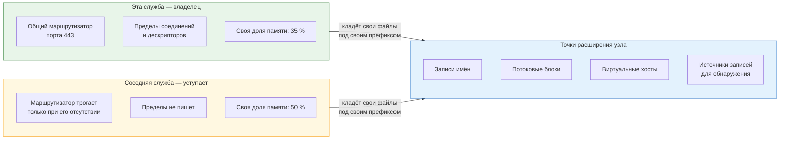

# 6. Совместное размещение с другой службой

Узел может делиться с другой службой организации. Тогда общими становятся память узла,
служба маршрутизации соединений, порт для внешних обращений и правила межсетевого экрана.

## Что делится на общем узле



Соседняя служба уступает общее и расширяет узел только через предоставленные каталоги.
Правило пределов: значение, задаваемое владельцем, покрывает нагрузку **всех** служб
узла — уступившая сторона восполнить его нехватку не может.

## Как узнаётся соседство

Развёртывание осматривает каталоги расширения маршрутизатора при каждом прогоне:
собственные файлы известны поимённо, всё прочее принадлежит соседям. Признак
устанавливается осмотром, а не объявляется в инвентаре: узел мог стать общим уже после
прошлого прогона.

Результат осмотра печатается: обнаружено соседство или нет, какие чужие файлы найдены,
какая доля памяти взята.

## Разделение памяти

| Служба | Доля узла |
|---|---|
| Эта служба | 35 % |
| Соседняя служба | 50 % |
| Ядро и системные службы | 15 % |

Доли объявлены, а не выведены измерением. Прежде доля соседа вычиталась опросом его
пределов, и это требовало, чтобы сосед был уже развёрнут: до его первого прогона доля
выходила нулевой, а после его правок молча устаревала.

Соседняя служба вправе превысить свою долю, если её неснижаемые пределы того требуют,
и предупреждает об этом. Тогда стоит проверить, помещается ли узел целиком: эта служба
считает свои 35 % от полной памяти узла и о потеснении не знает.

## Кто чем распоряжается

| Ресурс | Владелец | Как ведёт себя соседняя служба |
|---|---|---|
| Общий маршрутизатор соединений | Эта служба | Разворачивает свою редакцию, только если файла нет вовсе |
| Пределы соединений и дескрипторов | Эта служба | Уступает и своих значений не пишет |
| Записи карты имён, потоковые блоки, виртуальные хосты | Каждый свои | Кладёт файлы с собственным префиксом в предоставленные каталоги |
| Источники записей для обнаружения вторжений | Каждый свой файл | Общий файл источников не перезаписывается |

**Правило пределов:** значение, задаваемое владельцем, обязано покрывать нагрузку **всех**
служб узла. Уступившая сторона восполнить его нехватку не может — строка в файле одна.

## Проверка конфигурации маршрутизатора

```bash
nginx -t
```

<!-- [AIV: date=2026-08-30; method=stand-wsl2-incus; result=verified; note=nginx-ok] -->
```text
nginx: the configuration file /etc/nginx/nginx.conf syntax is ok
nginx: configuration file /etc/nginx/nginx.conf test is successful
```
<!-- [/AIV] -->

## Что проверить после развёртывания соседа

1. Соединения этой службы проходят: обращение с рабочего места даёт успех.
2. Пределы соединений не понижены: сосед должен был их не тронуть.
3. Порт этой службы открыт: сброс правил межсетевого экрана соседом закрыл бы его.
