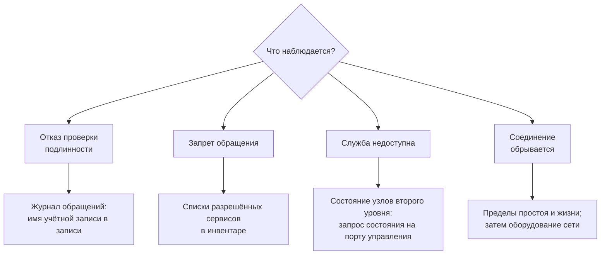

# 8. Разбор отказов

## Порядок

Сначала — штатные средства служб узла: их состояние, показатели, журналы. Внешние
косвенные признаки и произвольные пробы дают меньше и вводят в заблуждение чаще.

## С чего начинать



Порядок один во всех случаях: сначала штатные средства служб узла — состояние,
показатели, журналы. Внешние косвенные признаки дают меньше и вводят в заблуждение чаще.

## Обращения не проходят

| Что видит пользователь | Что смотреть | Обычная причина |
|---|---|---|
| Отказ проверки подлинности | Журнал обращений: имя учётной записи в записи | Записи нет в файле либо файл не роздан на узел после правки |
| Запрет обращения | Заданные списки разрешённых сервисов | Целевой сервис не входит в список |
| Служба недоступна | Журнал работы: состояние узлов второго уровня | Все узлы второго уровня недоступны, а запасной прямой выход запрещён |
| Соединение не устанавливается вовсе | Состояние службы, правила межсетевого экрана | Служба не запущена либо порт закрыт правилами — в том числе сброшенными соседней службой |

## Соединение обрывается

Соединение закрывается после часа **без передачи данных**. Таймер переармируется каждой
порцией, поэтому долгое обдумывание ответа сервисом обрывом не грозит: пока данные идут,
соединение живёт. Абсолютный предел жизни соединения — сутки.

Если обрывы происходят раньше часа простоя, причина не в этих пределах: смотреть следует
также на OOM и перезапуски служб, пределы соединений nginx/mtg, DNS и
промежуточное оборудование. Запишите временную метку и хост зависшего запроса.
Если проблема только в Firefox с FoxyProxy, сравните режимы на одном access-узле
и проверьте запросы медиахостов; не ограничивайтесь перезапусками Squid.

## Служба не запускается после правки

```bash
squid -k parse          # разбор конфигурации: покажет строку и причину отказа
journalctl -u squid -n 50
```

При исправной конфигурации разбор заканчивается перечнем обработанных директив
и единственным предупреждением, которое отказом не является:

<!-- [AIV: date=2026-08-30; method=stand-wsl2-incus; result=verified; note=parse-ok] -->
```text
2026/08/30 17:02:57| Processing: buffered_logs on
2026/08/30 17:02:57| WARNING: HTTP requires the use of Via
```
<!-- [/AIV] -->

Предупреждение о заголовке отслеживания появляется потому, что его передача отключена
намеренно — это часть сокрытия признаков прохождения через прокси.

Развёртывание проверяет конфигурацию до применения и не заменяет рабочую на негодную.
Отказ после прогона обычно означает правку на узле вручную.

## Обнаружение вторжений блокирует своих

```bash
cscli decisions list                 # действующие блокировки
cscli decisions delete --ip <адрес>  # снять блокировку
```

Адреса собственных узлов внесены в список исключений при развёртывании. Адрес рабочего
места туда не входит: подбор реквизитов с рабочего места блокируется наравне с прочими.

## Записи прокси не порождают событий обнаружения

Это заданное состояние, а не отказ: разбора записей прокси-сервера не существует —
подходящего разборщика нет ни в основном наборе, ни у сторонних авторов. Обнаружение
по обращениям работает через журнал маршрутизации соединений, вид записи которого
подогнан под действующий разборщик.

## Память узла не сходится

Развёртывание останавливается и называет числа: сколько нужно службам, сколько доступно,
сколько зарезервировано ОС и соседям. Цель — треть RAM, но если минимумы
включённых служб требуют больше, бюджет повышается до их суммы. Потолок
1 000 000 000 байт, физическая RAM и резервы остаются обязательными.
Минимумы отдельных программ не снижаются ради размещения. Проверьте явные
переопределения, отключите необязательный компонент или увеличьте память узла.

## Разрешение имён не работает

```bash
unbound-checkconf                                  # разбор конфигурации резолвера
dig @127.0.0.1 example.com                         # проверка с узла
dig @<адрес зарубежного узла> example.com          # проверка доступности с узла доступа
```

<!-- [AIV: date=2026-08-30; method=stand-wsl2-incus; result=verified; note=unbound-ok] -->
```text
unbound-checkconf: no errors in /etc/unbound/unbound.conf
```
<!-- [/AIV] -->

Порт разрешения имён на зарубежном узле открыт **только** узлам уровня доступа. Отказ
с другого адреса — заданное поведение.

## Смена адреса целевого сервиса не подхватывается

Разрешённое имя держат два кеша: резолвер узла и сам прокси-сервер. Очистка первого
на второй **не влияет**. Срок хранения в кеше прокси-сервера — шесть часов; чтобы
применить смену немедленно, службу перезапускают.

## Команды на всех access-узлах

Запускайте из `Servers/deploy` с рабочим inventory. Сначала снимите состояние:

```bash
ansible -i inventory.yml access_proxies -b -m ansible.builtin.command -a "systemctl is-active squid"
ansible -i inventory.yml access_proxies -b -m ansible.builtin.command -a "journalctl -u squid --since -1h --no-pager -n 100"
ansible -i inventory.yml access_proxies -b -m ansible.builtin.command -a "systemctl show squid -p MemoryCurrent -p MemoryMax -p NRestarts"
```

После сбора данных при необходимости перезапустите только Squid:

```bash
ansible -i inventory.yml access_proxies -b -m ansible.builtin.systemd_service -a "name=squid state=restarted"
```

Это оборвёт текущие соединения. Общий nginx может обслуживать соседние проекты;
его перезапуск не является обязательным следующим шагом диагностики.

## CONNECT успешен, но Facebook не завершает TLS

`PR_CONNECT_RESET_ERROR` в Firefox означает сброс TCP-соединения; это не код
неверного сертификата ([описание Mozilla](https://firefox-source-docs.mozilla.org/nspr/reference/nspr_error_handling.html)).
Он не определяет, кто отправил сброс: сервер, прокси или промежуточное устройство.

Для локализации используйте один фиксированный IPv4 Facebook и один upstream:
с access сравните CONNECT с SNI `www.facebook.com` и `connect.facebook.net`.
Если второй TLS проходит с проверенным сертификатом, а первый зависает, отказ
зависит от SNI, а не от разрешения имени или выбора IPv6. Такое поведение выявлено
на рабочих узлах 2026-10-19; шифрование участка к upstream восстановило доступ
в отдельной сравнительной проверке. Для исправленного режима нужен Squid OpenSSL.

Отделяйте успешный `200 Connection established` от TLS сайта: первый ответ
подтверждает только открытие туннеля. Проверьте один и тот же сайт напрямую
с каждого зарубежного узла и через прокси локально с access-узла. Если прямой
выход upstream работает, а оба access не завершают TLS, проверяйте межузловой тракт.
Такой результат согласуется с фильтрацией открытого ClientHello на этом участке;
он сам по себе не доказывает вмешательство конкретного сетевого устройства.

Не включайте TLS как безусловное лечение ошибки сайта. Сначала установите,
какой транспорт действует на узлах. `squid_transit_tls` по умолчанию **false**;
при явном true у `cache_peer` должны быть `tls`, доверенный CA и `tls-domain`.
Одного `squid -k parse` недостаточно: Squid 6.14 с GnuTLS не отправляет нужный SNI.
Проверьте `squid -v`: для TLS-участка требуется `--with-openssl`. На Debian/Ubuntu
плейбук при включении выбирает пакет `squid-openssl`; его замена может перезапустить
Squid. Применяйте сначала upstream, затем access и проверяйте реальный CONNECT.
Не отключайте проверку сертификата ради восстановления доступа.

Если после HTTP 200 тело останавливается, проверьте полную передачу через каждую
пару access → upstream. Сравните HTTP/1.1 и HTTP/2 и счётчики TCP-ретрансляций:
исправная TLS-проверка не гарантирует передачу всего ответа. Для исключения
неисправной связи задайте на конкретном access `squid_upstream_hosts` непустым
списком проверенных имён из группы upstreams. Другие access сохранят свои пулы;
причину потерь на исключённой линии нужно расследовать отдельно.


При незашифрованном участке CONNECT и сквозной ClientHello сайта видны сети между
узлами. Обновление Git, stash и переключение коммитов не меняют конфигурацию серверов:
для этого требуется применение плейбука. Общий текст Firefox «Ваше соединение не
защищено» не определяет причину; в «Дополнительно» сохраните точный код ошибки,
а при наличии сертификата — его имя и издателя.

Если локальная проверка с access работает, а из браузера TLS не проходит, отдельно
проверяйте участок клиент → access: HTTP-прокси на порту 443 не шифрует его автоматически.
Именно такое различие выявлено после включения серверного TLS 2026-10-19:
локальный запрос с access проходил, запрос Facebook из Windows — нет. Для закрытия
этого участка включите `https_proxy_enabled`, задайте отдельное `https_proxy_hostname`
и публичный сертификат. В FoxyProxy нужен тип HTTPS, а не HTTP на порту 443.
Порядок выпуска через ACME и все параметры приведены в
[инструкции развёртывания](../../../Servers/deploy/README.md#https-прокси-для-клиентов).
Такой вход проверен из Windows: Facebook и YouTube загружались полностью;
владелец подтвердил работу в Firefox. При смене DNS очистите локальный и ближний
кеши: обращение к старому access без HTTPS-входа оборвётся до CONNECT.
Расширение браузерного списка доменов не исправляет уже открытый, но зависший туннель.
