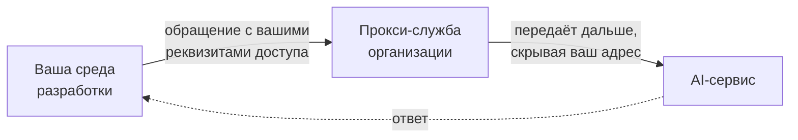

# 1. Что даёт служба

## Назначение

Служба открывает доступ к внешним AI-сервисам — помощникам в среде разработки,
интерфейсам к языковым моделям — из корпоративной сети, где прямой доступ к ним закрыт.

## Куда идёт ваше обращение

Служба **не видит** содержимого: оно зашифровано между вашей машиной и сервисом.
Записывается лишь факт обращения — время, ваша учётная запись, имя сервиса, объём.
Подробнее — в разделе [Что о вас записывается](04-privacy.md).

## Как это выглядит для вас

После однократной настройки среда разработки работает как обычно: обращения к сервису
уходят через прокси-службу, ответы возвращаются. Ручных действий при каждом обращении
не требуется.

## Что нужно получить у администратора

| Что | Зачем |
|---|---|
| Адрес и порт службы | Куда направлять обращения |
| Имя учётной записи и пароль | Служба обслуживает только тех, кто подтвердил подлинность |
| Перечень доступных сервисов | Если доступ ограничен списком — узнать, какие сервисы в него входят |

## Что служба НЕ делает

- **Не видит содержимого обмена.** Ваш запрос и ответ сервиса зашифрованы между вашей
  машиной и сервисом; прокси-служба передаёт их, не разбирая.
- **Не заменяет учётные записи в самих сервисах.** Ключи доступа к AI-сервисам остаются
  вашими и вводятся в среде разработки как обычно.
- **Не ускоряет обращения.** Путь через два узла добавляет задержку, обычно незаметную
  на фоне времени ответа самого сервиса.
